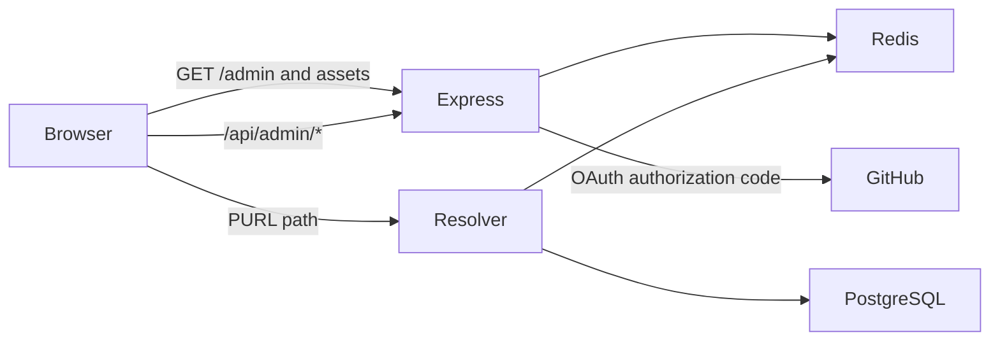
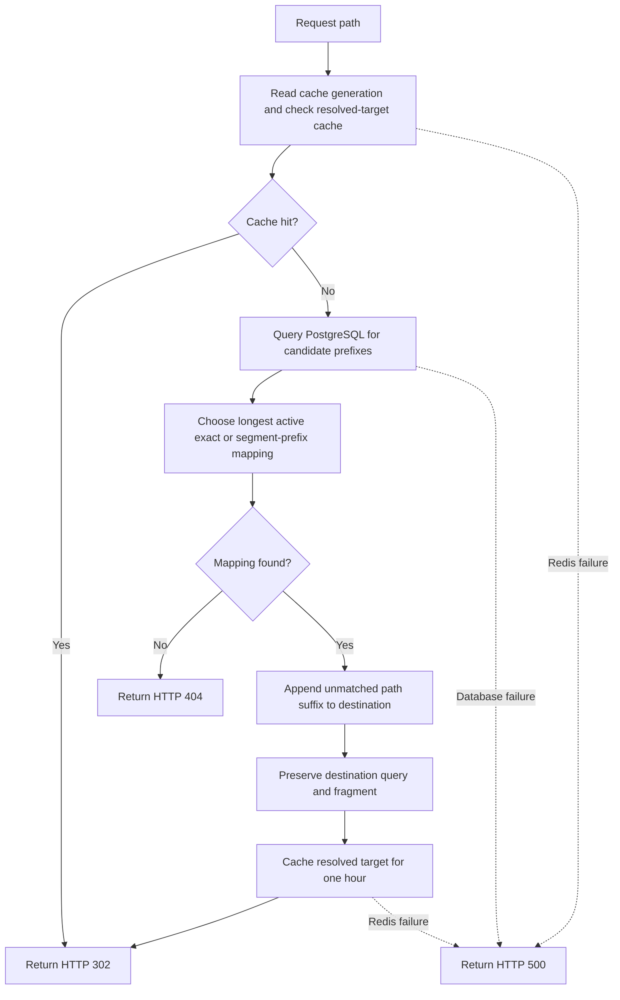

A Persistent URL (PURL) is a stable public path that points indirectly to a resource. This helps prevent link rot by ensuring that references to the resource remain valid even if its actual location changes.

This post compares PURLs with other persistent identifiers, then walks through a resolver suitable for production at limited workloads, from request handling and storage to administration, authentication, deployment, and operational tradeoffs.

## Problem statement

The core problem addressed by a PURL resolver is link rot: the phenomenon where URLs become invalid over time as resources are moved or removed. Without a persistent layer, references can break and make resources difficult or impossible to access through their published URLs. Depending on the resource, link rot can also lead to data loss.

When we assign a PURL to a resource, we create a stable public path that will always redirect to the current location of that resource. When the resource moves, update the PURL mapping to its new location.

This is a partial solution to the link rot problem, as it only addresses the stability of URLs rather than the availability of the underlying resources.

## Why use a PURL?

Several persistent identifier options can keep references useful when a resource moves. This section compares the domain-operated PURLs in this application with DOI, URN, ARK, and Handle systems, then contrasts PURLs with URL shorteners. The goal is to show when a simple web redirect is sufficient and when a managed identifier or stewardship model is a better fit.

### Comparing persistent identifiers

These options differ in identifier format, how users resolve an identifier to a resource, and who maintains that resolution. Here, a PURL is an ordinary web URL on a domain the operator controls; this resolver redirects it to the current destination.

* **PURLs:** They are directly usable in browsers, and an operator can change the destination without changing the published URL. Their longevity depends on maintaining the domain and resolver. This application does not provide a public registration system or the metadata and governance associated with a broader identifier service.
* **DOIs:** A DOI is a registered, citable identifier that can resolve through the DOI system and be associated with descriptive metadata. This makes DOIs useful for scholarly works and other objects that need durable citation. Registration and stewardship add process, and a DOI typically resolves to a landing page.
* **URNs:** A URN names a resource within a namespace without encoding its network location. This separates identity from location, but a URN is not necessarily a browser-ready link. An application needs a namespace-specific way to resolve it to a location.
* **ARKs:** Archival Resource Keys are designed to identify digital objects for long-term access and are used by libraries, archives, and cultural heritage organizations. An ARK can be expressed as a URL and resolved to a current location. Its persistence depends on the responsible authority maintaining the identifier and resolution service.
* **Handle identifiers:** The Handle System provides a managed namespace for identifiers that can resolve to current locations. A Handle separates an object's identifier from its location, while resolution depends on maintained Handle records and service infrastructure. DOI resolution also uses the Handle System, with DOI registration and metadata managed as an additional layer.

Use this resolver's PURLs when you need browser-ready URLs with changeable destinations and can maintain the domain and resolver. A DOI suits registered, citable identifiers with managed metadata. A URN provides a location-independent name but needs namespace-specific resolution. ARK and Handle identifiers offer other managed identifier and resolution models.

Regardless of identifier type, a persistent reference does not guarantee that the resource itself will remain available.

### PURLs and URL shorteners

Both a PURL and a URL shortener create an indirect URL that redirects to a destination. The difference is mainly in purpose and how the identifier is managed, not in the redirect itself. A shortener such as bit.ly is usually optimized for compact sharing and may provide click analytics. A PURL is intended to be a stable reference to a resource, often with a readable or meaningful path, whose destination can be maintained as the resource moves.

These categories can overlap: a short link can remain active for years, and a PURL can be short. Persistence depends on the service's ownership and policies. In this design, PURL paths are treated as identifiers: their destinations can change, but the paths are not renamed or deleted.

Keep a PURL path stable because it may already appear in published documents, bookmarks, or other references; renaming it in place would break those links. If you need a different path, create a second PURL with the new path and the same destination. Keep the original mapping active while existing references still need to resolve, and update those references where possible.

This design implements PURLs through a redirect service on a domain the operator controls. The following sections show how the runtime, database, cache, and admin API support that design.

## Runtime topology

The resolver looks up the current destination and returns an HTTP 302 redirect. Operators can repair a destination without changing the published path.

PURL paths are immutable through the admin API. If a semantic path becomes outdated, create a new PURL rather than renaming the existing one. A mapping can be deactivated without deleting its historical identity.

The normal production build is a single Node.js process serving both the React dashboard and dynamic requests on one origin:



The implementation can also serve the built React files from static hosting, with API and PURL paths routed to the backend. Hosting-specific configuration is not covered in this post.

## Request resolution

The public resolver is mounted after the admin API and static-file middleware. A request to `/research/2026/report.pdf` follows this flow:

1. The resolver reads the current cache generation from Redis and checks the fully resolved target cache key for the request path.
2. On a cache miss, it queries PostgreSQL for candidate prefixes: the full request path, each shorter path prefix, and `/`.
3. The resolver filters inactive mappings and selects the longest mapping whose path matches exactly or ends at a segment boundary. For example, `/research/data` matches `/research/data/file.pdf`, but not `/research/database`.
4. The resolver appends the remaining request path to the destination's path, retains the destination query and fragment, caches the result for one hour, and returns HTTP 302.
5. If no active mapping matches, the response is `404 PURL not found`. Unexpected lookup or cache failures return HTTP 500.



An exact match for a non-root PURL redirects to its destination without appending a suffix. A mapping at `/` is a catch-all: it matches a request to `/` and any other absolute path that has no more-specific mapping. Because the longest matching path wins, a root mapping serves as a fallback for unmatched paths. With an active root mapping, those paths are redirected to its destination with the remaining path appended instead of returning a resolver-level 404. Without an active root mapping, a request to `/` returns not found.

This resolver accepts only HTTP and HTTPS destinations. That is an implementation choice, not a requirement of indirect, persistent URLs: another resolver could allow a URI such as `ftp://` or a custom scheme. A browser may pass such a redirect to a registered external application, but support depends on the browser, operating system, and installed handlers, so it is not guaranteed.

The HTTP handler receives database and Redis dependencies. Its database query finds active rows among the candidate paths.

The code examples in this post are snippets from the implementation, not standalone files. See the [PURL resolver repository](https://github.com/caraya/purl-db) for the full working demo. Here, the first function selects a matching mapping, and the second appends the unmatched suffix to its destination:

```ts
export function selectBestMapping<T extends PurlMapping>(
  requestPath: string,
  mappings: T[],
): T | undefined {
  return mappings
    .filter(({ path, isActive }) => {
      if (!isActive) return false;
      if (path === '/') return requestPath.startsWith('/');
      return requestPath === path || requestPath.startsWith(`${path}/`);
    })
    .sort((left, right) => right.path.length - left.path.length)[0];
}

export function resolveTargetUrl(targetUrl: string, mappingPath: string, requestPath: string): string {
  const target = new URL(targetUrl);
  if (target.protocol !== 'http:' && target.protocol !== 'https:') {
    throw new TypeError('PURL targets must use HTTP or HTTPS.');
  }

  const remainder = mappingPath === '/' ? requestPath : requestPath.slice(mappingPath.length);
  if (!remainder) return target.toString();

  const basePath = target.pathname.replace(/\/+$/, '');
  target.pathname = `${basePath}/${remainder.replace(/^\/+/, '')}`;
  return target.toString();
}
```

## Database schema

The PostgreSQL `purl_mappings` table stores:

* `id`: generated primary key.
* `path`: unique, required PURL path.
* `target_url`: required current destination.
* `title`: required internal label.
* `description`: optional internal note.
* `is_active`: required flag, defaulting to true.
* `created_at` and `updated_at`: timestamps.

Drizzle Kit applies this schema through `npm run db:push`. Docker Compose currently runs that command before starting the app.

The table definition is:

```ts
export const purlMappings = pgTable('purl_mappings', {
  id: serial('id').primaryKey(),
  path: text('path').unique().notNull(),
  targetUrl: text('target_url').notNull(),
  title: text('title').notNull(),
  description: text('description'),
  isActive: boolean('is_active').default(true).notNull(),
  createdAt: timestamp('created_at').defaultNow().notNull(),
  updatedAt: timestamp('updated_at').defaultNow().notNull(),
});
```

## Resolver cache

Redis serves two separate purposes:

* **Resolution cache:** A resolved target is stored for 3600 seconds. The cache key includes a global generation value: `purl:<generation>:<request-path>`.
* **Session store:** `connect-redis` stores Express sessions used by the admin interface.

When an admin creates or updates a mapping, the API increments `purl:cache-version`. Requests then use the new generation, so previously cached nested resolutions become unreachable without scanning Redis for every affected path. Existing keys expire naturally.

Before querying the database, the resolver checks a key that includes the current cache generation:

```ts
const cacheVersion = await cache.get('purl:cache-version') ?? '0';
const cacheKey = `purl:${cacheVersion}:${requestPath}`;
const cachedTarget = await cache.get(cacheKey);
if (cachedTarget) return res.redirect(302, cachedTarget);

const mapping = selectBestMapping(requestPath, await findMappings(getPathCandidates(requestPath)));
if (!mapping) return res.status(404).send('PURL not found');

const target = resolveTargetUrl(mapping.targetUrl, mapping.path, requestPath);
await cache.setEx(cacheKey, 3600, target);
return res.redirect(302, target);
```

## Admin API and path governance

The session-protected admin API exposes these endpoints under `/api/admin`:

* `GET /purls`: list mappings, newest first.
* `POST /purls`: create a mapping.
* `PUT /purls/:id`: partially update target, title, description, or active status.

There is no delete endpoint. The update handler rejects any payload containing a `path` property. Input validation requires a leading slash, limits path length, accepts ASCII URL-safe path segments, rejects `.` and `..` segments, requires an HTTP(S) destination without embedded credentials, and bounds title and description lengths. Duplicate paths return HTTP 409.

Runtime PURL changes go through the admin API. Its create and update handlers apply the request validation described above before writing to PostgreSQL. The database separately enforces schema constraints such as required values and unique paths.

If a request includes the `path` property, the endpoint responds with HTTP 400 before building the update object. This keeps the public PURL stable; to use a different path, create a new mapping.

After an update succeeds, the endpoint invalidates cached resolutions so later requests resolve against the updated mapping. A failed update or a request for a mapping that does not exist returns before cache invalidation.

The handler excerpt shows both behaviors:

```ts
router.put('/purls/:id', async (req, res) => {
  if (!isRecord(req.body) || Object.hasOwn(req.body, 'path')) {
    return res.status(400).json({ error: 'PURL paths are immutable.' });
  }

  // Validate and collect only targetUrl, title, description, and isActive.
  const updated = await repository.update(id, update);
  if (!updated) return res.status(404).json({ error: 'PURL not found.' });
  await invalidateCache();
  return res.json(updated);
});
```

This is an excerpt of the update handler. The validation rules described above apply before the update object is passed to the repository.

## GitHub OAuth and sessions

The server implements the browser authorization-code flow for a GitHub OAuth App, not a GitHub App. It requests the `read:user` scope and:

1. Creates a cryptographically random OAuth `state`, saves it in the session, and redirects to GitHub.
2. Verifies and consumes the returned state before exchanging the code for a token.
3. Fetches the GitHub profile and compares its login, case-insensitively, with `GITHUB_USERNAME`.
4. Rejects other accounts, rotates the session ID on successful authentication, stores the allowed username, and redirects to `/admin`.

The access token is used to read the profile and is not stored. The browser receives an HTTP-only, same-site-lax session cookie named `purl.sid`; it is marked secure when the request is HTTPS and expires after eight hours. Set `TRUST_PROXY=true` only behind a trusted proxy that forwards the original protocol.

`POST /api/admin/auth/logout` destroys the server-side session and clears the cookie. The React dashboard then displays a signed-out view with an explicit sign-in link. It does not immediately restart OAuth, which would silently sign users back in if their GitHub browser session is still active. On an unauthenticated initial dashboard load, a 401 response starts GitHub sign-in.

The sign-in-start excerpt creates the OAuth state, stores it in the server-side session, and redirects to GitHub:

```ts
const state = randomBytes(32).toString('hex');
req.session.oauthState = state;
req.session.save((error) => {
  if (error) return res.status(500).send('Unable to start GitHub sign-in.');
  const authorizationUrl = new URL('https://github.com/login/oauth/authorize');
  authorizationUrl.search = new URLSearchParams({
    client_id: clientId,
    redirect_uri: callbackUrl,
    scope: 'read:user',
    state,
  }).toString();
  res.redirect(302, authorizationUrl.toString());
});
```

On return, the server verifies that state, exchanges the code, checks the GitHub login against the allowlist, and rotates the session ID before marking the session authenticated.

GitHub's OAuth App **Homepage URL** should be the dashboard URL (`APP_ORIGIN` plus `/admin`). The **Authorization callback URL** is `${APP_ORIGIN}/api/admin/auth/github/callback`. `APP_ORIGIN` is only the scheme and host, with no path. For local development, set it to `http://localhost:6677`; in production, use the public origin, such as `https://purl.example.com`.

## React dashboard and ports

The React 19 dashboard supports listing, searching, creating, and editing PURLs; toggling active status; and signing out. Paths are displayed as read-only values. The interface has loading, empty, error, and signed-out states.

The following excerpt shows the dashboard’s sign-out handler.

```tsx
async function handleSignOut() {
  setError('');
  try {
    const response = await fetch('/api/admin/auth/logout', { method: 'POST' });
    if (!response.ok && response.status !== 401) throw new Error(await getErrorMessage(response));
    setSignedOut(true);
  } catch (signOutError) {
    setError(signOutError instanceof Error ? signOutError.message : 'Unable to sign out.');
  }
}
```

The signed-out view links to `/api/admin/auth/github`; logout itself does not redirect there.

In production, the server does not run Vite: Express serves the dashboard at `/admin` and its static assets, then routes remaining paths through the PURL resolver.

For Compose, the app listens on container port `PORT` (default `3000`) and publishes it as host port `HOST_PORT` (default `6677`).

## Startup and configuration

Before opening a listener, the server validates configuration. Required values are `DATABASE_URL`, `REDIS_URL`, `GITHUB_CLIENT_ID`, `GITHUB_CLIENT_SECRET`, `GITHUB_USERNAME`, and `SESSION_SECRET`. The session secret must contain at least 32 bytes. `PORT` must be an integer from 1 to 65535. `APP_ORIGIN` must be an HTTP(S) origin without a path, query, or fragment; it defaults to `http://localhost:<PORT>`. `TRUST_PROXY=true` trusts one proxy hop.

Startup connects to PostgreSQL and Redis before listening. If startup fails, the process logs the failure, closes any opened clients, and exits unsuccessfully.

## Container and local services

The production container uses a multi-stage build to compile the TypeScript server and Vite dashboard, then runs the compiled server on Node.js 24. A Compose deployment can run the app with PostgreSQL 16 and Redis 7, wait for database and cache health checks, and preserve database data in a named volume.

Compose currently runs `npm run db:push` in the container command before `npm start`. That is convenient for the single-app local setup. In multi-instance production deployments, run schema changes once as a controlled migration step rather than from every app instance.

## Tests and build

`npm test` type-checks the tests and runs eight behavior tests across resolver matching, HTTP redirects and caching, admin authorization and validation, and OAuth state/account checks. `npm run build` compiles the server, type-checks the frontend, and bundles the React dashboard.

## Future improvements

* The server uses a single `pg.Client`, which can limit concurrency as load grows. Add a bounded connection pool sized to the database's connection limit.
* The server does not yet handle `SIGTERM`, stop accepting new requests, drain in-flight requests, or close PostgreSQL and Redis clients during shutdown. Add graceful shutdown before deploying to a runtime that replaces instances during scaling or rollout.
* Unknown paths query PostgreSQL on every request. Add negative caching (briefly caching a "not found" result for a path with no active mapping) to reduce repeated lookups. Use a short TTL or include the cache generation so a newly created mapping becomes visible promptly.
* Cache invalidation uses a global generation, so creating or updating any mapping makes all cached resolutions unreachable. Explore path-scoped invalidation so changes affect only relevant resolutions.
* Performance issues and bottlenecks are harder to diagnose without useful monitoring. Add observability for resolver and dependency health, latency, and errors.
* A single resolver or cache instance may not meet the needs of high-traffic deployments. Evaluate horizontal scaling strategies as traffic and availability requirements grow.

## Summary

This design keeps published PURL paths stable while allowing their destinations to change. The resolver uses longest-prefix matching and a generation-keyed Redis cache, while the admin API enforces path immutability. Before scaling, address the current operational limits: the single PostgreSQL client, missing graceful shutdown, uncached misses, and global cache invalidation.
