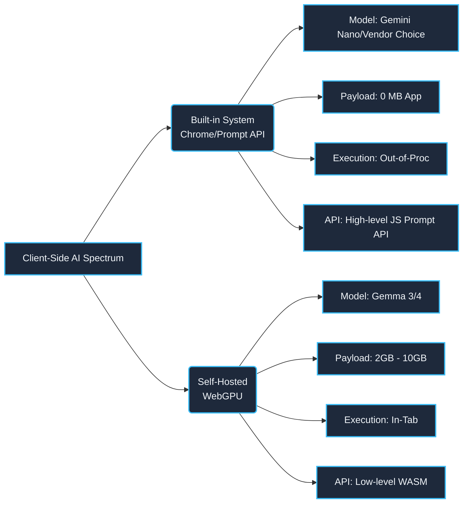
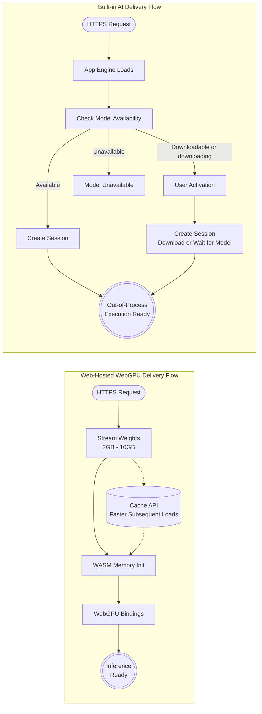
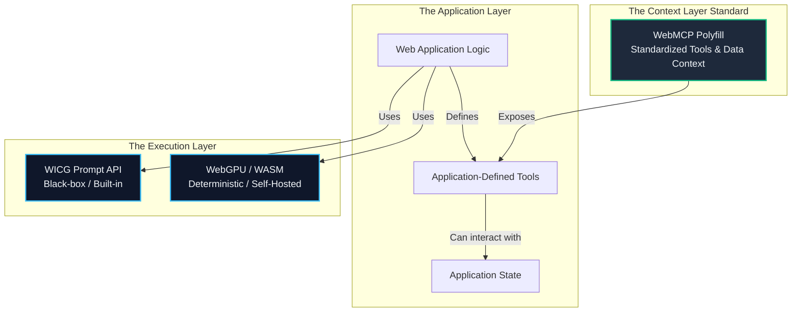

As client-side hardware capability grows, web architects face a complex decision when designing applications that require local artificial intelligence. Rather than relying entirely on cloud-based API endpoints, developers can execute text, vision, and audio models directly on the client machine.

The landscape is rapidly evolving from proprietary vendor experiments into formalized web standards, specifically through the WICG Prompt API and W3C WebMCP efforts. This architectural analysis evaluates two client-side Web AI execution paradigms:

* **Built-in System AI** (e.g., Google Chrome's WICG Prompt API / Gemini Nano)
* **Self-Hosted WebGPU Engines** (e.g., Gemma 3 or Gemma 4 loaded via WebAssembly and WebGPU)

This report analyzes the engineering trade-offs of each paradigm across delivery mechanics, resource management, standardizations, sandboxing constraints, and developer control.

## Taxonomy of client-side Web AI

These two execution models offer different balances of network payload, runtime safety, and developer autonomy.



### Paradigm: Built-in browser AI (the native system approach)

This approach treats the machine learning model as a standard browser utility, similar to the Web Speech API or native translation engines. The browser vendor manages, updates, and optimizes the model weights at the operating system level.

* **The Developer's Interface:** The [WICG Prompt API](https://webmachinelearning.github.io/prompt-api/), part of an ongoing effort to standardize browser-native AI capabilities and building on earlier experiments such as `window.ai`.
* **Resource Profile:** Zero-bandwidth hosting overhead for the web application developer; execution runs out-of-process. For Chrome's built-in Gemini Nano, the browser downloads the model when an app first calls a dependent API and reuses it afterward; periodic model updates or a re-download if the model is removed also use the user's data.

### Paradigm: Self-hosted WebGPU engines (the self-contained approach)

This approach gives developers complete control over the runtime environment. You bundle your chosen open-weights model (such as a quantized Gemma 3 or Gemma 4), stream it to the user's browser over HTTPS, cache it locally using the Cache API, and execute it inside the tab.

Cached weights can be evicted under storage pressure. Requesting persistent storage with `navigator.storage.persist()` can protect the origin from automatic eviction, but the browser may deny the request. Users can still clear stored data, depending on their browser and what they choose to remove.

* **The Developer's Interface:** Low-level WebGPU API calls, compiled WebAssembly (WASM) execution graphs, or runtime wrappers (such as `transformers.js` v4).
* **Resource Profile:** Gigabytes of network transfer; execution is completely isolated within the browser tab's active process. Both the host's CDN budget and the user's local network connection bear the load of downloading the heavy model parameters.

## Payload and delivery mechanics

The primary UX challenge of client-side Web AI is the initial time-to-interactivity.



* **Web-Hosted (WebGPU):** Demands streaming quantized weights across the internet on first load. Even highly compressed models require 2 GB to 4 GB of data. Architects must design detailed streaming progress indicators, handle mid-transfer network dropouts, and verify local storage limits before requesting weights. Once downloaded, these assets are cached using the browser's Cache API, bringing subsequent load times down to local disk read speeds.
* **Built-in browser AI:** The browser manages the model weights, so the application doesn't host or transfer them. **The user's network connection still bears the data transfer burden.** For Chrome, the browser downloads Gemini Nano when needed, consuming roughly 2 GB to 3 GB of the user's data.

## Resource isolation and system reliability

Running large language, vision, and audio models requires significant GPU compute and memory allocation.

* **Out-of-Process (Built-in AI):** The execution engine runs in a separate process managed by the operating system or browser shell. If the model runs out of VRAM or triggers a driver hang, the parent browser process remains unaffected.
* **In-Tab (Self-Hosted WebGPU):** The entire execution graph runs inside the active tab's memory space. If WebGPU runs out of memory or loses its device, inference can fail and leave the AI feature unusable. Recovery may not be possible without changing the model or the available hardware.

## Real-world hardware bottlenecks

### Apple Silicon (unified memory architecture)

* **Unified memory limits:** Apple Silicon's practical GPU memory limit is commonly 65% to 75% of physical memory. WebGPU can access up to 75% on 32 GB or 64 GB systems, but the limit depends on hardware and macOS configuration; exceeding it does not automatically cause WebGPU device loss.
* **The Base-Model Penalty:** On base configurations (8 GB or 16 GB), a 4 GB quantized model severely impacts the entire OS due to shared memory.

### Windows (WDDM virtualization)

* **Discrete GPUs and WDDM Spillover:** Windows can use shared system memory when dedicated GPU memory is insufficient. The available amount depends on system memory and graphics configuration; it is a dynamic ceiling, not a reservation. Spillover can slow inference substantially, potentially by more than 50x.
* **Integrated GPUs (iGPU) and shared memory:** The common 50% limit is not universal. Windows' [WDDM calculation](https://learn.microsoft.com/en-us/windows-hardware/drivers/display/calculating-graphics-memory) allows up to 80% on high-memory systems, while select Intel Core Ultra systems offer a [Shared GPU Memory Override](https://downloadmirror.intel.com/869846/ReleaseNotes_101.6987_WHQL.pdf) of up to 87%. Some AMD systems also expose UMA settings in BIOS. These limits depend on hardware and RAM configuration; exceeding 50% does not automatically cause WebGPU device loss.
* **Windows TDR:** Non-preemptible GPU work that exceeds Windows' default 2-second timeout can trigger a driver reset and WebGPU device loss (`GPUDevice.lost`).

## The sandbox bottleneck: WebAssembly memory caps

* **The WASM32 4GB Cap (Safari / WebKit):** Restricted to a 32-bit addressing space (WASM32), capping the WASM heap at a hard limit of 4 GB (practical ceiling ~3.2 GB).
* **The WASM64 Advantage (Chromium / Firefox):** Support WASM64 with 64-bit memory indexing, removing the 4GB addressing ceiling and providing more address space to accommodate potential memory duplication when copying weights to a `GPUBuffer`. Actual memory remains subject to device and browser limits.

## Developer control, determinism, and standardization

* **Built-in browser AI:** This option offers a highly abstracted environment. The browser handles prompt execution, meaning vendor updates to model weights expose the developer to **temporal and cross-platform behavioral drift**. Different browsers will back the API with entirely different models (e.g., Gemini vs. Apple Intelligence), causing the exact same app code to produce structurally different responses.
* **Self-Hosted WebGPU (Gemma):** Provides greater behavioral stability through pinned model weights. You package and serve the weights, locking the model version until you choose to update it.

### The abstraction challenge: Implicit vs. explicit complexity

Google engineered massive C++ translation layers to migrate Chrome's IndexedDB from LevelDB to SQLite without breaking the public JavaScript API. Browser vendors are doing the exact same thing with the built-in Prompt API. Apple could use Apple Intelligence on Safari, Google could use Gemini Nano on Chrome, and the JavaScript API would theoretically look identical.

However, mapping a text prompt to distinct models requires semantic, structural translation. The browser must dynamically apply proprietary chat templates, inject guardrails, and translate parameters behind the scenes. Built-in APIs make this complexity *implicit*, shifting the burden of invisible behavioral quirks onto developers. WebGPU makes tiering *explicit* and controllable.

### Mitigating native abstraction: Regression testing

Because cross-browser fragmentation is a given, architects choosing native browser APIs must **pin their evaluation test suite instead of the model**.

**The Continuous QA Tax:** Modern browsers like Chrome and Firefox operate on rapid **two-week release cycles**. Because their release schedules may be staggered, relying on built-in AI means your QA team may need to run regression suites *weekly* to catch behavioral drift after either browser updates.

## Standardizing the interface and context: Prompt API and WebMCP

The transition to standardizing the interface (Prompt API) and the context layer (WebMCP) fundamentally shifts how architects mitigate the risks of native AI abstraction.

### The Prompt API: Formalizing the "leaky abstraction"

The shift from experimental namespaces (like `window.ai`) to the WICG-incubated **Prompt API** standardizes the JS interface for streaming and session management. However, it formalizes the abstraction paradox: it standardizes *how* you ask the model a question, but not *how the model thinks*. The cross-browser semantic drift and the Continuous QA Tax remain permanently encoded into the standard.

### WebMCP: Standardizing the "context layer"

The effort to build a W3C polyfill for the **Web Model Context Protocol (WebMCP)** significantly alters the stack. Instead of forcing models to output reliable JSON via raw prompt engineering, WebMCP standardizes the schema and handshake for tool calling and data context.

1.  **Tooling Becomes Engine-Agnostic:** You can pass the exact same WebMCP context to *either* the native Prompt API *or* your self-hosted WebGPU model.
2.  **Mitigating Native Semantic Drift:** Forcing built-in models to communicate strictly through standardized WebMCP tool calls rather than open-ended natural language tightly constrains their output space, making silent browser updates far less likely to break your app.
3.  **Elevating WebGPU:** WebMCP exposes application-defined tools that can interact with application state.

### The new client-side AI stack



## Implementation: Isolated reference guides

### Approach: Built-in AI (Prompt API / Gemini Nano)

#### Detecting Prompt API availability

The Prompt API has appeared under different global names and availability methods. This probe prefers the current WICG API, then checks earlier `window.ai` interfaces:

```js
async function detectPromptAPI() {
  const languageModel = globalThis.LanguageModel;

  if (
    typeof languageModel?.availability === "function" &&
    typeof languageModel.create === "function"
  ) {
    const status = await languageModel.availability();
    return {
      api: "WICG Prompt API",
      status,
      supported: status !== "unavailable",
      ready: status === "available",
    };
  }

  const legacyLanguageModel = globalThis.ai?.languageModel;

  if (
    typeof legacyLanguageModel?.capabilities === "function" &&
    typeof legacyLanguageModel.create === "function"
  ) {
    const { available: status } = await legacyLanguageModel.capabilities();
    return {
      api: "window.ai.languageModel",
      status,
      supported: status !== "no",
      ready: status === "readily",
    };
  }

  const legacyAI = globalThis.ai;

  if (
    typeof legacyAI?.canCreateTextSession === "function" &&
    typeof legacyAI.createTextSession === "function"
  ) {
    const status = await legacyAI.canCreateTextSession();
    return {
      api: "window.ai",
      status,
      supported: status !== "no",
      ready: status === "readily",
    };
  }

  return {
    api: null,
    status: "unsupported",
    supported: false,
    ready: false,
  };
}

detectPromptAPI().then((result) => console.log(result));
```

`supported` means the detected API can run now or after a model download; `ready` means the model is ready now. For configuration-specific checks with the WICG API, pass the same options to `LanguageModel.availability()` that you will pass to `LanguageModel.create()`.

Invoke the adapter or router from a user action when the browser may need to download its built-in model; the WICG API can require a user gesture to create a session in that case.

The adapter returns `null` when the Prompt API is unsupported or the model is unavailable. Session creation and inference errors propagate to the caller.

```typescript
type PromptSession = {
  prompt(input: string): Promise<string>;
  destroy?: () => void;
};

type WICGAvailability = "available" | "downloadable" | "downloading" | "unavailable";
type LegacyAvailability = "no" | "after-download" | "readily";

type PromptGlobals = typeof globalThis & {
  LanguageModel?: {
    availability(): Promise<WICGAvailability>;
    create(): Promise<PromptSession>;
  };
  ai?: {
    languageModel?: {
      capabilities(): Promise<{ available: LegacyAvailability }>;
      create(): Promise<PromptSession>;
    };
    canCreateTextSession?: () => Promise<LegacyAvailability>;
    createTextSession?: () => Promise<PromptSession>;
  };
};

/**
 * Executes a text prompt using an available Prompt API implementation.
 */
export async function runBuiltInAI(prompt: string): Promise<string | null> {
  const globals = globalThis as PromptGlobals;
  const languageModel = globals.LanguageModel;

  if (
    typeof languageModel?.availability === "function" &&
    typeof languageModel.create === "function"
  ) {
    const status = await languageModel.availability();
    if (status === "unavailable") {
      return null;
    }

    const session = await languageModel.create();
    try {
      return await session.prompt(prompt);
    } finally {
      session.destroy?.();
    }
  }

  const legacyLanguageModel = globals.ai?.languageModel;
  if (
    typeof legacyLanguageModel?.capabilities === "function" &&
    typeof legacyLanguageModel.create === "function"
  ) {
    const { available } = await legacyLanguageModel.capabilities();
    if (available === "no") {
      return null;
    }

    const session = await legacyLanguageModel.create();
    try {
      return await session.prompt(prompt);
    } finally {
      session.destroy?.();
    }
  }

  const legacyAI = globals.ai;
  if (
    typeof legacyAI?.canCreateTextSession === "function" &&
    typeof legacyAI.createTextSession === "function"
  ) {
    const status = await legacyAI.canCreateTextSession();
    if (status === "no") {
      return null;
    }

    const session = await legacyAI.createTextSession();
    try {
      return await session.prompt(prompt);
    } finally {
      session.destroy?.();
    }
  }

  return null;
}
```

### Approach: Self-hosted Gemma via WebGPU

Install Transformers.js v4 or newer in your project. See the [Transformers.js installation guide](https://huggingface.co/docs/transformers.js/installation) for details. This example uses the ONNX version of Gemma 3 4B. You can substitute another model if its architecture, ONNX weights, and text-generation task are supported by Transformers.js. By default, the library downloads the model from the Hugging Face Hub; configure a model host to serve it yourself.

```typescript
import { pipeline, env, type TextGenerationPipeline } from '@huggingface/transformers';
env.backends.onnx.wasm.numThreads = 1;

export async function runGemma_WebGPU(prompt: string): Promise<string> {
  if (!navigator.gpu) throw new Error("WebGPU not supported.");

  const pipe = await pipeline('text-generation', 'onnx-community/gemma-3-4b-it-ONNX', {
    device: 'webgpu',
    dtype: 'q4',
  }) as TextGenerationPipeline;

  const result = await pipe(prompt, { max_new_tokens: 100 });
  return result[0].generated_text;
}
```

## The unified orchestration layer

An orchestrator is an application-level router, not another model. It tries browser-provided AI first, then self-hosted WebGPU. The browser may still download model files for built-in AI, but the website does not host those weights. WebGPU itself doesn't determine where the model comes from. An application might load prepared files from its own server, an external host, or a local cache. Downloading weights can use substantial user bandwidth and, when self-hosted, incur CDN costs. Cache reuse can reduce later transfers, but eviction may require another download.

Because that final fallback is expensive, don't start it automatically without user consent. Explain the download size, provide progress, and let users decline.

### Router

To normalize workloads, define one application-level request and response contract, then write an adapter for each backend. Each adapter maps the request to that API's methods, checks its supported inputs, and returns a common result shape; it can also standardize availability, download progress, cancellation, and errors. This example gives callers a shared function and string result; both adapters handle text only. A common interface cannot make model outputs, capabilities, latency, or quality identical. WebMCP can standardize tool and context descriptions, but it does not remove those model differences or the WebGPU download cost.

The router calls `runBuiltInAI()` above and tries WebGPU only if the Prompt API is unsupported or unavailable and the user has opted in. Other errors propagate to the caller.

```typescript
export async function runClientAI(
  prompt: string,
  allowWebGPUFallback = false,
): Promise<string> {
  const result = await runBuiltInAI(prompt);
  if (result !== null) return result;

  if (!allowWebGPUFallback) {
    throw new Error("WebGPU fallback may download a multi-gigabyte model and requires user opt-in.");
  }

  // Fallback to Web-hosted WebGPU
  console.log("Executing in-tab WebGPU fallback...");
  return await runGemma_WebGPU(prompt);
}
```

## Summary and strategic recommendations

Selecting a client-side AI architecture requires matching your user base with your application's reliability needs, mediated by the modern web stack:

* **For General Consumer Web Apps (Broad Reach):** Use backend adapters to keep application requests consistent, and use WebMCP to standardize tool and context descriptions. Make self-hosted WebGPU a user-approved fallback because it can require a multi-gigabyte download; it does not eliminate differences in model behavior.
* **For High-Performance Enterprise Tools:** Consider **self-hosted Gemma via WebGPU** when you need control over model weights and guardrails. Pinning weights can improve reproducibility, but outputs and supported modalities still depend on the model, runtime, hardware, and configuration. Verify browser support for WebGPU and WASM64 before deployment.
