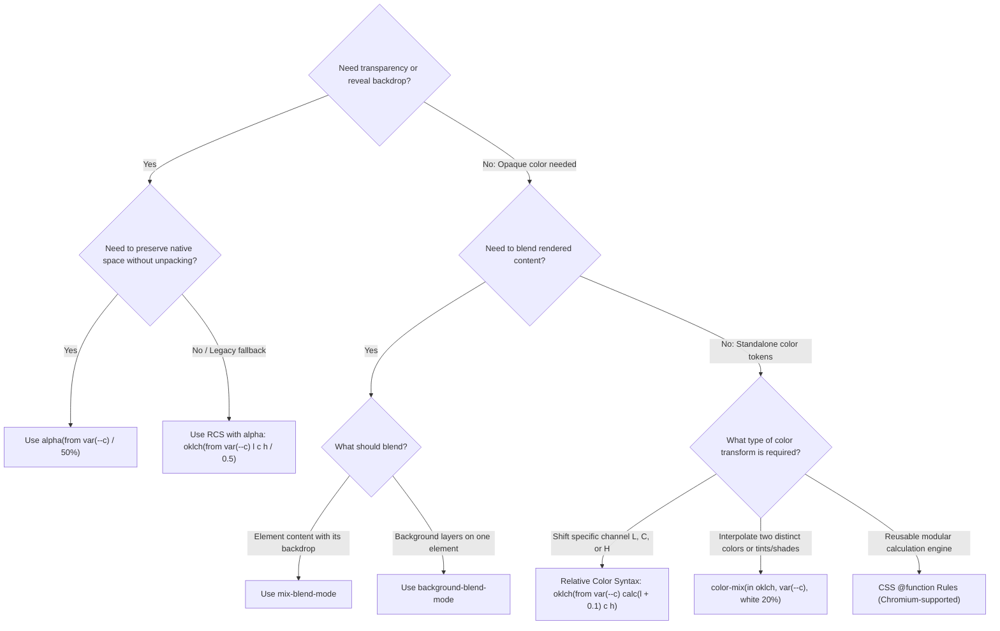

CSS now supports more color spaces, color functions, and blending techniques.

This post examines modern CSS color operations, including `color-mix()`, Relative Color Syntax (RCS), and `alpha()`. It also compares gradients and blend modes, explains when transparency depends on the backdrop, and shows how CSS `@function` can package reusable color utilities.

## Web platform and baseline specification status

Before selecting an approach, check each feature's **Baseline** status separately from its browser-engine support. Baseline statuses are Widely Available, Newly Available, and Limited availability.

| Feature | Specification | Baseline Status | Production Readiness | Fallback Strategy |
| :--- | :--- | :--- | :--- | :--- |
| **`color-mix()`** | CSS Color Module Level 5 | **Baseline: Widely Available** | Production-ready across all evergreen engines | None needed for modern browsers. |
| **Relative Color Syntax (RCS)** | CSS Color Module Level 5 | **Baseline: Widely Available** | Production-ready across modern engines | Pre-calculated CSS variables or build-time transforms. |
| **`alpha()` Functional Notation** | CSS Color Module Level 5 | **[Baseline 2026: Newly Available](https://developer.mozilla.org/en-US/docs/Web/CSS/Reference/Values/color_value/alpha#browser_compatibility)** | Supported in latest browser releases | RCS fallback: `oklch(from var(--c) l c h / <alpha>)`; replace `<alpha>` with the desired alpha value. |
| **CSS `@function` At-Rule** | CSS Functions & Mixins Level 1 | **Limited availability** | Chromium-based (stable); Safari Technology Preview (preview); no Firefox support | Preprocessed functions (Sass, PostCSS) or static CSS custom properties. |

<custom-admonition no-icon type="info" title="Practical Rule for Teams">
<p>Use <code>color-mix()</code> and Relative Color Syntax (RCS) freely for solid production tokens. Adopt <code>alpha(from ... / ...)</code> for concise transparency adjustments; where older browser support is required, provide an RCS fallback and replace <code>&lt;alpha&gt;</code> with the desired alpha value. Treat <code>@function</code> rules as a Chromium-first progressive enhancement or run them through build-time tooling if targeting Gecko (Firefox) or WebKit (Safari).</p>
</custom-admonition>

## Core blending strategies and comparative overview

Modern CSS provides multiple native mechanisms to adjust transparency, compute tints and shades, or blend color channels. Selecting the appropriate technique depends on whether the element requires color-space preservation, backdrop dependency, or predictable solid contrast.

| Method | Output Nature | Combination Behavior | Background Dependency | Primary Use Cases |
| :--- | :--- | :--- | :--- | :--- |
| **`alpha()` Function** (`alpha(from ...)`) | Translucent color | **Full preservation** (retains origin color space) | **High** (reveals backdrop) | Overlays, modal scrims, focus rings, glassmorphism |
| **`color-mix()`** | Opaque or translucent mix | Interpolates in declared space (`oklch`, `srgb`, etc.) | **None** (when inputs are opaque and weights total 100%) | Solid UI states, tonal steps, tints, shades |
| **Relative Color Syntax (RCS)** | Programmatic transform | Decomposes and reconstructs coordinates | **None** (opaque source); depends on backdrop if preserved source alpha is below 100% | Perceptual lightness shifts, chroma scaling |
| **CSS Gradients** | Rendered surface fill | Interpolates along a continuous spatial vector | **None** (when stops are opaque); alpha-bearing stops reveal the backdrop | Ramps, transitions, decorative fills |
| **`mix-blend-mode`** | Composited element content | Blends with the backdrop using the selected blend mode | **High** (depends on content behind the element) | Photo treatments, text and image effects |
| **`background-blend-mode`** | Composited background layers | Blends the element's background layers with each other and its background color | **Within the element** (does not blend with content behind it) | Layered backgrounds, duotones |

## Deep dive: The alpha() function vs. color-mix()

### The standalone alpha() function (CSS Color Module Level 5)

The dedicated `alpha()` functional notation provides direct manipulation of a color's alpha channel without requiring you to unpack and reconstruct its individual color coordinates through space-specific relative syntax (such as `oklch(from var(--c) l c h / ...)`).

```css
:root {
  /* 1. Base colors */
  --brand-blue: oklch(0.6 0.2 250);
  --brand-p3: color(display-p3 0.2 0.5 0.9 / 0.8);

  /* 2. Absolute alpha replacement */
  --brand-blue-10: alpha(from var(--brand-blue) / 10%);
  --brand-blue-20: alpha(from var(--brand-blue) / 20%);
  --brand-blue-50: alpha(from var(--brand-blue) / 50%);

  /* 3. Relative alpha scaling using the 'alpha' channel keyword */
  /* Reduces existing opacity of --brand-p3 by half (0.8 * 0.5 = 0.4) */
  --brand-p3-faded: alpha(from var(--brand-p3) / calc(alpha * 0.5));
}
```

* **Color Space Preservation:** `alpha()` does not convert or project the input color into a different space. If the origin color is defined in `display-p3`, `oklch`, or `srgb`, the return value remains strictly in that native color space with identical chromatic components.
* **Compositing Model:** Only modifies opacity. The browser compositor blends the resulting translucent surface against all underlying rendered layers.
* **Architectural Trade-offs & Limitations:**
  * **Contrast Instability:** When placed over dynamic or varying background surfaces (e.g., light cards vs. dark canvas backgrounds), the perceived color shifts unpredictably, risking WCAG and APCA contrast failures.
  * **Layer Accumulation:** Overlapping sibling elements, rounded corners, or borders with partial alpha produce visible seam artifacts where alpha values compound.

### color-mix() functional notation

In the two-color examples here, `color-mix()` takes two color values, weights them by percentage, and interpolates their coordinates within the specified color space.

```css
:root {
  --brand-blue: oklch(0.6 0.2 250);

  /* Opaque tonal ramp interpolated in perceptual OKLCH space */
  --brand-blue-light:   color-mix(in oklch, var(--brand-blue) 20%, white);
  --brand-blue-surface: color-mix(in oklch, var(--brand-blue) 8%, #ffffff);
  --brand-blue-hover:   color-mix(in oklch, var(--brand-blue) 85%, black);
}
```

* **Compositing Model:** Produces a discrete color value evaluated before paint time. With opaque inputs and weights totaling 100%, the output is opaque. If the weights total less than 100%, the output's alpha is reduced by the unused percentage.
* **Color Space Control:** `oklch` interpolates lightness, chroma, and hue separately. For equal-chroma complementary colors, it interpolates the hue angle instead of averaging opposing chromatic coordinates toward zero, so the midpoint does not inherently become gray.
* **What "gray mud" means:** When rectangular coordinates are interpolated, opposing hues can cancel: the `a` and `b` coordinates in OKLab, or the RGB channel values in sRGB, may move toward a neutral color near the midpoint. This loss of chroma is often called "gray mud." OKLCH represents chroma as a non-negative magnitude and hue as an angle, so equal-chroma colors can travel through hue while retaining chroma instead of canceling it. The default shorter-hue path determines which way hue travels; near neutrals hue is undefined, and gamut mapping can still reduce chroma for colors outside the output gamut.
* **Contrast Predictability:** For fixed opaque inputs and weights totaling 100%, `color-mix()` produces an opaque, deterministic output independent of backdrop layers. You can calculate its WCAG contrast ratio or APCA contrast value against a chosen foreground and check it against your requirements before deployment.

## Expanded color manipulation techniques

### Relative color syntax (RCS)

Relative Color Syntax lets you deconstruct an existing color token into individual channel values, apply channel math, and rebuild an entirely new color token.

```css
:root {
  --base-primary: oklch(0.65 0.22 145);

  /* Precise lightness stepping */
  --primary-tint: oklch(from var(--base-primary) calc(l + 0.15) c h);
  --primary-shade: oklch(from var(--base-primary) calc(l - 0.2) c h);

  /* Chroma adjustments without changing hue */
  --primary-muted: oklch(from var(--base-primary) l calc(c * 0.4) h);
}
```

Unlike `color-mix()`, which interpolates toward another color, RCS lets you modify the components of the chosen color space directly. In perceptual spaces such as OKLCH and OKLab, this provides control over perceptual dimensions; OKLCH exposes lightness, chroma, and hue explicitly.

### Gradient interpolation for smooth color ramps

CSS linear gradients support explicit color space interpolation, enabling continuous multi-step ramps without manually calculating intermediate tokens:

```css
.color-ramp-swatch {
  /* Interpolates smoothly through OKLCH without graying out */
  background: linear-gradient(
    in oklch to right,
    oklch(0.65 0.25 140),
    oklch(0.85 0.15 85)
  );
}
```

### Blend modes (background-blend-mode and mix-blend-mode)

Blend modes perform pixel-level math between overlapping CSS layers or HTML elements using composite algorithms (Multiply, Screen, Overlay, Luminosity).

```css
/* Dual-tone image treatment */
.hero-banner {
  background-image: url("/assets/hero.jpg"), linear-gradient(to right, #0052d4, #4364f7);
  background-blend-mode: multiply;
}

/* Dynamic text adjustment across varying backgrounds */
.inverted-badge {
  mix-blend-mode: difference;
  color: white;
}
```

`mix-blend-mode: difference` is a visual effect, not a contrast guarantee. Do not rely on it to keep text readable across arbitrary backgrounds.

## Method selection heuristic

The following decision graph guides method selection based on transparency requirements, background dependency, and whether you are altering channels or blending color values:



## Color calculations and backdrop blending

Color functions such as `color-mix()`, Relative Color Syntax, and `alpha()` calculate color values without sampling rendered pixels behind an element. A translucent result from `alpha()` can still reveal its backdrop when rendered.

### `mix-blend-mode`

When `mix-blend-mode` is not `normal`, the element establishes a stacking context and blends with the backdrop within that context. Because the result depends on the content behind the element, it can vary with the page composition.

### `background-blend-mode`

`background-blend-mode` blends an element's background image layers with the layers beneath them and the element's background color. It does not blend those backgrounds with the content behind the element.

## CSS @function utilities: Scrims, tints, shades, and blends

Using CSS Functions and Mixins Module Level 1 (implemented in Chromium engines), we can encapsulate `alpha()`, `color-mix()`, and Relative Color Syntax into reusable primitives specifically designed for alpha modulation, tinting, shading, and surface blending.

```css
/**
 * Generates an absolute translucent scrim while preserving the origin color space.
 * Accepts any valid color (Hex, RGB, Display-P3, OKLCH, etc.).
 */
@function --scrim(--base <color>, --opacity <percentage>: 30%) returns <color> {
  result: alpha(from var(--base) / var(--opacity));
}

/**
 * Scales an element's existing alpha channel relatively.
 * e.g., --fade(var(--semi-transparent-color), 0.5) halves its existing opacity.
 */
@function --fade(--base <color>, --factor <number>: 0.5) returns <color> {
  result: alpha(from var(--base) / calc(alpha * var(--factor)));
}

/**
 * Creates an opaque tint when the base color is opaque, using OKLCH interpolation.
 * Eliminates backdrop dependency while keeping hue interpolation explicit.
 */
@function --tint(--base <color>, --weight <percentage>: 20%) returns <color> {
  result: color-mix(in oklch, var(--base), #ffffff var(--weight));
}

/**
 * Creates an opaque shade when the base color is opaque, using OKLCH interpolation.
 */
@function --shade(--base <color>, --weight <percentage>: 20%) returns <color> {
  result: color-mix(in oklch, var(--base), #000000 var(--weight));
}

/**
 * Creates a color mix between a source color and a known surface.
 * Perceptually mixes a color with a known surface in OKLCH.
 * This is not equivalent to compositing a translucent overlay.
 */
@function --surface-mix(--color <color>, --surface <color>, --strength <percentage>: 15%) returns <color> {
  result: color-mix(in oklch, var(--color) var(--strength), var(--surface));
}

/**
 * Shifts perceptual lightness directly in OKLCH, clamped between 0 and 1.
 * Useful when exact lightness offsets are required rather than mixing toward white/black.
 */
@function --shift-lightness(--base <color>, --delta <number>) returns <color> {
  result: oklch(from var(--base) clamp(0, calc(l + var(--delta)), 1) c h);
}
```

### Consumption examples

```css
:root {
  --brand: #2563eb;
  --surface-canvas: #f8fafc;

  /* Translucent overlays (backdrop-dependent) */
  --overlay-modal: --scrim(var(--brand), 40%);
  --focus-halo:    --scrim(var(--brand), 25%);

  /* Opaque interactive states (backdrop-independent) */
  --btn-hover:     --shade(var(--brand), 15%);
  --btn-active:    --shade(var(--brand), 25%);
  --badge-bg:      --tint(var(--brand), 85%);

  /* Perceptual color mix with the canvas surface */
  --card-tint:     --surface-mix(var(--brand), var(--surface-canvas), 10%);
}

.modal-backdrop {
  background-color: var(--overlay-modal);
  backdrop-filter: blur(8px);
}

.primary-button {
  background-color: var(--brand);
  color: #ffffff;
}

.primary-button:hover {
  background-color: var(--btn-hover);
}

.primary-button:focus-visible {
  outline: 3px solid var(--focus-halo);
}
```
