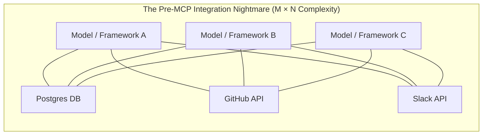
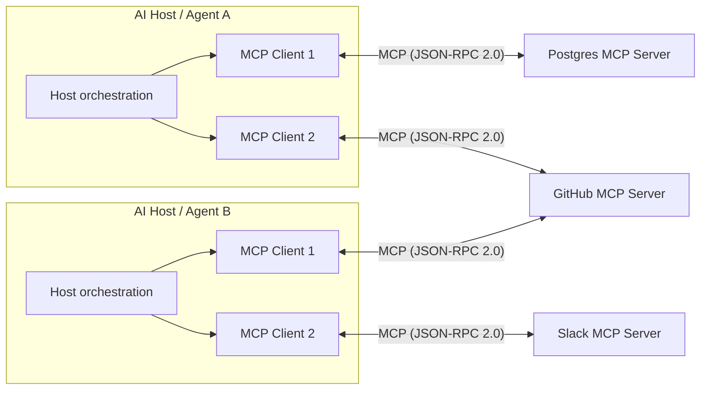
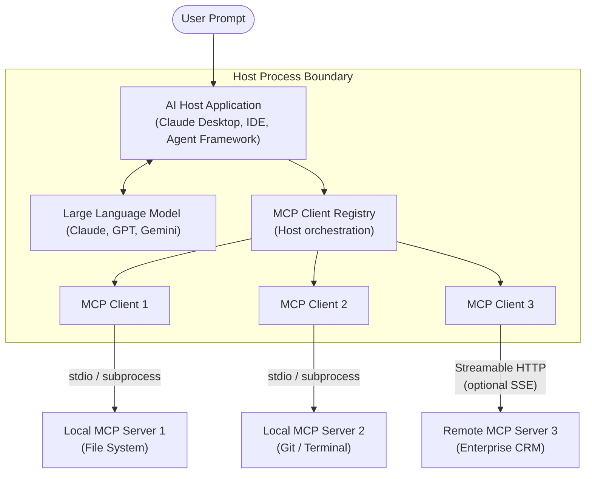
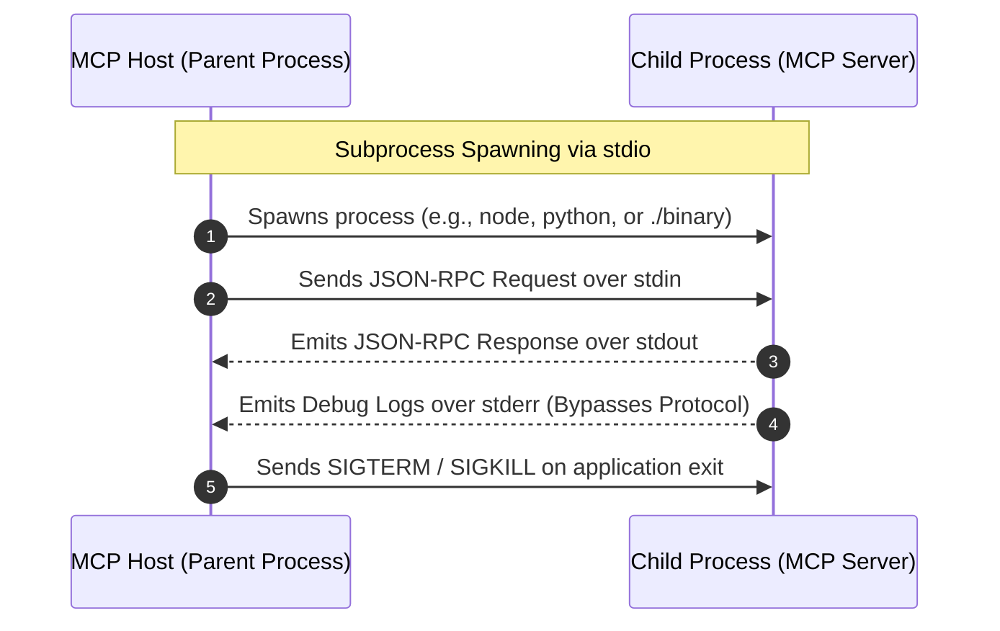
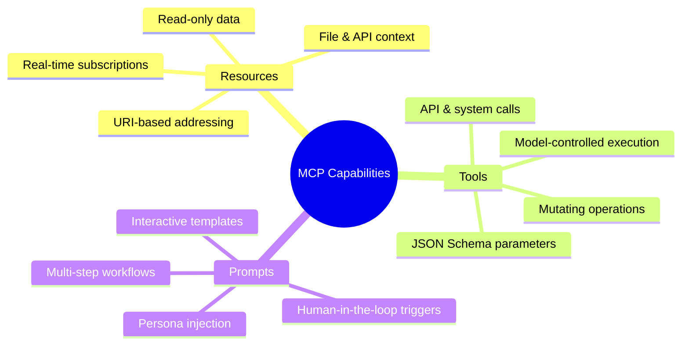
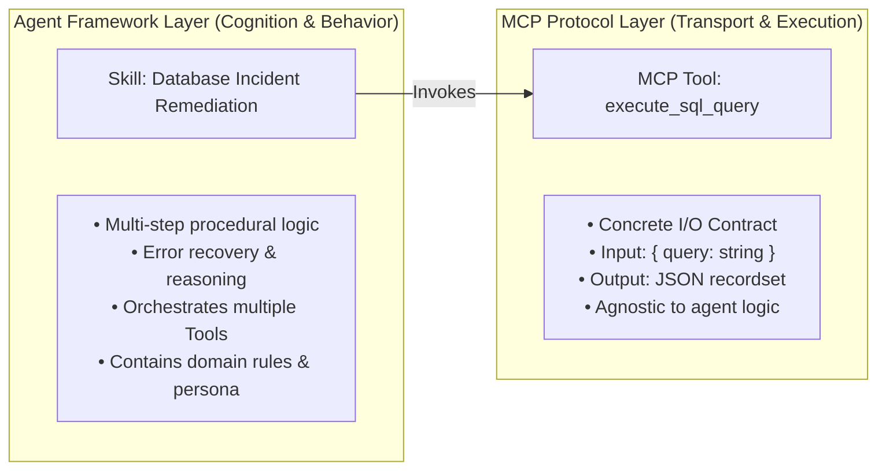
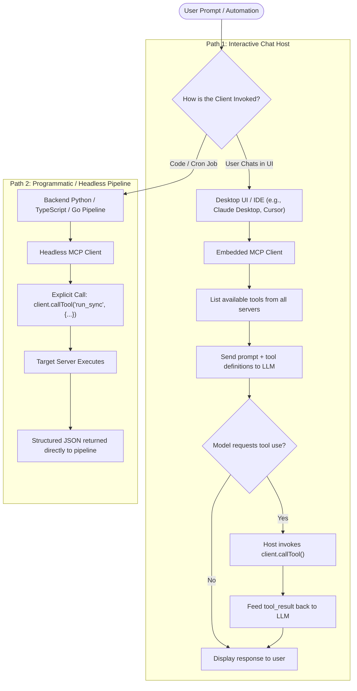
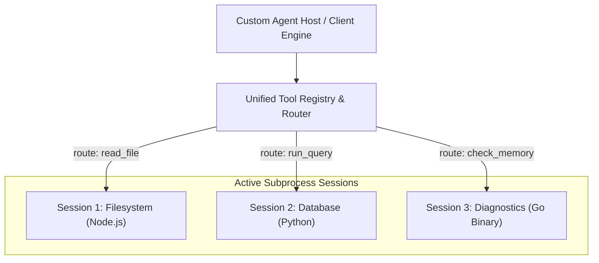

This is part 1 of a three-part series on the Model Context Protocol (MCP).

> * Part 1: Architecture, Core Primitives & Host Orchestration **(You are here)**
> * [Part 2: Hands-On MCP: Building Servers and Clients in TypeScript, Python, and Go](/mcp-guide-part2/)
> * [Part 3: Advanced MCP: Hierarchical Agents, Markdown Skills, and Packaging](/mcp-guide-part3/)

## Introduction: The AI tooling fragmentation crisis

Before late 2024, integrating external tools with Large Language Models (LLMs) was an exercise in pure fragmentation. If an engineering team wanted an AI assistant to query a Postgres database, inspect a Git repository, and search Slack, they faced an $M \times N$ matrix problem:

* $M$ models and frameworks (Anthropic, OpenAI, Gemini, LangChain, LlamaIndex, custom agents)
* $N$ systems and tools (Databases, REST APIs, local file systems, developer utilities)

Every tool required custom glue code, tailored schemas, proprietary error-handling wrappers, and brittle authorization hooks. Swapping a model or adding a tool required rewriting integration layers across the entire stack.



The **Model Context Protocol (MCP)**, open-sourced by Anthropic, resolves this crisis. By standardizing the wire protocol that connects models to data sources and tools, MCP transforms the $M \times N$ problem into an $M + N$ solution:



**MCP acts as a universal adapter**: a host can coordinate separate MCP clients, each connected directly to one compliant server. Because they share a standard protocol, clients and servers can interoperate regardless of implementation language, host OS, or deployment target.

## The core architecture: one host, many clients and servers

A host can coordinate connections to multiple MCP servers, but each MCP client maintains a separate connection to one server. The host can use a client registry to manage those connections and aggregate their capabilities; this registry is host orchestration, not an MCP protocol primitive.



### The web browser analogy

Consider how modern web browsers operate:

* **The MCP Host (Your Browser):** One browser application can visit many websites; similarly, one AI host can coordinate connections to multiple MCP servers rather than requiring a separate host for each service.
* **MCP Clients (Per-Server Connections):** The host manages a separate MCP client for each server. Each client speaks the same JSON-RPC 2.0 protocol, whether its server runs locally or remotely. In this analogy, the browser is the host, not an individual MCP client.
* **MCP Servers (Websites):** Each external service exposes an MCP server with capabilities such as tools, resources, and prompts. The transport can differ between local and remote servers, while the protocol provides a common interface.

### Component placement and responsibilities

| Component | Operational Role | Where It Lives |
| :---: | --- | --- |
| **Host Application** | The top-level user or automation environment (e.g., Claude Desktop, Cursor, Zed, custom CLI). Manages permissions, UI rendering, LLM orchestration, and coordination across MCP clients. | End-user machine or central orchestrator service. |
| **MCP Client** | The protocol engine that maintains a session with one MCP server and routes protocol messages. The host can aggregate capabilities across its clients. | Inside the Host process runtime. |
| **MCP Server** | A lightweight adapter exposing specific capabilities (tools, resources, prompts) through the protocol. | Run locally as a process or container and connect over stdio, or host remotely over Streamable HTTP, which can optionally use SSE for streaming. |

## Language runtime & host execution requirements

Because MCP is a standardized wire protocol built on **JSON-RPC 2.0**, an MCP server can be authored in **any programming language**. However, because most MCP host applications (like Claude Desktop or IDE extensions) interact with local servers via the standard input/output transport (`stdio`), developers must understand how the host executes child processes.



### TypeScript / Node.js

* **Execution Model:** Requires a local Node.js runtime installed on the host system.
* **Development Execution:** Hosts can execute source files directly using TypeScript runners such as `npx tsx src/server.ts` or `bun run src/server.ts`.
* **Production Packaging:** Compile to JavaScript (`tsc`) and execute with `node dist/index.js`, or publish the server as an npm package and run it on demand with `npx -y @my-org/mcp-server`. `npx` fetches the package to npm's cache when needed without adding it to the project dependencies or installing it globally.
* **Critical Rule:** Never write application logs using `console.log()`—this corrupts the `stdout` stream used for JSON-RPC transport. All logging must be routed to `stderr` (`console.error()`).

### Python

* **Execution Model:** Requires a Python interpreter (Python 3.10+) accessible to the host process.
* **Virtual Environments:** Always configure hosts to reference the interpreter inside a virtual environment (e.g., `/path/to/project/.venv/bin/python`) rather than a global system binary to prevent missing-dependency failures.
* **Packaging:** Distribute through PyPI and run via modern package runners such as `uvx my-mcp-server` or `pipx run my-mcp-server`.
* **Critical Rule:** Avoid bare `print()` statements. Use the standard `logging` library configured to emit to `sys.stderr` or use the FastMCP logging primitives.

### Go: standalone binaries vs. source code

* **No Host-Side Compilation:** MCP hosts do **not** compile Go source files. A host cannot execute `main.go` directly.
* **Why `go run` is Discouraged:** Launching a server via `go run main.go` invokes the Go toolchain on every host startup. Go must load package and module metadata and resolve dependencies before it can determine whether cached build artifacts can be reused; when they cannot, Go compiles the required packages. This startup work can delay host initialization, especially on cold starts or when dependencies are missing from the module cache.
* **Official Go SDK:** The example below uses the official `github.com/modelcontextprotocol/go-sdk` package. SDK v1.7.0 and later support the latest MCP protocol revision.

  Add the SDK dependency from your Go module:

  ```bash
  go get github.com/modelcontextprotocol/go-sdk/mcp
  ```

  This minimal server exposes a `greet` tool over stdio:

  ```go
  package main

  import (
      "context"
      "log"

      "github.com/modelcontextprotocol/go-sdk/mcp"
  )

  type GreetingInput struct {
      Name string `json:"name" jsonschema:"the name of the person to greet"`
  }

  type GreetingOutput struct {
      Greeting string `json:"greeting" jsonschema:"the greeting to tell to the user"`
  }

  func greet(_ context.Context, _ *mcp.CallToolRequest, input GreetingInput) (
      *mcp.CallToolResult,
      GreetingOutput,
      error,
  ) {
      return nil, GreetingOutput{Greeting: "Hi " + input.Name}, nil
  }

  func main() {
      server := mcp.NewServer(
          &mcp.Implementation{Name: "greeter", Version: "v1.0.0"},
          nil,
      )
      mcp.AddTool(server, &mcp.Tool{Name: "greet", Description: "Say hi"}, greet)

      if err := server.Run(context.Background(), &mcp.StdioTransport{}); err != nil {
          log.Fatal(err)
      }
  }
  ```

* **The Production Workflow:** Compile the Go application ahead of time into a standalone binary:

  Run these commands from the directory containing the server's `main` package:

  ```bash
  mkdir -p bin && go build -o bin/server .
  ```

  Point the host configuration directly to the compiled executable (`/absolute/path/to/bin/server`).
* **OS & CPU Architecture Specificity:** Go compiles into native, platform-specific machine code. A binary built on macOS Apple Silicon (`darwin/arm64`) will fail immediately if deployed to an Intel Linux VM (`linux/amd64`) or Windows (`windows/amd64`). When sharing or distributing Go-based MCP servers, cross-compile for the target architecture:

  ```bash
  mkdir -p dist

  # Linux 64-bit Intel
  GOOS=linux GOARCH=amd64 go build -o dist/server-linux-amd64 .

  # macOS Apple Silicon
  GOOS=darwin GOARCH=arm64 go build -o dist/server-darwin-arm64 .

  # Windows 64-bit
  GOOS=windows GOARCH=amd64 go build -o dist/server-windows-amd64.exe .
  ```

### Language execution matrix

| Requirement | TypeScript / Node.js | Python | Go |
| --- | --- | --- | --- |
| **Host Toolchain Required?** | Yes (`node`, `npm`/`npx`) | Yes (`python`, `uv`/`pipx`) | **No** (executes pre-built binary) |
| **Platform Portability** | Universal (executes cross-platform JS) | Universal (executes `.py` scripts) | **OS & CPU Architecture Specific** |
| **Standard Transport** | `stdio` / Streamable HTTP | `stdio` / Streamable HTTP | `stdio` / Streamable HTTP |

## Core primitives: the three pillars of MCP

The protocol specification standardizes three primary capabilities that servers can expose to clients:



### Resources (passive context)

Resources represent passive, read-only data that provide context to an LLM. They are addressed using unique URIs (e.g., `file:///var/log/syslog` or `postgres://schema/customers`).

* Resources can be static files, dynamic API responses, or system metrics.
* When a server supports resource subscriptions, clients can subscribe to resource URIs. The server sends notifications when subscribed resources change.
* Crucially, the model does *not* execute code to read a resource; the host retrieves the resource and appends it to the model's context window.

### Tools (active execution)

Tools represent executable functions that allow an LLM to take actions and affect external systems.

* Tools are declared with a name, description, and strict **JSON Schema** defining input arguments.
* In a model-directed AI host, the model may request a tool call based on the user's intent. The host receives the request and invokes the corresponding MCP client operation.
* Examples: Executing SQL queries, creating a GitHub issue, restarting a Docker container, sending an email.

### Prompts (user-triggered interaction templates)

Prompts are pre-configured prompt templates and conversational workflows exposed by the server.

* They allow servers to supply standardized system prompts, persona configurations, and multi-turn workflows.
* Unlike tools (which are chosen autonomously by the LLM), prompts are typically exposed to the end-user via slash commands or menus (e.g., `/debug-issue` or `/summarize-incident`).

## The critical distinction: tools vs. skills

As agent frameworks evolve, the terms "Tool" and "Skill" are frequently conflated. Understanding the protocol-level boundary is essential:



### The metaphor: the tool vs. the craftsman

* **A Tool is a hammer or a scalpel.** It has a fixed interface, performs one mechanical operation, and has no innate intelligence. In MCP, `create_github_issue` is a tool.
* **A Skill is the craftsmanship.** It represents the procedural knowledge required to build a cabinet or perform heart surgery. A skill knows *when* to pick up the hammer, how to inspect the wood grain, how to correct a crooked nail, and when the task is finished.

### Can a "skill" be a core MCP primitive?

No, and this omission is deliberate.

The MCP specification was architected as a **transport and capabilities standard**, deliberately avoiding agent orchestration logic. If the protocol attempted to define "skills," it would have to standardize agent cognitive loops, state machines, and reflection strategies—binding the protocol to specific agent architectures.

Instead, MCP provides the foundational primitives (Tools, Prompts, and Resources) from which advanced skills can be constructed:

* A **Tool** gives the agent hands.
* A **Resource** gives the agent eyes.
* A **Prompt** sets the agent's intent.
* The **Agent Framework** provides the brain that turns those primitives into an intelligent skill.

## Invoking the client: chat hosts vs. programmatic pipelines

How does an MCP client actually get called? An MCP client is not simply a chat box; it is an underlying protocol driver that can be invoked through two distinct operational paths:



### The interactive chat host

In environments like Claude Desktop, Cursor, or Zed, the user never touches JSON-RPC messages.

1. The user types: *"Summarize my last 3 GitHub pull requests."*
2. The host queries its registered MCP servers for available tools (`tools/list`).
3. The host converts the tool schemas into the model's native format and includes them in the LLM payload.
4. The model returns a tool invocation request.
5. The host asks the user for permission (if required), executes the call via the MCP client, and passes the result back to the model for final synthesis.

### Programmatic / headless automation

In backend workflows (e.g., daily cron jobs, CI/CD pipelines, or autonomous microservices), developers instantiate an MCP client directly in code without any chat UI:

This example uses the MCP Python SDK v2. Install it with `uv add "mcp>=2,<3"`. It assumes `server.py` starts an MCP server that exposes a `backup_database` tool. Replace the path and any required server arguments, then run the client with `uv run python headless_client.py`.

```python
import anyio
from mcp import Client, StdioServerParameters


async def main() -> None:
    server = StdioServerParameters(
        command="python",
        args=["path/to/server.py"],
    )

    async with Client(server) as client:
        result = await client.call_tool("backup_database", {"target": "s3"})
        print(result.content)


if __name__ == "__main__":
    anyio.run(main)
```

## Connecting multiple MCP servers

In real-world deployments, an AI agent connects to many servers simultaneously. This can be configured declaratively for consumer hosts, or programmatically for custom agent runtimes.

### Declarative multi-server configuration

Consumer hosts use a centralized configuration file (such as `claude_desktop_config.json`) to register multiple servers spanning different programming runtimes:

The token below is a placeholder. Supply real credentials through the host's supported secure secret-management mechanism, and do not commit them in this configuration file.

```json
{
  "mcpServers": {
    "local-filesystem": {
      "command": "npx",
      "args": ["-y", "@modelcontextprotocol/server-filesystem", "/Users/developer/workspace"]
    },
    "github-integrations": {
      "command": "node",
      "args": ["/opt/mcp-servers/github-server/dist/index.js"],
      "env": {
        "GITHUB_PERSONAL_ACCESS_TOKEN": "<your-token>"
      }
    },
    "postgres-analytics": {
      "command": "/Users/developer/.venv/bin/python",
      "args": ["-m", "mcp_server_postgres", "--connection-string", "postgresql://localhost/prod_db"]
    },
    "system-diagnostics-go": {
      "command": "/opt/mcp-servers/bin/system-diagnostics-darwin-arm64",
      "args": ["--verbose"]
    }
  }
}
```

### Programmatic multi-server client architecture

When building a custom autonomous agent, the host maintains a **Session Pool** and a **Unified Tool Registry**:



#### Multi-server routing engine (Python example)

Use the client in an `async with MultiServerMCPClient() as client:` block so exiting the block closes every registered connection and transport. This example also uses the MCP Python SDK v2.

```python
import anyio
from contextlib import AsyncExitStack
from typing import Any
from mcp import Client, StdioServerParameters

class MultiServerMCPClient:
    """Manages connections to multiple independent MCP servers."""

    def __init__(self):
        self.sessions: dict[str, Client] = {}
        self.tool_to_server_map: dict[tuple[str, str], str] = {}
        self.unified_tools: list[dict[str, Any]] = []
        self._exit_stack = AsyncExitStack()

    async def __aenter__(self):
        await self._exit_stack.__aenter__()
        return self

    async def __aexit__(self, exc_type, exc_value, traceback):
        return await self._exit_stack.__aexit__(exc_type, exc_value, traceback)

    async def connect_server(self, name: str, params: StdioServerParameters):
        client = await self._exit_stack.enter_async_context(Client(params))
        self.sessions[name] = client

        # Discover tools exposed by this specific server
        tools_response = await client.list_tools()
        for tool in tools_response.tools:
            self.tool_to_server_map[(name, tool.name)] = name
            self.unified_tools.append({
                "server": name,
                "name": tool.name,
                "description": tool.description,
                "input_schema": tool.input_schema
            })

    async def call_tool(self, server_name: str, tool_name: str, arguments: dict[str, Any]) -> Any:
        server_tool = (server_name, tool_name)
        if server_tool not in self.tool_to_server_map:
            raise ValueError(f"Tool '{tool_name}' not found on server '{server_name}'.")

        client = self.sessions[server_name]
        return await client.call_tool(tool_name, arguments)
```

Assuming the filesystem server exposes a `read_file` tool, use the imports and class above to connect and call it:

```python
async def main() -> None:
    server_params = StdioServerParameters(
        command="python",
        args=["path/to/filesystem_server.py"],
    )

    async with MultiServerMCPClient() as client:
        await client.connect_server("filesystem", server_params)
        result = await client.call_tool("filesystem", "read_file", {"path": "README.md"})
        print(result)


anyio.run(main)
```

## What's next?

With the architectural foundation, core primitives, and runtime requirements clearly defined, you are ready to write code.

In **[Part 2: Hands-On MCP: Building Servers and Clients in TypeScript, Python, and Go](/mcp-guide-part2/)**, we will build:

* Production-ready MCP servers in **TypeScript**, **Python**, and **Go**.
* External API integrations connecting live services to AI models.
* Cross-model schema adapters for Anthropic Claude, OpenAI, and Google Gemini—demonstrating why MCP completely eliminates vendor lock-in.
