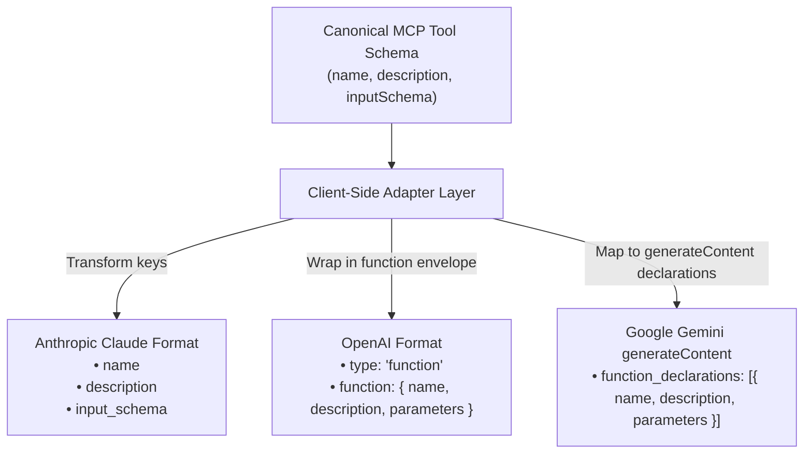
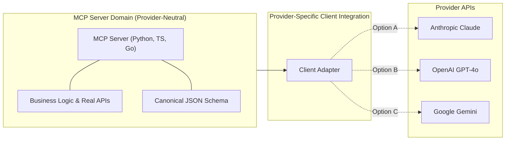

## Introduction: From Theory to Implementation

> **Series Navigation**
>
> * [Part 1: Architecture, Core Primitives & Host Orchestration](/mcp-guide-part1/)
> * **Part 2: Hands-On MCP: Building Servers and Clients in TypeScript, Python, and Go** *(You are here)*
> * [Part 3: Advanced MCP: Hierarchical Agents, Markdown Skills, and Packaging](/mcp-guide-part3/)

In **Part 1**, we explored the architectural blueprint of the Model Context Protocol: how a single host client orchestrates multiple servers over `stdio` and JSON-RPC 2.0, and how the core primitives (Resources, Tools, and Prompts) decouple tools from model reasoning.

In this practical guide, we’ll build working MCP servers and clients in TypeScript, Python, and Go, then review the additional checks to consider before deployment.

1. **TypeScript / Node.js** (using the v2 server and client packages with Zod)
2. **Python** (using the v2 `MCPServer` and `Client` APIs)
3. **Go** (using the official Go MCP SDK and compiled standalone binaries)

We will also compare model-provider tool schemas and show how MCP can reduce provider-specific coupling in server implementations, while client-side translation and integration remain provider-specific.

> **SDK version note:** The TypeScript and Python examples use their current v2 SDK APIs. The Go SDK has independent versioning: this article uses Go SDK v1.8.0, which supports MCP protocol version 2026-07-28. There is no corresponding Go SDK v2 release. See the [TypeScript v2 documentation](https://ts.sdk.modelcontextprotocol.io/v2/), [Python v2 documentation](https://py.sdk.modelcontextprotocol.io/), and [Go SDK version compatibility](https://github.com/modelcontextprotocol/go-sdk#version-compatibility).

## Building MCP Servers with TypeScript

The v2 `@modelcontextprotocol/server` package provides high-level primitives for creating servers with Node.js 20 or later, or Bun.

### Installation

```bash
npm init -y
npm pkg set type=module
npm install @modelcontextprotocol/server@^2 @modelcontextprotocol/client@^2 zod@^4
npm install -D typescript @types/node tsx
npx tsc --init
```

### Example: Basic Arithmetic Server

This server exposes basic mathematical functions using strict Zod schema validation:

```typescript
// src/calculator-server.ts
import { McpServer } from "@modelcontextprotocol/server";
import { serveStdio } from "@modelcontextprotocol/server/stdio";
import * as z from "zod/v4";

function createServer() {
  const server = new McpServer({
    name: "calculator-server",
    version: "1.0.0",
  });

  server.registerTool(
    "calculate_sum",
    {
      description: "Add two numbers.",
      inputSchema: z.object({
        a: z.number().describe("First numerical operand"),
        b: z.number().describe("Second numerical operand"),
      }),
    },
    async ({ a, b }) => ({
      content: [
        {
          type: "text",
          text: `Calculation Result: ${a} + ${b} = ${a + b}`,
        },
      ],
    })
  );

  return server;
}

void serveStdio(createServer);
console.error("Calculator MCP Server running on stdio transport.");
```

### Example: External API Integration (GitHub Issues)

This server integrates with GitHub's REST API, accepting a personal access token from the environment:

```typescript
// src/github-server.ts
import { McpServer } from "@modelcontextprotocol/server";
import { serveStdio } from "@modelcontextprotocol/server/stdio";
import * as z from "zod/v4";

const GITHUB_TOKEN = process.env.GITHUB_PERSONAL_ACCESS_TOKEN;

function createServer() {
  const server = new McpServer({
    name: "github-issues-server",
    version: "1.0.0",
  });

  server.registerTool(
    "create_github_issue",
    {
      description: "Create an issue in a GitHub repository.",
      inputSchema: z.object({
        owner: z.string().describe("GitHub organization or repository owner"),
        repo: z.string().describe("Target repository name"),
        title: z.string().describe("Issue title"),
        body: z.string().optional().describe("Detailed markdown body for the issue"),
      }),
    },
    async ({ owner, repo, title, body }) => {
      if (!GITHUB_TOKEN) {
        return {
          isError: true,
          content: [{ type: "text", text: "GITHUB_PERSONAL_ACCESS_TOKEN is not configured." }],
        };
      }

      try {
        const response = await fetch(`https://api.github.com/repos/${owner}/${repo}/issues`, {
          method: "POST",
          headers: {
            "Accept": "application/vnd.github.v3+json",
            "Authorization": `Bearer ${GITHUB_TOKEN}`,
            "User-Agent": "MCP-GitHub-Server",
            "Content-Type": "application/json",
          },
          body: JSON.stringify({ title, body }),
        });

        if (!response.ok) {
          const errorText = await response.text();
          return {
            isError: true,
            content: [{ type: "text", text: `GitHub API error (${response.status}): ${errorText}` }],
          };
        }

        const issueData = (await response.json()) as { number: number; html_url: string };
        return {
          content: [
            {
              type: "text",
              text: `Issue #${issueData.number} created successfully: ${issueData.html_url}`,
            },
          ],
        };
      } catch (error: unknown) {
        const message = error instanceof Error ? error.message : String(error);
        return {
          isError: true,
          content: [{ type: "text", text: `Failed to connect to GitHub: ${message}` }],
        };
      }
    }
  );

  return server;
}

void serveStdio(createServer);
console.error("GitHub MCP Server running on stdio transport.");
```

### Example: TypeScript Client for the Calculator Server

This client starts the calculator server as a subprocess, discovers its tools, and calls `calculate_sum`:

```typescript
// src/calculator-client.ts
import { Client } from "@modelcontextprotocol/client";
import { StdioClientTransport } from "@modelcontextprotocol/client/stdio";

async function main() {
  const client = new Client({ name: "calculator-client", version: "1.0.0" });
  const transport = new StdioClientTransport({
    command: "npx",
    args: ["tsx", "src/calculator-server.ts"],
  });

  try {
    await client.connect(transport);

    const { tools } = await client.listTools();
    console.log("Available tools:", tools.map((tool) => tool.name));

    const result = await client.callTool({
      name: "calculate_sum",
      arguments: { a: 42.5, b: 17.5 },
    });

    if (result.isError) {
      throw new Error("The calculator tool call failed.");
    }

    for (const content of result.content) {
      if (content.type === "text") {
        console.log(content.text);
      }
    }
  } finally {
    await client.close();
  }
}

main().catch((error) => {
  console.error("Calculator client failed:", error);
  process.exitCode = 1;
});
```

Run the client from the project root:

```bash
npx tsx src/calculator-client.ts
```

## Building MCP Servers with Python

The Python v2 SDK uses `MCPServer` to register tools from typed functions. Its `Client` API can launch a local server over stdio or connect to a remote server over Streamable HTTP.

### Installation

```bash
pip install "mcp[cli]>=2,<3" httpx
```

The v2 Python SDK requires Python 3.10 or later.

### Example: Basic Text Metrics Server

```python
# text_metrics_server.py
from mcp.server import MCPServer

mcp = MCPServer("TextMetricsServer")

@mcp.tool()
def compute_text_metrics(text: str) -> str:
    """Calculates word count, character count, and average word length for a given text."""
    words = text.split()
    word_count = len(words)
    char_count = len(text)
    avg_len = sum(len(w) for w in words) / word_count if word_count > 0 else 0.0

    return (
        f"Text Analysis Results:\n"
        f"- Characters: {char_count}\n"
        f"- Words: {word_count}\n"
        f"- Average Word Length: {avg_len:.2f} characters"
    )

if __name__ == "__main__":
    mcp.run()
```

### Example: External API Integration (Live Weather via Open-Meteo)

This server queries Open-Meteo's open weather API using asynchronous HTTP requests:

```python
# weather_server.py
import httpx
from mcp.server import MCPServer
from mcp.server.mcpserver.exceptions import ToolError

mcp = MCPServer("LiveWeatherServer")

@mcp.tool()
async def get_current_weather(latitude: float, longitude: float) -> str:
    """Retrieves real-time temperature, windspeed, and weather conditions for given coordinates.
    
    Args:
        latitude: Latitude in decimal degrees (e.g., 37.7749)
        longitude: Longitude in decimal degrees (e.g., -122.4194)
    """
    url = "https://api.open-meteo.com/v1/forecast"
    params = {
        "latitude": latitude,
        "longitude": longitude,
      "current": ["temperature_2m", "wind_speed_10m"]
    }

    async with httpx.AsyncClient() as client:
        response = await client.get(url, params=params, timeout=10.0)

        if response.status_code != 200:
          raise ToolError(f"Weather API error: HTTP {response.status_code}")

        data = response.json()
        current = data.get("current", {})

        temp_c = current.get("temperature_2m")
        wind_speed = current.get("wind_speed_10m")
        time = current.get("time")

        return (
            f"Current Conditions for ({latitude}, {longitude}):\n"
            f"- Temperature: {temp_c}°C\n"
            f"- Wind Speed: {wind_speed} km/h\n"
            f"- Recorded At: {time} UTC"
        )

if __name__ == "__main__":
    mcp.run()
```

### Example: Python Client for the Text Metrics Server

The client launches the server with the same Python interpreter, initializes the session, lists the tools, and calls `compute_text_metrics`:

```python
# text_metrics_client.py
import asyncio
import sys

from mcp import Client, StdioServerParameters
from mcp.types import TextContent


async def main() -> None:
    server = StdioServerParameters(
        command=sys.executable,
        args=["text_metrics_server.py"],
    )

    async with Client(server) as client:
        tools = await client.list_tools()
        print("Available tools:", [tool.name for tool in tools.tools])

        result = await client.call_tool(
            "compute_text_metrics",
            {"text": "MCP clients call server tools."},
        )

        if result.is_error:
            raise RuntimeError("The text metrics tool call failed.")

        for content in result.content:
            if isinstance(content, TextContent):
                print(content.text)


if __name__ == "__main__":
    asyncio.run(main())
```

Run the client from the directory containing both Python files:

```bash
python text_metrics_client.py
```

## Building MCP Servers and Clients in Go

The Go SDK uses its own version numbering, independent of the TypeScript and Python SDKs. Go is also useful when you want to deploy a single binary with no separate runtime dependency.

### Initialize the Go Module

```bash
mkdir mcp-go-suite
cd mcp-go-suite
go mod init example.com/mcp-go-suite
go get github.com/modelcontextprotocol/go-sdk/mcp@v1.8.0
```

### Example: Basic Go Calculator Server

```go
// cmd/calculator/main.go
package main

import (
	"context"
	"fmt"
	"os"

	"github.com/modelcontextprotocol/go-sdk/mcp"
)

type AddArguments struct {
	A float64 `json:"a" jsonschema:"description=First operand"`
	B float64 `json:"b" jsonschema:"description=Second operand"`
}

func main() {
	server := mcp.NewServer(&mcp.Implementation{
		Name:    "go-calculator-server",
		Version: "1.0.0",
	}, nil)

	mcp.AddTool(server, &mcp.Tool{
		Name:        "add_numbers",
		Description: "Adds two floating point numbers together.",
	}, func(ctx context.Context, req *mcp.CallToolRequest, args AddArguments) (*mcp.CallToolResult, any, error) {
		sum := args.A + args.B
		return &mcp.CallToolResult{
			Content: []mcp.Content{
				&mcp.TextContent{
					Type: "text",
					Text: fmt.Sprintf("Go Math Output: %f + %f = %f", args.A, args.B, sum),
				},
			},
		}, nil, nil
	})

	if err := server.Run(context.Background(), &mcp.StdioTransport{}); err != nil {
		fmt.Fprintf(os.Stderr, "Go MCP server terminated with error: %v\n", err)
		os.Exit(1)
	}
}
```

### Example: Go External Weather API Server

```go
// cmd/weather/main.go
package main

import (
	"context"
	"encoding/json"
	"fmt"
	"net/http"
	"os"
	"time"

	"github.com/modelcontextprotocol/go-sdk/mcp"
)

type WeatherArgs struct {
	Latitude  float64 `json:"latitude" jsonschema:"description=Latitude in decimal degrees"`
	Longitude float64 `json:"longitude" jsonschema:"description=Longitude in decimal degrees"`
}

type OpenMeteoResponse struct {
  Current struct {
    Temperature2m float64 `json:"temperature_2m"`
    WindSpeed10m  float64 `json:"wind_speed_10m"`
    Time          string  `json:"time"`
  } `json:"current"`
}

func main() {
	server := mcp.NewServer(&mcp.Implementation{
		Name:    "go-weather-server",
		Version: "1.0.0",
	}, nil)

	mcp.AddTool(server, &mcp.Tool{
		Name:        "get_weather",
		Description: "Queries Open-Meteo for real-time weather metrics.",
	}, func(ctx context.Context, req *mcp.CallToolRequest, args WeatherArgs) (*mcp.CallToolResult, any, error) {
		apiURL := fmt.Sprintf(
      "https://api.open-meteo.com/v1/forecast?latitude=%f&longitude=%f&current=temperature_2m,wind_speed_10m",
			args.Latitude, args.Longitude,
		)

		reqHTTP, err := http.NewRequestWithContext(ctx, http.MethodGet, apiURL, nil)
		if err != nil {
			return nil, nil, fmt.Errorf("failed to prepare request: %w", err)
		}

		client := &http.Client{Timeout: 10 * time.Second}
		resp, err := client.Do(reqHTTP)
		if err != nil {
			return nil, nil, fmt.Errorf("network request failed: %w", err)
		}
		defer resp.Body.Close()
		if resp.StatusCode < http.StatusOK || resp.StatusCode >= http.StatusMultipleChoices {
			return nil, nil, fmt.Errorf("Open-Meteo returned HTTP %s", resp.Status)
		}

		var weatherData OpenMeteoResponse
		if err := json.NewDecoder(resp.Body).Decode(&weatherData); err != nil {
			return nil, nil, fmt.Errorf("failed to decode JSON response: %w", err)
		}

		summary := fmt.Sprintf("Go Weather Reporter: %0.1f°C, Wind: %0.1f km/h (at %s)",
      weatherData.Current.Temperature2m,
      weatherData.Current.WindSpeed10m,
      weatherData.Current.Time,
		)

		return &mcp.CallToolResult{
			Content: []mcp.Content{
				&mcp.TextContent{Type: "text", Text: summary},
			},
		}, nil, nil
	})

	if err := server.Run(context.Background(), &mcp.StdioTransport{}); err != nil {
		fmt.Fprintf(os.Stderr, "Server error: %v\n", err)
		os.Exit(1)
	}
}
```

### Example: Building a Standalone Go MCP Client

An MCP client in Go can launch any MCP server subprocess, discover its tools, and invoke them programmatically:

```go
// cmd/client/main.go
package main

import (
	"context"
	"fmt"
	"os"
	"os/exec"

	"github.com/modelcontextprotocol/go-sdk/mcp"
)

func main() {
	ctx := context.Background()

	// 1. Configure the command to spawn the Go calculator binary as a subprocess
	cmd := exec.Command("./bin/calculator")
	transport := &mcp.CommandTransport{Command: cmd}

	// 2. Initialize the MCP Client
	client := mcp.NewClient(&mcp.Implementation{
		Name:    "go-test-client",
		Version: "1.0.0",
	}, nil)

	session, err := client.Connect(ctx, transport, nil)
	if err != nil {
		fmt.Fprintf(os.Stderr, "Failed to connect to server: %v\n", err)
		os.Exit(1)
	}
	defer session.Close()

	// 3. Discover available tools
	toolsResp, err := session.ListTools(ctx, nil)
	if err != nil {
		fmt.Fprintf(os.Stderr, "ListTools failed: %v\n", err)
		os.Exit(1)
	}

	fmt.Println("Discovered Tools:")
	for _, t := range toolsResp.Tools {
		fmt.Printf("- %s: %s\n", t.Name, t.Description)
	}

	// 4. Execute a tool call
	callArgs := map[string]any{"a": 42.5, "b": 17.5}
	res, err := session.CallTool(ctx, &mcp.CallToolParams{
		Name:      "add_numbers",
		Arguments: callArgs,
	})
	if err != nil {
		fmt.Fprintf(os.Stderr, "Tool execution failed: %v\n", err)
		os.Exit(1)
	}

	for _, content := range res.Content {
		if textContent, ok := content.(*mcp.TextContent); ok {
			fmt.Printf("Execution Output: %s\n", textContent.Text)
		}
	}
}
```

### Compiling the Go Suite

To run these executables, create a local `bin/` directory and compile the standalone binaries into it:

```bash
mkdir -p bin

go build -o bin/calculator cmd/calculator/main.go
go build -o bin/weather cmd/weather/main.go
go build -o bin/client cmd/client/main.go

# Run the Go client against the compiled calculator binary
./bin/client
```

## Operational Readiness and Validation

The examples demonstrate the core protocol flow, but production readiness also depends on the host, deployment environment, and the data each tool can access. Before deploying a server:

* Pin the runtime and SDK versions, and build from a dependency lockfile in CI.
* Treat tool arguments as untrusted input. Validate business constraints, such as coordinate ranges, and authorize users before performing side effects.
* Keep credentials in a secret manager or environment configuration, grant only the permissions each integration needs, and never include secrets in tool results or logs.
* For `stdio` servers, reserve stdout for MCP messages and write diagnostics to stderr. Set timeouts for upstream requests, check HTTP status codes, validate response fields, and avoid returning success-shaped default values when an upstream request fails.
* Run the server under a process supervisor that can restart failures and deliver a graceful shutdown signal.

Validate each server through an MCP host or the MCP Inspector before deployment:

1. Start the server and complete initialization. Confirm that the expected tools and input schemas appear in the tool list.
2. Call each tool with a valid input and verify its result. Also test missing, malformed, and out-of-range arguments; the server should reject them clearly rather than perform unintended work.
3. For integrations, test missing credentials, upstream non-success responses, timeouts, and malformed response bodies. Confirm that each failure is reported as an error and never presented as successful data.
4. Confirm that stdout contains only protocol traffic, then verify that the host can stop and restart the server cleanly.

Keep business logic tests independent of live services, and add integration tests that simulate upstream success and failure responses. Run these checks in CI so SDK, runtime, or deployment changes do not silently break the server contract.

## Model Provider-Specific Schemas & Tool Translation

When an MCP client retrieves tool definitions from a server, they are represented in canonical MCP format:

```json
{
  "name": "get_weather",
  "description": "Retrieves real-time weather metrics.",
  "inputSchema": {
    "type": "object",
    "properties": {
      "latitude": { "type": "number", "description": "Latitude coordinate" },
      "longitude": { "type": "number", "description": "Longitude coordinate" }
    },
    "required": ["latitude", "longitude"]
  }
}
```

However, each model provider expects a slightly different JSON structure over its HTTP inference API.



### Format Comparison Matrix

| Provider | Tool-Definition Fragment | Parameter Schema Key | Tool Result Message Structure |
| :--- | :--- | :--- | :--- |
| **Canonical MCP** | Root Tool Object | `inputSchema` (JSON Schema) | `content: [{ type: "text", text }]` |
| **Anthropic Claude** | Root Tool Object | `input_schema` (snake_case) | `role: "user", content: [{ type: "tool_result", tool_use_id, content }]` |
| **OpenAI** | `{"type": "function", "function": {...}}` | `parameters` | `role: "tool", tool_call_id, content: string` |
| **Google Gemini generateContent** | `{"function_declarations": [...]}` (inside the request's `tools` array) | `parameters` | `role: "function", parts: [{ functionResponse: { name, response } }]` |

### Provider Tool-Definition Adapters (Python)

These functions return tool-definition fragments, not complete model request bodies. The Gemini adapter targets the `generateContent` API and returns a `function_declarations` object for the request's `tools` array. It does not target the Interactions API, which uses a different tool-definition shape.

```python
from typing import Dict, Any, List

def mcp_to_anthropic(mcp_tool: Dict[str, Any]) -> Dict[str, Any]:
    """Converts a canonical MCP tool schema to Anthropic's expected payload format."""
    return {
        "name": mcp_tool["name"],
        "description": mcp_tool.get("description", ""),
        "input_schema": mcp_tool.get("inputSchema", {"type": "object", "properties": {}})
    }

def mcp_to_openai(mcp_tool: Dict[str, Any]) -> Dict[str, Any]:
    """Converts a canonical MCP tool schema to OpenAI's function calling envelope."""
    return {
        "type": "function",
        "function": {
            "name": mcp_tool["name"],
            "description": mcp_tool.get("description", ""),
            "parameters": mcp_tool.get("inputSchema", {"type": "object", "properties": {}})
        }
    }

def mcp_to_gemini(mcp_tools: List[Dict[str, Any]]) -> Dict[str, Any]:
    """Builds a Gemini generateContent function-declarations fragment."""
    declarations = []
    for tool in mcp_tools:
        declarations.append({
            "name": tool["name"],
            "description": tool.get("description", ""),
            "parameters": tool.get("inputSchema", {"type": "object", "properties": {}})
        })
    return {"function_declarations": declarations}
```

---

## How MCP Reduces Server-Side Provider Coupling

Provider APIs use different tool schemas and result formats. MCP standardizes communication between a host and a server, but it does not standardize each model provider's API or eliminate client-side adapters.

An MCP server can expose tools without importing a model provider's SDK. The host still needs to translate tool definitions and results for its chosen provider, and a provider change can require client-side code or configuration changes.



### What You Can Reuse Across Providers

1. **Server-side separation:** The MCP server can expose tools through the protocol without importing `openai`, `anthropic`, or `google-generativeai`. This can let multiple compatible hosts use the same server implementation.
2. **Server reuse:** Switching providers may not require changes to the MCP server, but the host may need different credentials, schema conversion, tool-call handling, or result mapping. Check the target provider's supported schema and behavior.
3. **Framework support:** Frameworks such as `langchain-mcp-adapters` can manage MCP connections and tool conversion for supported model integrations. The framework's provider support and schema compatibility still determine how much client code or configuration is needed:

```python
from langchain_mcp_adapters.client import MultiServerMCPClient
from langchain_openai import ChatOpenAI
from langchain_anthropic import ChatAnthropic

# 1. Connect to any standard MCP server
client = MultiServerMCPClient(...)
tools = await client.get_tools()

# Bind the MCP tools to a model supported by the framework:
# model = ChatAnthropic(model="claude-3-7-sonnet").bind_tools(tools)
model = ChatOpenAI(model="gpt-4o").bind_tools(tools)
```

## What's Next?

With working servers running across TypeScript, Python, and Go—and provider-agnostic tool translation clarified—we can move beyond simple utility functions.

In **[Part 3: Advanced MCP: Hierarchical Agents, Markdown Skills, and Packaging](/mcp-guide-part3/)**, we will explore:

* **The Agent-as-a-Tool Pattern:** Embedding autonomous, multi-step sub-agents inside MCP servers.
* **Declarative Markdown Agents (`agent.md` / `SKILL.md`):** Exposing prompt-based persona skills as native MCP tools and prompts.
* **Packaging and Distribution Strategies:** Shipping servers using `npx`, `uvx`, compiled Go binaries, and Docker.
