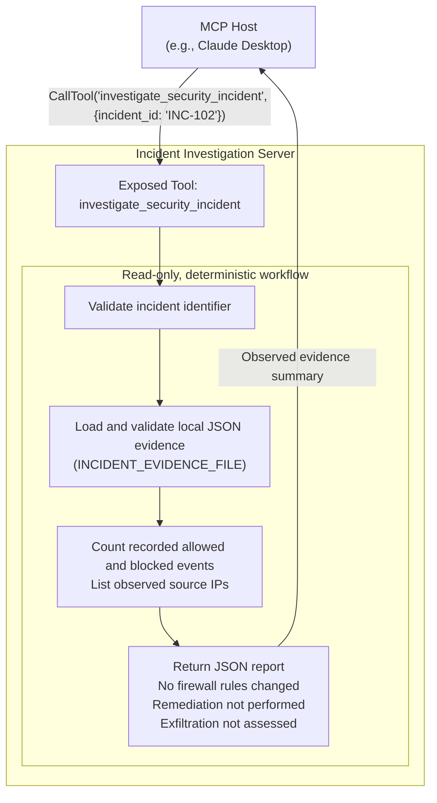
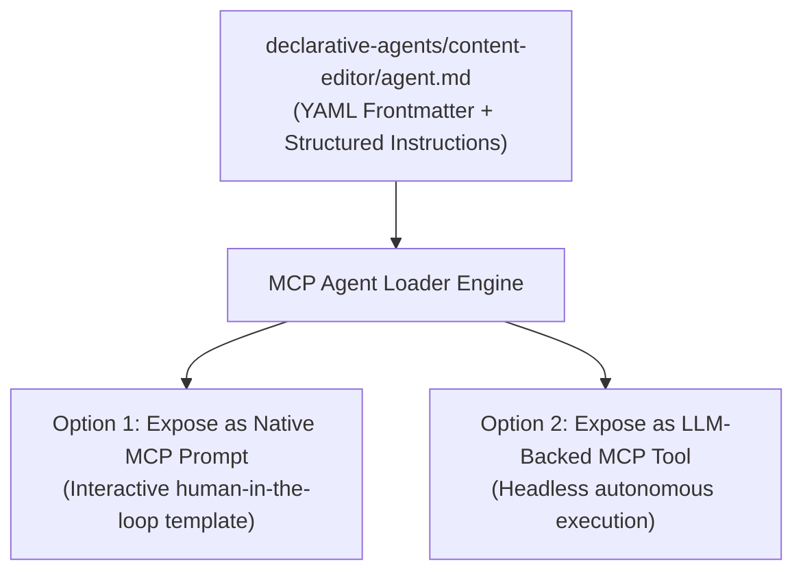
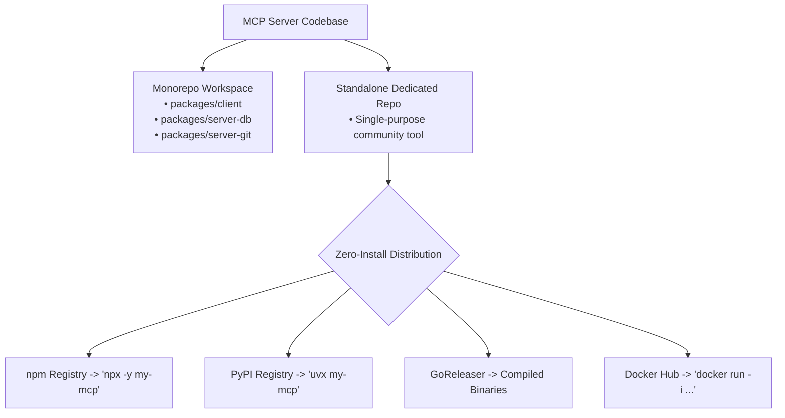

## Introduction: Scaling beyond simple tool wrapping

> **Series Navigation**
>
> * [Part 1: Architecture, Core Primitives & Host Orchestration](/mcp-guide-part1/)
> * [Part 2: Hands-On MCP: Building Servers and Clients in TypeScript, Python, and Go](/mcp-guide-part2/)
> * **Part 3: Advanced MCP: Hierarchical Agents, Markdown Skills, and Packaging** *(You are here)*

In **Part 1** and **Part 2**, we established the foundational architecture of MCP and built production servers that expose APIs and system utilities across TypeScript, Python, and Go.

However, MCP servers can do more than wrap individual REST endpoints or database tables. As systems scale, exposing dozens of low-level tools directly to an agent can make tool selection harder, especially when their descriptions or responsibilities overlap. If an agent chooses an inappropriate tool and uses its output to answer the original request, it may produce unsupported conclusions or hallucinated details.

In this final installment, we elevate MCP to an enterprise-grade architectural backbone:

1. **The Agent-as-a-Tool Pattern:** Exposing autonomous, self-correcting sub-agents as single, high-level MCP tools.
2. **Declarative & Markdown-Defined Agents (`agent.md`):** Ingesting prompt-driven skill definitions and dynamically exposing them via MCP Prompts and Tools.
3. **Packaging & Distribution:** Packaging and releasing servers for zero-install developer adoption via `npx`, `uvx`, GoReleaser, and Docker.

## The agent-as-a-tool pattern: Hierarchical multi-agent systems

Instead of exposing 20 raw API endpoints to a root orchestrator, you can encapsulate a specialized sub-agent (built in LangGraph, CrewAI, or raw code) inside an MCP server and expose it as a single, composite tool.

MCP supplies the host-server interface for discovering tools, invoking them, and returning results. The server application implements any agent loop, retry policy, and orchestration of internal tools. These behaviors are not automatic MCP features: the same interface can expose either an autonomous agent or a deterministic workflow.



### Architectural benefits

* **Context Window Optimization:** The root agent can receive a summarized result instead of handling every intermediate API call, SQL retry, or syntax correction.
* **Stack & Framework Interoperability:** Your sub-agent can be written in LangGraph in Python, your code reviewer in TypeScript, and your infrastructure auditor in Go. A compatible, configured MCP host can invoke all three.
* **Isolated Reflection & Self-Correction:** When a sub-agent encounters an intermediate error, it can retry or alter its internal plan without the root orchestrator ever witnessing the messy trial-and-error.

### Implementation: The sub-agent pattern across 3 languages

The following examples expose specialized, read-only workflows as MCP tools. Choose the example that matches your stack:

* **Python:** Validate local incident evidence, summarize recorded firewall decisions, and report progress.
* **TypeScript:** Check a PR checkout for correctness findings, security hotspots, and excessive cyclomatic complexity.
* **Go:** Query pod status in an authorized Kubernetes namespace and report the observed snapshot.

Each example includes its prerequisites, startup instructions, and limitations. These implementations are deterministic workflows; adding an autonomous agent loop is a separate application concern.

#### 1. Python: FastMCP with progress notifications

Multi-step tools can take time to execute. MCP supports **progress updates** when the caller supplies a progress token and the host supports displaying notifications. The Python SDK handles the token through `Context.report_progress`; without one, the tool still returns its final result.

This server performs a read-only investigation of a local JSON evidence file. It validates the incident identifier and recorded IP addresses, then counts observed firewall decisions. It does not query threat-intelligence services, detect exfiltration, or apply firewall rules. An observed `blocked` event means the supplied log recorded a block, not that this server installed one.

Use Python 3.11 or later. In a separate server project, install the dependencies:

```sh
uv init --python 3.11
uv add "mcp>=1.12,<2" "pydantic>=2,<3"
```

```python
# security_subagent_server.py
import asyncio
import json
import os
from collections import Counter
from pathlib import Path
from typing import Literal

from mcp.server.fastmcp import FastMCP, Context
from pydantic import BaseModel, ConfigDict, Field, IPvAnyAddress

mcp = FastMCP("IncidentInvestigationServer")
MAX_EVIDENCE_BYTES = 1024 * 1024


class FirewallEvent(BaseModel):
    model_config = ConfigDict(extra="forbid", strict=True)
    source_ip: IPvAnyAddress
    action: Literal["allowed", "blocked"]


class IncidentEvidence(BaseModel):
    model_config = ConfigDict(extra="forbid", strict=True)
    incident_id: str = Field(pattern=r"^INC-[0-9]+$")
    events: list[FirewallEvent] = Field(min_length=1)


def load_evidence(incident_id: str) -> IncidentEvidence:
    configured_path = os.environ.get("INCIDENT_EVIDENCE_FILE")
    if not configured_path:
        raise ValueError("Set INCIDENT_EVIDENCE_FILE to an authorized evidence file.")
    with Path(configured_path).open("rb") as evidence_file:
        data = evidence_file.read(MAX_EVIDENCE_BYTES + 1)
    if len(data) > MAX_EVIDENCE_BYTES:
        raise ValueError("Evidence exceeds the 1 MiB limit.")
    evidence = IncidentEvidence.model_validate_json(data)
    if evidence.incident_id != incident_id:
        raise ValueError("The evidence file does not match the requested incident.")
    return evidence


@mcp.tool()
async def investigate_security_incident(incident_id: str, ctx: Context) -> str:
    """Summarizes recorded firewall decisions without changing firewall rules."""
    if not incident_id.startswith("INC-") or not incident_id[4:].isascii() or not incident_id[4:].isdigit():
        raise ValueError("Use an incident identifier such as INC-102.")
    await ctx.report_progress(progress=0, total=3)
    evidence = await asyncio.to_thread(load_evidence, incident_id)
    await ctx.report_progress(progress=1, total=3)
    decisions = Counter(event.action for event in evidence.events)
    sources = sorted({str(event.source_ip) for event in evidence.events})
    await ctx.report_progress(progress=2, total=3)
    report = json.dumps(
        {
            "incident_id": evidence.incident_id,
            "evidence": "Local log snapshot; not independently verified",
            "events_reviewed": len(evidence.events),
            "source_ips": sources,
            "allowed_events": decisions["allowed"],
            "blocked_events": decisions["blocked"],
            "firewall_rules_changed": False,
            "remediation_status": "Not performed",
            "exfiltration_status": "Not assessed",
        },
        indent=2,
    )
    await ctx.report_progress(progress=3, total=3)
    return report


if __name__ == "__main__":
    mcp.run()
```

Create an evidence file with the following schema. These two events are test data, not a real incident:

```json
{
  "incident_id": "INC-102",
  "events": [
    { "source_ip": "198.51.100.23", "action": "allowed" },
    { "source_ip": "198.51.100.23", "action": "blocked" }
  ]
}
```

Set `INCIDENT_EVIDENCE_FILE` to the absolute path of that file and run `uv run python security_subagent_server.py`. Invoke `investigate_security_incident` with `{"incident_id": "INC-102"}` from an MCP host. For this fixture, the report contains two events, one allowed and one blocked, with `firewall_rules_changed: false`. Missing files, invalid JSON, invalid IP addresses, oversized evidence, and incident mismatches raise errors that FastMCP exposes as tool failures.

The evidence format is an application-specific input contract, not a parser for any firewall vendor's native logs. A production integration needs an authorized log collector and provenance checks. Actual remediation additionally requires a firewall-specific API, server-side authorization, an approval policy, and verification that the intended rule took effect. This example intentionally implements none of those mutations and is a deterministic workflow, not an autonomous reasoning agent.

#### 2. TypeScript: Code review sub-agent

This example delegates a read-only review to a deterministic analysis pipeline, not an LLM reasoning loop. It parses JavaScript and TypeScript, checks selected correctness rules, flags potential security hotspots, and enforces a cyclomatic complexity limit of 10. Security hotspots require human triage; a clean result does not prove that a repository has no vulnerabilities. The tool returns a recommendation, but does not approve the PR or post inline comments.

Use Node.js 22 or later and Git. In a separate server project, install the dependencies:

```sh
npm init -y
npm pkg set type=module
npm install @modelcontextprotocol/sdk@1 zod@3 eslint@9 @typescript-eslint/parser@8 eslint-plugin-security@4
npm install --save-dev typescript@5.9 tsx@4 @types/node@22
```

Set `REVIEW_REPO_PATH` to a trusted local repository. Before invoking the tool, fetch the intended PR head into `refs/pull/<number>/head` and check out that commit. The tool verifies that `HEAD` matches this ref and rejects tracked or untracked working-tree changes. It reviews the entire checkout, not just the PR diff, and excludes dependencies, build output, and coverage. Only use it with repositories you are authorized to read. It does not execute the repository's scripts or load its ESLint configuration.

```typescript
// code_review_agent_server.ts
import { McpServer } from "@modelcontextprotocol/sdk/server/mcp.js";
import { execFile } from "node:child_process";
import { realpath } from "node:fs/promises";
import { relative } from "node:path";
import { promisify } from "node:util";
import { ESLint } from "eslint";
import tsParser from "@typescript-eslint/parser";
import security from "eslint-plugin-security";
import { z } from "zod";

const execFileAsync = promisify(execFile);
const complexityLimit = 10;
const sourceFiles = ["**/*.{js,mjs,cjs,jsx,ts,mts,cts,tsx}"];
const server = new McpServer({
  name: "code-review-agent",
  version: "1.0.0",
});

async function git(repoPath: string, args: string[]): Promise<string> {
  const { stdout } = await execFileAsync("git", ["-C", repoPath, ...args], {
    timeout: 10_000,
    maxBuffer: 1024 * 1024,
    encoding: "utf8",
  });
  return stdout.trim();
}

export async function reviewRepository(
  repoPath: string,
  pullRequestNumber: number,
): Promise<string> {
  const allowedPath = process.env.REVIEW_REPO_PATH;
  if (!allowedPath) {
    throw new Error("Set REVIEW_REPO_PATH to the authorized repository.");
  }
  if (!Number.isSafeInteger(pullRequestNumber) || pullRequestNumber < 1) {
    throw new Error("The pull request number must be a positive safe integer.");
  }
  const root = await realpath(repoPath);
  if (root !== await realpath(allowedPath)) {
    throw new Error("The requested repository is not authorized.");
  }
  if (root !== await realpath(await git(root, ["rev-parse", "--show-toplevel"]))) {
    throw new Error("repoPath must identify the repository root.");
  }
  const head = await git(root, ["rev-parse", "--verify", "HEAD^{commit}"]);
  const prHead = await git(root, [
    "rev-parse", "--verify", `refs/pull/${pullRequestNumber}/head^{commit}`,
  ]);
  if (head !== prHead) {
    throw new Error("Check out the fetched PR head before running the review.");
  }
  if (await git(root, ["status", "--porcelain", "--untracked-files=all"])) {
    throw new Error("The repository must have a clean working tree.");
  }

  const eslint = new ESLint({
    cwd: root,
    overrideConfigFile: true,
    allowInlineConfig: false,
    overrideConfig: [
      { ignores: ["**/node_modules/**", "**/dist/**", "**/build/**", "**/coverage/**"] },
      {
        files: sourceFiles,
        languageOptions: {
          parser: tsParser,
          parserOptions: { ecmaFeatures: { jsx: true } },
        },
        plugins: { security },
        rules: {
          ...security.configs.recommended.rules,
          complexity: ["error", { max: complexityLimit, variant: "classic" }],
          "no-unreachable": "error",
          "valid-typeof": "error",
          "constructor-super": "error",
        },
      },
    ],
  });
  const results = await eslint.lintFiles(sourceFiles);
  if (results.length === 0) {
    throw new Error("No supported source files were found; review not completed.");
  }

  const findings = results.flatMap((result) =>
    result.messages.map((message) => ({
      file: relative(root, result.filePath),
      ...message,
    })),
  );
  if (findings.some((finding) => finding.fatal)) {
    throw new Error(`Parsing failed; review incomplete:\n${findings
      .filter((finding) => finding.fatal)
      .map((finding) => `${finding.file}:${finding.line}: ${finding.message}`)
      .join("\n")}`);
  }
  if (head !== await git(root, ["rev-parse", "--verify", "HEAD^{commit}"]) ||
      await git(root, ["status", "--porcelain", "--untracked-files=all"])) {
    throw new Error("The checkout changed during analysis; rerun the review.");
  }

  const hotspots = findings.filter((finding) => finding.ruleId?.startsWith("security/"));
  const complexity = findings.filter((finding) => finding.ruleId === "complexity");
  const correctness = findings.filter((finding) =>
    !finding.ruleId?.startsWith("security/") && finding.ruleId !== "complexity",
  );
  return [
    `Review of PR #${pullRequestNumber} at ${head}:`,
    `- Scope: ${results.length} source files in the full checkout.`,
    `- Correctness findings: ${correctness.length}.`,
    `- Potential security hotspots: ${hotspots.length} (not confirmed vulnerabilities).`,
    `- Functions exceeding complexity ${complexityLimit}: ${complexity.length}.`,
    `- Recommendation: ${findings.length > 0
      ? "REQUEST CHANGES: triage the findings below."
      : "No findings from these checks; human review is still required."}`,
    "- No GitHub review or inline comments were submitted.",
    ...findings.map((finding) =>
      `${finding.file}:${finding.line}:${finding.column} [${finding.ruleId ?? "parser"}] ${finding.message}`,
    ),
  ].join("\n");
}

server.tool(
  "perform_deep_code_review",
  {
    repoPath: z.string().describe("Path to the authorized, clean PR checkout"),
    pullRequestNumber: z.number().int().positive().max(Number.MAX_SAFE_INTEGER)
      .describe("PR number whose fetched head is checked out"),
  },
  async ({ repoPath, pullRequestNumber }) => {
    try {
      const report = await reviewRepository(repoPath, pullRequestNumber);
      return { content: [{ type: "text" as const, text: report }] };
    } catch (error) {
      const message = error instanceof Error ? error.message : String(error);
      console.error("Code review failed:", message);
      return {
        isError: true,
        content: [{ type: "text" as const, text: `Review failed: ${message}` }],
      };
    }
  }
);

export { server };
```

Save the server as `code_review_agent_server.ts` and start it with a separate entry point:

```typescript
// main.ts
import { StdioServerTransport } from "@modelcontextprotocol/sdk/server/stdio.js";
import { server } from "./code_review_agent_server.js";

async function main() {
  await server.connect(new StdioServerTransport());
}
main().catch((error) => {
  console.error("Code review server failed:", error);
  process.exitCode = 1;
});
```

Run `npx tsx main.ts` with `REVIEW_REPO_PATH` set in the server's environment. Invoke `perform_deep_code_review` from your MCP host with that repository path and the PR number. A failed Git command, parse error, missing source files, or changed checkout produces a tool error rather than a success-shaped review. This example does not perform dependency auditing, type checking, tests, or a complete security assessment.

#### 3. Go: Kubernetes diagnostic sub-agent

This server uses `kubectl` to query actual pod status in one authorized namespace. It reports pod phases, readiness, recorded container restarts, and waiting reasons. It does not invent memory usage, CPU throttling, or an overall cluster-health verdict.

Use Go 1.25 or later, the MCP Go SDK v1.7.0, and a `kubectl` version compatible with your cluster. In a separate server project:

```sh
go mod init example.com/k8s-diagnostic
go get github.com/modelcontextprotocol/go-sdk@v1.7.0
```

Configure a kubeconfig with read-only permission to list pods in the intended namespace. Set `KUBE_CONTEXT` to an explicit kubeconfig context and `KUBE_NAMESPACE` to the namespace this server may inspect. The MCP caller cannot select another context or namespace.

```go
// main.go
package main

import (
	"context"
	"encoding/json"
	"fmt"
	"os"
	"os/exec"
	"regexp"
	"strings"
	"time"

	"github.com/modelcontextprotocol/go-sdk/mcp"
)

type DiagnosticArgs struct {
	Namespace string `json:"namespace" jsonschema:"Authorized Kubernetes namespace"`
}

type PodList struct {
	Kind  string `json:"kind"`
	Items []struct {
		Metadata struct {
			Name              string  `json:"name"`
			DeletionTimestamp *string `json:"deletionTimestamp"`
		} `json:"metadata"`
		Status struct {
			Phase      string `json:"phase"`
			Conditions []struct {
				Type   string `json:"type"`
				Status string `json:"status"`
			} `json:"conditions"`
			ContainerStatuses []struct {
				RestartCount int `json:"restartCount"`
				State        struct {
					Waiting *struct {
						Reason string `json:"reason"`
					} `json:"waiting"`
				} `json:"state"`
			} `json:"containerStatuses"`
		} `json:"status"`
	} `json:"items"`
}

var namespacePattern = regexp.MustCompile(`^[a-z0-9]([-a-z0-9]*[a-z0-9])?$`)

func summarizePods(data []byte, namespace string) (string, error) {
	var pods PodList
	if err := json.Unmarshal(data, &pods); err != nil {
		return "", fmt.Errorf("decode pod response: %w", err)
	}
	if pods.Kind != "PodList" || pods.Items == nil {
		return "", fmt.Errorf("expected a PodList with an items array")
	}
	lines := []string{fmt.Sprintf("Namespace %s: %d pods observed", namespace, len(pods.Items))}
	if len(pods.Items) == 0 {
		lines = append(lines, "No pods found; namespace health cannot be inferred.")
	}
	for _, pod := range pods.Items {
		if pod.Metadata.Name == "" || pod.Status.Phase == "" {
			return "", fmt.Errorf("pod response lacks a name or phase")
		}
		ready := false
		for _, condition := range pod.Status.Conditions {
			if condition.Type == "Ready" && condition.Status == "True" {
				ready = true
			}
		}
		restarts := 0
		waiting := []string{}
		for _, container := range pod.Status.ContainerStatuses {
			restarts += container.RestartCount
			if container.State.Waiting != nil {
				waiting = append(waiting, container.State.Waiting.Reason)
			}
		}
		lines = append(lines, fmt.Sprintf(
			"- %s: phase=%s, ready=%t, terminating=%t, container restarts=%d, waiting reasons=%v",
			pod.Metadata.Name, pod.Status.Phase, ready,
			pod.Metadata.DeletionTimestamp != nil, restarts, waiting,
		))
	}
	lines = append(lines, "Snapshot only: resource pressure, application health, and cluster health are not assessed.")
	return strings.Join(lines, "\n"), nil
}

func diagnoseNamespace(ctx context.Context, args DiagnosticArgs) (string, error) {
	kubeContext, allowedNamespace := os.Getenv("KUBE_CONTEXT"), os.Getenv("KUBE_NAMESPACE")
	if kubeContext == "" || allowedNamespace == "" {
		return "", fmt.Errorf("set KUBE_CONTEXT and KUBE_NAMESPACE before querying")
	}
	if len(args.Namespace) > 63 || !namespacePattern.MatchString(args.Namespace) {
		return "", fmt.Errorf("invalid Kubernetes namespace")
	}
	if args.Namespace != allowedNamespace {
		return "", fmt.Errorf("namespace is not authorized")
	}
	diagCtx, cancel := context.WithTimeout(ctx, 30*time.Second)
	defer cancel()
	cmd := exec.CommandContext(diagCtx, "kubectl",
		"--context", kubeContext, "--namespace", args.Namespace,
		"--request-timeout=25s", "get", "pods", "-o", "json",
	)
	data, err := cmd.Output()
	if err != nil {
		if diagCtx.Err() != nil {
			return "", fmt.Errorf("Kubernetes query interrupted: %w", diagCtx.Err())
		}
		if exitErr, ok := err.(*exec.ExitError); ok {
			return "", fmt.Errorf("kubectl query failed: %w: %s", err, strings.TrimSpace(string(exitErr.Stderr)))
		}
		return "", fmt.Errorf("run kubectl: %w", err)
	}
	report, err := summarizePods(data, args.Namespace)
	if err != nil {
		return "", err
	}
	return fmt.Sprintf("Kubeconfig context: %s\n%s", kubeContext, report), nil
}

func newServer() *mcp.Server {
	server := mcp.NewServer(&mcp.Implementation{
		Name:    "k8s-diagnostic-subagent",
		Version: "1.0.0",
	}, nil)

	mcp.AddTool(server, &mcp.Tool{
		Name:        "diagnose_cluster_namespace",
		Description: "Queries pod status in the configured, authorized namespace.",
	}, func(ctx context.Context, req *mcp.CallToolRequest, args DiagnosticArgs) (*mcp.CallToolResult, any, error) {
		report, err := diagnoseNamespace(ctx, args)
		if err != nil {
			fmt.Fprintf(os.Stderr, "Kubernetes diagnostic failed: %v\n", err)
			return nil, nil, err
		}
		return &mcp.CallToolResult{
			Content: []mcp.Content{
				&mcp.TextContent{Text: report},
			},
		}, nil, nil
	})
	return server
}

func main() {
	if err := newServer().Run(context.Background(), &mcp.StdioTransport{}); err != nil {
		fmt.Fprintf(os.Stderr, "Go Agent Server Error: %v\n", err)
		os.Exit(1)
	}
}
```

Run `go run .` with the two environment variables set, then call `diagnose_cluster_namespace` with the same namespace. A `Running` phase alone does not mean that a pod is ready; the report uses the `Ready` condition separately and also identifies terminating pods. Restart counts cover the current regular-container status records, not an all-time history or init-container analysis.

Without a reachable Kubernetes API server, a working kubeconfig context, `kubectl`, and sufficient permissions, the tool returns an error. You can test JSON parsing and failure paths with fixtures or a stub `kubectl`, but those tests cannot establish live cluster connectivity. CPU and memory measurements would require additional APIs such as Metrics Server; CPU throttling needs separate telemetry. This is a bounded, read-only diagnostic workflow, not an autonomous agent or a comprehensive health assessment.

## Declarative & markdown-defined agents (`agent.md` / `SKILL.md`)

Not all agent instructions need to be written in procedural code. Tools such as Claude Code and Cursor, and formats such as Agent Skills, use markdown files to define agent roles, reusable skills, or project rules. File names, locations, frontmatter fields, and loading behavior differ by tool and format; these files do not share a universal `agent.md` convention. MCP does not define their file format.

For the application-specific `agent.md` used in the examples below, a definition might contain:

1. **YAML Frontmatter:** Metadata such as a name and description. Model preferences or parameter schemas belong here only if the application's loader supports them.
2. **Persona & Role:** Core identity, editorial style, or technical specialization.
3. **Structured Workflows:** Multi-pass instructions (e.g., Pass 1: Architecture, Pass 2: Verification).
4. **Constraints:** Non-negotiable operational boundaries.



### Pattern 1: Expose as an MCP prompt (interactive human-in-the-loop)

Using an MCP prompt, the markdown instructions are loaded and exposed as a selectable prompt template in compatible hosts. Retrieving the prompt does not execute the editing workflow or call a model.

Use Python 3.11 or later and `uv`. In a new, separate Python server project, initialize an isolated environment and add the packages:

```sh
uv init --python 3.11
uv add "mcp>=1.12,<2" "python-frontmatter>=1.1,<2"
```

Create `agents/content-editor/agent.md` relative to the server project root. Both patterns in this section use this application-specific file:

```markdown
---
name: content_editor
description: Reviews a draft for clarity and technical consistency.
---

Review the supplied draft for clarity and technical consistency.
Return categorized findings and concrete suggestions.
Preserve the author's intent. Flag claims requiring verification rather than inventing evidence.
```

Save the following code as `prompt_agent_server.py` in the project root:

```python
# prompt_agent_server.py
from pathlib import Path
import frontmatter
from mcp.server.fastmcp import FastMCP

mcp = FastMCP("MarkdownAgentPromptServer")

AGENT_FILE = Path("./agents/content-editor/agent.md")

@mcp.prompt()
def content_editor(draft_text: str, tone: str = "technical") -> str:
    """Loads the declarative content-editor agent.md rules and formats a prompt."""
    post = frontmatter.load(AGENT_FILE)
    system_rules = post.content.strip()
    if not system_rules:
        raise ValueError("The agent file must contain nonempty instructions.")

    return f"""
{system_rules}

---
### Input data to edit
**Target Tone:** {tone}

{draft_text}
"""

if __name__ == "__main__":
    mcp.run()
```

From the project root, run `uv run python prompt_agent_server.py`. Configure your MCP host to launch that command with the project root as its working directory. Through the host's prompt interface, retrieve `content_editor` with `draft_text` and optional `tone` arguments. For example, `{"draft_text": "A short draft.", "tone": "technical"}` returns prompt text containing the agent instructions, requested tone, and draft. No API credentials are needed because this server only constructs a prompt. A missing agent file or empty instructions produces a prompt error.

### Pattern 2: Expose as an executable tool (LLM-backed execution)

If you want other automated pipelines to invoke the markdown agent programmatically, your MCP server reads `agent.md` and passes it as the system prompt to an LLM:

Use Node.js 22 or later. In a new, separate TypeScript server project, install these dependencies:

```sh
npm init -y
npm pkg set type=module
npm install @modelcontextprotocol/sdk@1 zod@3 gray-matter@4 @anthropic-ai/sdk@0.131
npm install --save-dev typescript@5.9 tsx@4 @types/node@22
```

Create the same `agents/content-editor/agent.md` file shown in Pattern 1. Set `ANTHROPIC_API_KEY` in the server environment using your secret-management mechanism, and set `ANTHROPIC_MODEL` to a model identifier available to your Anthropic account. Do not put credentials in the agent file or source code. A model call requires network access and may incur charges; these checks cannot verify account access before the request.

Save the following code as `markdown_agent_tool_server.ts` in the project root:

```typescript
// markdown_agent_tool_server.ts
import { McpServer } from "@modelcontextprotocol/sdk/server/mcp.js";
import { StdioServerTransport } from "@modelcontextprotocol/sdk/server/stdio.js";
import { z } from "zod";
import * as fs from "fs";
import matter from "gray-matter";
import Anthropic from "@anthropic-ai/sdk";

const server = new McpServer({
  name: "markdown-agent-runner",
  version: "1.0.0",
});

const apiKey = process.env.ANTHROPIC_API_KEY;
const model = process.env.ANTHROPIC_MODEL;
if (!apiKey || !model) {
  throw new Error("Set ANTHROPIC_API_KEY and ANTHROPIC_MODEL in the server environment.");
}
const anthropic = new Anthropic({ apiKey, timeout: 30_000, maxRetries: 0 });

// Parse the declarative agent markdown file
const fileContent = fs.readFileSync("./agents/content-editor/agent.md", "utf-8");
const { data: metadata, content: systemPrompt } = matter(fileContent);
const agentName = z.string().regex(/^[A-Za-z0-9_-]+$/)
  .parse(metadata.name ?? "content_editor");
if (!systemPrompt.trim()) {
  throw new Error("The agent file must contain nonempty instructions.");
}

server.tool(
  agentName,
  {
    draft: z.string().describe("The draft content to be evaluated and edited"),
    tone: z.string().optional().describe("Target tone (e.g., authoritative, conversational)"),
  },
  async ({ draft, tone }) => {
    // Execute an internal inference call using the markdown instructions as system context
    const response = await anthropic.messages.create({
      model,
      max_tokens: 4096,
      system: systemPrompt,
      messages: [
        {
          role: "user",
          content: `Execute editing workflow.${tone ? ` Tone: ${tone}` : ""}\n\nDraft:\n${draft}`,
        },
      ],
    });

    if (response.stop_reason !== "end_turn") {
      throw new Error(`Editing response did not complete normally: ${response.stop_reason}`);
    }
    const output = response.content
      .filter((block) => block.type === "text")
      .map((block) => block.text)
      .join("\n");
    if (!output.trim()) {
      throw new Error("The model returned no text; editing was not completed.");
    }

    return {
      content: [{ type: "text", text: output }],
    };
  }
);

async function main() {
  await server.connect(new StdioServerTransport());
}
main().catch((error) => {
  console.error("Markdown agent server failed:", error);
  process.exitCode = 1;
});
```

From the project root, run `npx tsx markdown_agent_tool_server.ts` with both environment variables set. Configure your MCP host to launch this command in that directory and pass the credentials through its environment. Invoke `content_editor` (the name from the sample frontmatter) with `{"draft": "A short draft.", "tone": "technical"}`. The tool returns the model's text as MCP content; it does not write the edited draft to disk.

This is a single model request, not a multi-agent loop, independent fact-checker, or guarantee that every instruction was followed. The model has no external tools in this example. Missing configuration or an invalid agent file prevents startup; provider errors, incomplete responses, and empty text fail the tool call rather than returning a successful editing result. Runtime validation with a stub response can check request construction and error handling, but only a live request can establish model availability and editing quality.

## Packaging, repository architecture & distribution

How should you package and distribute an MCP server for public or enterprise adoption?



### 1. Monorepo vs. standalone repositories

| Repository Strategy | Best For | Recommended Tooling |
| :--- | :--- | :--- |
| **Monorepo** | Enterprise agent suites with shared schemas, shared clients, and multiple internal MCP servers. | `pnpm` workspaces (TS), `uv` workspaces (Python), Go Workspaces (`go.work`). |
| **Standalone Repository** | Open-source utilities meant to be installed independently across the global developer community. | GitHub Actions with automated releases to npm, PyPI, or GitHub Releases. |

### 2. Zero-install distribution channels

These distribution methods let users run MCP servers without manually cloning a repository or managing a per-server development environment, beyond the application's existing prerequisites.

Language and package dependencies are distinct from application prerequisites. TypeScript and Python package runners obtain the application packages using an available language runtime; a self-contained Go binary normally includes the Go runtime and imported Go packages. Developers may already have the relevant runtimes or package runners installed before using MCP.

Regardless of language, document any required external executables, native libraries, services, credentials, and host configuration. For example, the Go diagnostic server above requires `kubectl` and access to a Kubernetes cluster; a Python or TypeScript implementation using the same external tool would have those requirements too.

#### TypeScript: Distribution via `npx`

Publish the package to npm with an executable binary defined in `package.json`:

Ensure the built entry point, `dist/index.js`, is included in the published package and begins with the shebang `#!/usr/bin/env node` so the executable runs through Node.js.

```json
{
  "name": "my-mcp-server",
  "version": "1.0.0",
  "bin": {
    "my-mcp-server": "./dist/index.js"
  }
}
```

End users configure their host with:

```json
{
  "command": "npx",
  "args": ["-y", "my-mcp-server"]
}
```

#### Python: Distribution via `uvx`

Publish your project to PyPI with a configured console script entry point in `pyproject.toml`:

```toml
[project.scripts]
my-mcp-server = "my_package.server:main"
```

With `uvx` available, users configure their host with:

```json
{
  "command": "uvx",
  "args": ["my-mcp-server"]
}
```

#### Go: Automated cross-compiled binaries via GoReleaser

Use GoReleaser in GitHub Actions to compile native binaries for macOS, Linux, and Windows on every git tag. A self-contained Go binary normally bundles the Go runtime and imported Go packages, so users do not need to install Go. External executables and dynamically linked native libraries, if used, remain application prerequisites, just as they do for Python and TypeScript servers. Users download the binary for their platform and add its path directly to their host config:

```json
{
  "command": "/usr/local/bin/my-mcp-server-darwin-arm64",
  "args": []
}
```

#### Containerized distribution: Docker

For servers with complex external dependencies (e.g., Chromium for headless browser scraping or local database drivers), distribute via Docker over interactive `stdio`:

```json
{
  "command": "docker",
  "args": ["run", "-i", "--rm", "-e", "API_KEY", "my-org/mcp-browser-scraper:latest"]
}
```

## Production release checklist

Before shipping an MCP server to your team or the open-source community, verify the following safeguards:

* [ ] **Transport Stream Purity:** Verify that no debug prints or third-party libraries write to `stdout`. All logs must route to `stderr`.
* [ ] **Schema Documentation:** Include useful parameter descriptions in the generated input schema using the mechanism supported by your SDK, such as Zod's `.describe()`, Pydantic's `Field(description=...)`, or the Go SDK's `jsonschema` struct tags. Describe each parameter's purpose, expected format, and relevant constraints, and verify that the descriptions appear in the schema exposed to clients. Clear descriptions help clients and models understand how to use a tool; they do not guarantee correct tool selection.
* [ ] **Explicit Timeouts:** Subprocess and HTTP calls must have configured timeouts to prevent hanging the host client.
* [ ] **Graceful Signal Handling:** Ensure servers catch `SIGINT` and `SIGTERM` to close database connections and file locks cleanly when the host exits.
* [ ] **Safe Default Permissions:** Enforce permissions on the server before executing an operation, limiting access to authorized resources and actions. Use an appropriate approval flow for destructive or consequential actions, such as dropping a database table or changing firewall rules, and validate that approval applies to the specific action and target. A client-provided confirmation flag is not an authorization boundary, and approval does not replace permission checks.

## Series conclusion: A common interface for agentic applications

Across this three-part series, we have covered MCP's architecture, implementation, and advanced application patterns.

1. **The Architecture:** How an open JSON-RPC 2.0 wire protocol standardizes tool discovery and host supervision, breaking the $M \times N$ integration gridlock.
2. **The Implementations:** How to build high-performance servers and clients across TypeScript, Python, and Go, while using provider-agnostic schemas to reduce provider-specific integration work.
3. **The Frontier:** How to construct hierarchical multi-agent systems, ingest declarative markdown agents (`agent.md`), and package zero-install servers for seamless adoption.

MCP provides a common interface for connecting AI applications to external tools and data. Applications can use that interface to support context-aware workflows, while remaining responsible for orchestration, permissions, and validation of results.
