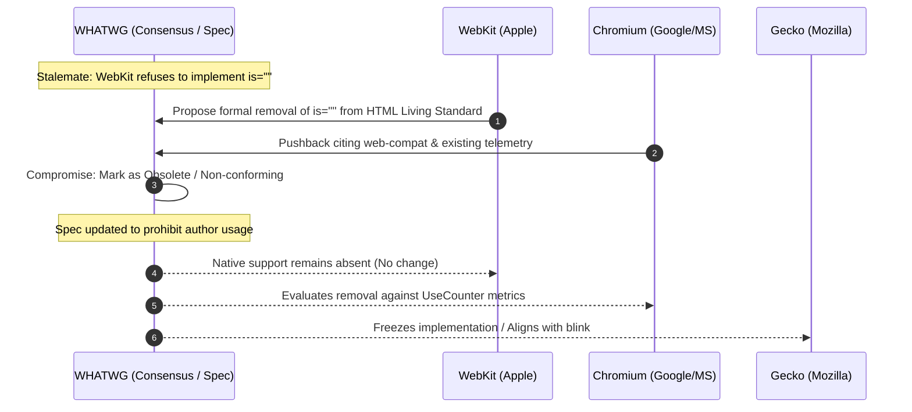
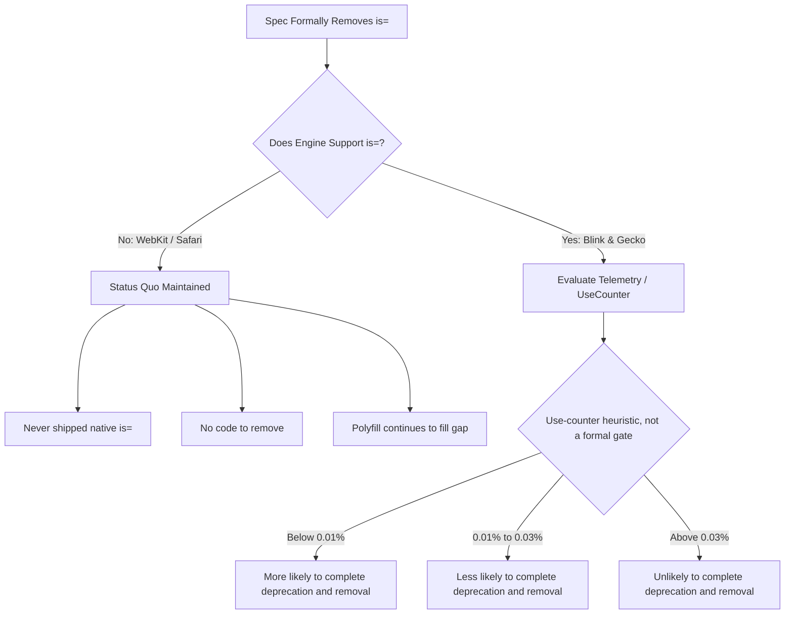
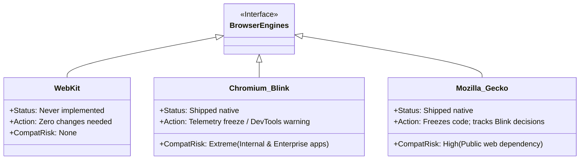
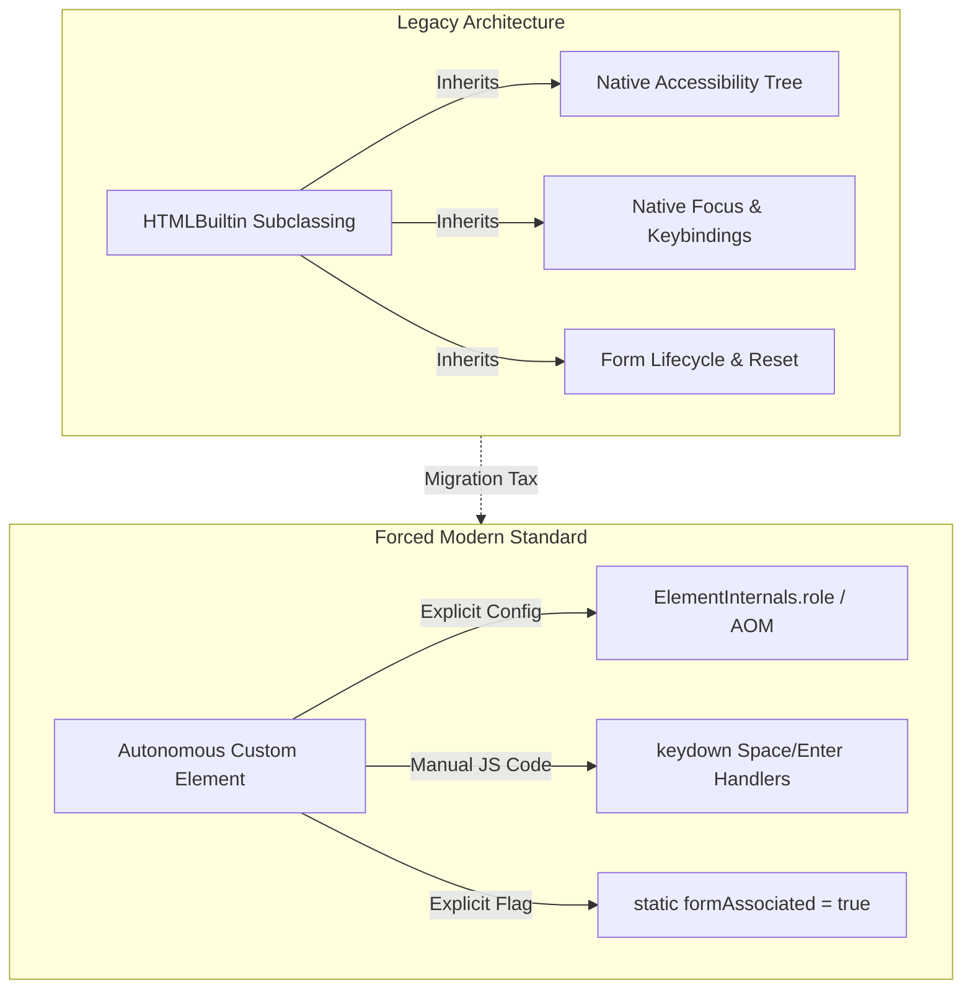

One of the most interesting debates in modern web development revolves around the use of **Customized Built-In Elements**, their limitations, and their place in the HTML standard.

This post provides an analysis of the architectural controversy surrounding **Customized Built-In Elements** (`<button is="my-button">`), the technical reasons behind proposals to deprecate them from the WHATWG HTML standard (and remove current browser implementations), a replacement in progress at WHATWG, and a practical technical blueprint for implementing them reliably in production environments despite cross-browser support gaps.

## The specification dilemma and browser non-consensus

The Custom Elements specification began at the W3C and was later incorporated into the WHATWG HTML Living Standard.

**WebKit (Apple Safari)** declined to implement customized built-in elements. That decision prompted ongoing discussion within the WHATWG HTML Working Group about deprecating the feature or removing it from the standard. The discussions continue, but customized built-in elements remain in the HTML Living Standard and are implemented by Chromium and Firefox.

Under the [WHATWG Working Mode](https://whatwg.org/working-mode), additions generally require support from at least two implementers, while avoiding strong objections is a recommendation. Chromium and Gecko's implementations meet the two-implementer condition, even though WebKit objects to the feature.


## Core architectural and technical objections

These are concerns Apple has raised about the `is=""` specification, not established flaws in the feature. Blink and Gecko implemented it. The public discussions show WebKit engineers outlining objections and pointing to alternatives, but provide no clear evidence that WebKit co-developed a replacement API with other vendors ([WebKit's position](https://github.com/WebKit/standards-positions/issues/97); [Platform-Provided Behaviors discussion](https://github.com/whatwg/html/issues/12150)).

| Objection Category | Technical Mechanism | Impact on the Platform |
| :--- | :--- | :--- |
| **Engine Fragility** | WebKit's concern was that element identity is both object-based and name/namespace-based. Niwa noted that user-agent code checks `localName`, so supporting an extended interface while retaining the native local name would require updating those checks ([original WebKit bug](https://www.w3.org/Bugs/Public/show_bug.cgi?id=28547); [WICG issue 133](https://github.com/WICG/webcomponents/issues/133); [Niwa's WICG comment](https://github.com/WICG/webcomponents/issues/509#issuecomment-222860736)). | WebKit described changing these implementation assumptions as difficult and opposed built-in subclassing for v1 ([WebKit's position](https://github.com/WebKit/standards-positions/issues/97); [2016 feedback](https://lists.w3.org/Archives/Public/public-webapps/2016JanMar/0059.html)). |
| **Encapsulation Violations** | For built-in elements that use user-agent shadow trees, page scripts cannot directly inspect or mutate those browser-owned trees through ordinary DOM APIs. WebKit cites limited shadow-tree access as a drawback of customized built-ins ([WebKit's position](https://github.com/WebKit/standards-positions/issues/97)). | As a broader architectural concern, Eisenberg argues that extending built-ins could constrain safe evolution of native behavior and standards, which he frames as an Open-Closed Principle concern ([Eisenberg's analysis](https://eisenbergeffect.medium.com/debunking-web-component-myths-and-misconceptions-ea9bb13daf61)). Customized built-ins can strain the behavioral contract associated with a native element's local name: the element keeps that name, while custom code can alter or extend its behavior. |
| **Shadow DOM Conflict** | Built-in elements such as `<video>` have user-agent shadow trees, and don't allow an author to attach author shadow roots. | The DOM Standard allows only a limited set of shadow hosts and throws a `NotSupportedError` exception for elements not in the allow list, except that a same-mode declarative shadow root can be reused ([DOM Standard](https://dom.spec.whatwg.org/#concept-attach-a-shadow-root)). |
| ^ | ^ | WebKit, Chromium, and Gecko reject unsupported `attachShadow()` calls with `NotSupportedError`. |
| ^ | ^ | WebKit cited shadow tree access as an objection to customized built-ins and documented the difficulty of supporting multiple shadow subtrees ([bug 77935](https://bugs.webkit.org/show_bug.cgi?id=77935); [standards position](https://github.com/WebKit/standards-positions/issues/97)). |
| **Flawed Design Syntax** | WebKit criticized the `is` syntax as an awkward compromise that prioritized implementers over web authors ([standards position](https://github.com/WebKit/standards-positions/issues/97)). | A central motivation for customized built-ins was to inherit the accessibility behavior of a native element while adding functionality. |
| ^ | WebKit argued that a customized element may have different semantics from its base, so its accessibility tree may still need customization; because customized built-ins cannot use `ElementInternals`, that customization would have to use the public ARIA API ([WebKit's position](https://github.com/WebKit/standards-positions/issues/97)). | ^ |
| ^ | Inheriting native semantics can reduce author work, but may not fit components whose semantics differ from the built-in element. | ^ |

## Emerging proposals for custom element behaviors

The Microsoft proposal for `elementInternals.type` ([issue 11061](https://github.com/whatwg/html/issues/11061)) was an early attempt to let autonomous custom elements opt into native behavior through `ElementInternals`. WHATWG later closed that proposal as “not planned.” The broader problem is now being explored through a distinct [Platform-Provided Behaviors proposal](https://github.com/whatwg/html/issues/12150), which has a different API shape and remains at [Stage 1 (Incubation)](https://whatwg.org/stages). Its proposed API declares behaviors on the custom element class rather than assigning a single `type` value. The following example illustrates that proposal; it is not a currently available browser API:

```javascript
class CustomButton extends HTMLElement {
  static formAssociated = true;
  static behaviors = [HTMLButtonBehavior];

  #internals;

  constructor() {
    super();
    this.#internals = this.attachInternals();
    this.#internals.behaviors.button.type = "button";
  }
}
customElements.define("custom-button", CustomButton);
```

## Production-ready implementation guide (polyfilled)

Safari’s lack of native support adds a compatibility cost: developers targeting Safari need a polyfill or an alternative. That cost may discourage adoption, and WebKit’s nonimplementation is part of the ongoing debate about the feature’s future in the standard.

### Complete HTML and JavaScript blueprint

The example registers a test customized built-in and verifies that `document.createElement()` upgrades a button to its registered class. If the check fails, it loads the `@ungap/custom-elements` polyfill and waits for its load event before registering `BigClicker`; if loading fails, registration does not proceed. `BigClicker` extends `HTMLButtonElement`, initializes `aria-pressed` when connected, toggles it when clicked, and removes its click listener when disconnected. The final `<button is="big-clicker">` markup opts into this behavior while retaining the native button element.

The example loads the pinned polyfill from unpkg and assumes that the CDN is reachable and trusted. Not all CDNs provide integrity information for every script; see the [Subresource Integrity guide](/subresource-integrity-guide/) for more information. Self-host the pinned version instead if your deployment requires a different delivery policy.

This example uses top-level `await` in a module and private class methods. The minimum browser versions for these language features are Chrome 89, Firefox 90, and Safari 15.0 ([top-level `await`](https://developer.mozilla.org/en-US/docs/Web/JavaScript/Reference/Operators/await#browser_compatibility); [private class methods](https://developer.mozilla.org/en-US/docs/Web/JavaScript/Reference/Classes/Private_elements#browser_compatibility)). Use current browser versions for current security updates.

```html
<!DOCTYPE html>
<html lang="en">
<head>
  <meta charset="UTF-8">
  <title>Customized Built-In Elements with Polyfill</title>

  <script>
    // 1. Precise feature detection for native 'is' support.
    const supportsCustomizedBuiltIns = (function() {
      try {
        const testName = 'customized-built-in-feature-test';
        class TestButton extends HTMLButtonElement {}
        customElements.define(testName, TestButton, { extends: 'button' });
        const button = document.createElement('button', { is: testName });
        return button instanceof TestButton;
      } catch (e) {
        return false;
      }
    })();

    // 2. Conditionally inject the ultra-lightweight @ungap/custom-elements polyfill for Safari
    window.customizedBuiltInsReady = supportsCustomizedBuiltIns
      ? Promise.resolve()
      : new Promise((resolve, reject) => {
      const script = document.createElement('script');
      script.src = 'https://unpkg.com/@ungap/custom-elements@1.3.0/es.js';
      script.addEventListener('load', resolve, { once: true });
      script.addEventListener('error', () => reject(new Error('Failed to load the customized built-in polyfill.')), { once: true });
      document.head.appendChild(script);
    });
  </script>

  <script type="module">
    await window.customizedBuiltInsReady;

    // 3. Register the customized built-in element extending the native HTMLButtonElement
    class BigClicker extends HTMLButtonElement {
      constructor() {
        // Always execute super() first within custom element constructors
        super();
      }

      connectedCallback() {
        if (!this.hasAttribute('aria-pressed')) {
          this.setAttribute('aria-pressed', 'false');
        }

        this.addEventListener('click', this.#togglePressed);
      }

      disconnectedCallback() {
        this.removeEventListener('click', this.#togglePressed);
      }

      // Private class method managing local state mutations
      #togglePressed() {
        const isPressed = this.getAttribute('aria-pressed') === 'true';
        this.setAttribute('aria-pressed', isPressed ? 'false' : 'true');
      }
    }

    // Bind the class wrapper directly to the native button definition
    customElements.define('big-clicker', BigClicker, { extends: 'button' });
  </script>
</head>
<body>

  <!-- Declarative markup utilization -->
  <button is="big-clicker">Click Me</button>

</body>
</html>
```

## Deployment guardrails for WebKit polyfills

When deploying this architecture to Safari, developers should account for two constraints:

1. **Global Namespace Styling:** Because the Safari polyfill does not provide an author shadow root for customized built-ins, style the customized-built-in host and its light-DOM content with global selectors (e.g., `button[is="big-clicker"]`) in a global stylesheet.
2. **Mutation Observer Ordering:** Install the polyfill's `MutationObserver` before the DOM mutations it must observe. `requestAnimationFrame()` and `DOMContentLoaded` are not general substitutes for that ordering requirement.

### Web-process watchdog termination

Calling `attachShadow()` on an ineligible host can throw a `NotSupportedError`; the exception alone does not terminate the browser. If an uncaught-error handler or framework recovery path responds by synchronously remounting the component or reparsing the same DOM, it can create a non-yielding error loop. Safari's watchdog may then terminate the WebContent process. Similar loops can make Chromium or Firefox unresponsive or lead to process termination, but that is a downstream effect of the recovery loop, not a normal result of the rejected shadow-root attachment.

## The removal process and impact of excising customized built-ins


Removing customized built-ins (is="...", extending concrete HTML elements) from the WHATWG HTML Living Standard would represent a formal capitulation to the multi-engine impasse. However, modifying specification text does not automatically translate to code removal across shipping browsers.

The process, architectural fallout, and engine-level responses follow distinct tracks between standards bodies and browser vendors.

### Specification de-standardization process

The WHATWG works with browser engine representatives to resolve standards issues. The diagram shows one possible sequence for removing a feature from the standard:



* **Status of the discussion**: WebKit's `WONTFIX` position prompted discussion about deprecating or removing customized built-ins; it did not itself deprecate the feature. The discussion is ongoing, and customized built-ins remain in the WHATWG HTML Living Standard.
* **Parser & IDL Adjustments**: The HTML parser specifications for handling the is attribute during tree construction, along with the ElementCreationOptions dictionary (customElements.define('x-btn', XBtn, { extends: 'button' })), are either excised or moved to a legacy annex defining fallback behavior.
* **Specifying Graceful Fallback**: The living standard must specify that conformant user agents treat un-upgraded or unsupported is="" elements strictly as their base element (e.g., render `<button is="...">` as standard HTMLButtonElement and ignore is).

These steps are illustrative, not a prescribed checklist. The [WHATWG FAQ](https://whatwg.org/faq#is-there-a-process-for-removing-bad-ideas-from-a-standard) describes removals as typically requiring coordination among implementations and telemetry to estimate web impact, followed by updating the standard once implementers agree to remove the feature. The [Working Mode's removal criteria](https://whatwg.org/working-mode#removals) require that a feature be either not widely implemented or already being removed from implementations, and that tests for unsupported behavior be added and existing tests adjusted or removed as appropriate. Deprecation tracking and [anchor preservation](https://whatwg.org/working-mode#anchor-permanence) can be useful, but are not universal requirements; changing the standard also does not itself remove code from browsers.

### Browser implementation response matrix

Browser engines do not pull functional code based on spec deletions alone. Their responses diverge based on existing technical architecture:





### Why Chromium and Gecko might retain the code

* **Use-counter heuristic**: Chromium’s UseCounter can track the runtime occurrence of `kCustomElementIsAttribute`. As a rough heuristic, usage below 0.01% makes deprecation and removal more likely to complete; usage from 0.01% through 0.03% makes completion less likely; and usage above 0.03% makes it unlikely. These ranges are not formal gates or guarantees, and removal still depends on compatibility and policy considerations.
* **Web-compatibility considerations**: Mozilla's staged `InstallTrigger` deprecation included telemetry and consideration of potential compatibility effects ([Bug 1754441](https://bugzilla.mozilla.org/show_bug.cgi?id=1754441)). This illustrates why removing an API can require measuring risk; it does not mean Gecko cannot remove a feature that Chromium supports.
* **Compatibility and code longevity**: The W3C's HTML design principles say changes should account for existing content's expectations (["Support Existing Content"](https://www.w3.org/TR/html-design-principles/#support-existing-content)). That can make removal costly and prolong support, but it does not guarantee that code will remain indefinitely.
* **WebKit's implementation decision**: WebKit marked its implementation of customized built-ins `RESOLVED WONTFIX` ([Bug 182671](https://bugs.webkit.org/show_bug.cgi?id=182671)). This documents WebKit's decision not to implement the feature; it does not establish how Blink or Gecko will handle future edge-case bugs.

### Impact on web architecture and developers

The removal debate underscores a persistent structural fork: WebKit has declined to implement customized built-ins, while Chromium and Gecko support them.



### The Real-World Developer Impact

| Vector | Immediate Impact | Long-Term Impact |
| --- | --- | --- |
| Existing Blink/Gecko Code | None. Code continues to execute on current browser engines without breaking. | Some edge-case fixes may be delayed or declined, but that is an engine-specific possibility, not a predictable `WONTFIX` outcome. WebKit's [WONTFIX decision](https://bugs.webkit.org/show_bug.cgi?id=182671) concerns implementing customized built-ins, not future Blink or Gecko bug fixes. |
| Cross-Browser Deployments | Ongoing polyfill requirement. Safari remains incapable of running these components natively. | Permanent reliance on runtime monkey-patching libraries (@ungap/custom-elements). |
| Table & form components | `<tr>` and `<option>` can be enhanced with JavaScript while retaining native semantics, but cannot host author shadow roots; styling those elements uses light-DOM CSS. | Developers choose between native table/select behavior with light-DOM styling and encapsulated wrappers or replacement controls, which may add accessibility, keyboard, and form-integration work. |
| Application Migration | High refactoring cost. Classes must be rewritten from `extends HTMLButtonElement` to `extends HTMLElement`. | Increased boilerplate: manual keyboard navigation, focus indicators, and ElementInternals plumbing must be added to every control. |

### The end result

If customized built-ins are excised from the standard:

* The specification becomes cleaner, eliminating an architectural pattern that WebKit considered an unworkable violation of object encapsulation.
* Engines are unlikely to remove a working feature implemented in other browsers, even if support is incomplete. If the feature leaves active development, shipped implementations may remain effectively frozen to preserve behavior that existing content depends on.
* The ecosystem burden increases, permanently shifting the cost of accessibility and focus maintenance onto developers via manual ElementInternals plumbing.
