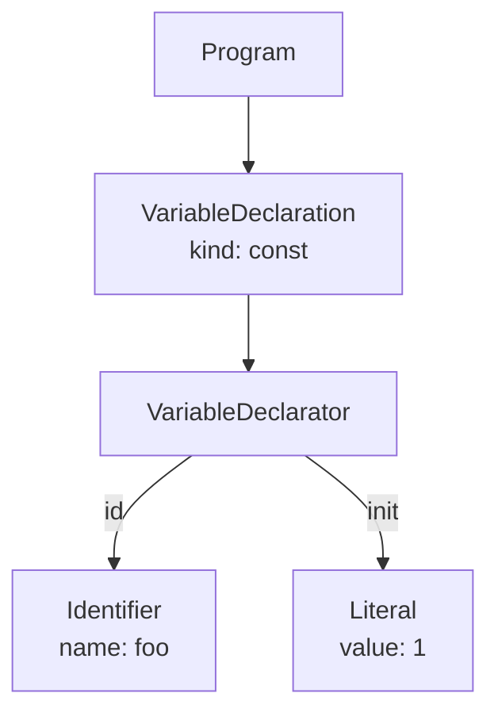

When standard ESLint rules don't cover your team's specific conventions or domain logic, you can build custom rules.

This post will walk through creating a custom ESLint rule, wrapping it in a plugin, and publishing it to npm or GitHub so it can be shared across projects.

## Objectives

By the end of this tutorial, you will be able to:

* Understand the anatomy of a custom ESLint rule and interact with the Abstract Syntax Tree (AST).
* Write a custom ESLint rule with built-in auto-fix capabilities.
* Write an alternative rule that provides warnings and optional IDE suggestions.
* Bundle one or more custom rules into a structured ESLint plugin using ESM.
* Test your plugin locally and publish it for broader use via npm, GitHub Packages, or a direct Git repository.

## Prerequisites

* Basic understanding of JavaScript and Node.js.
* Familiarity with ESLint configurations.
* Node.js and npm installed on your machine.

## Step 1: Understanding custom rules

According to the [ESLint Custom Rules documentation](https://eslint.org/docs/latest/extend/custom-rules), an ESLint rule is an object containing two main properties: `meta` and `create`.

* **`meta`**: Contains metadata about the rule (name, description, category, fixable status, and schema for options).
* **`create`**: A function that returns an object with methods that ESLint calls when it traverses the Abstract Syntax Tree (AST) of the JavaScript code.

### The AST (Abstract Syntax Tree)

ESLint parses your code with a parser such as Espree and turns it into an Abstract Syntax Tree (AST), a nested structure of syntax nodes. Each node represents a language construct, and child nodes represent the constructs it contains. This simplified AST shows the structure of `const foo = 1;`:



ESLint rules inspect these nodes rather than searching the source text. In the rule below, the `VariableDeclarator` listener runs when ESLint visits a variable declarator, and `node.id` refers to the declared name. Use [AST Explorer](https://astexplorer.net/) with the parser set to `espree` to inspect the actual nodes and properties for different code.

### Writing our first rule

Let's build a rule called `no-foo-vars` that forbids declaring variables named exactly `foo`.

Create a new folder and initialize an npm project:

```bash
mkdir eslint-plugin-custom-tutorial
cd eslint-plugin-custom-tutorial
npm init -y
npm install --save-dev eslint vitest
```

<custom-admonition type="warning">
  <p>This guide uses <code>.js</code> files with ECMAScript Modules (ESM), so add <code>"type": "module"</code> to your generated <code>package.json</code> to have Node.js treat those files as modules. Alternatively, Node.js treats <code>.mjs</code> files as ESM without this setting.</p>
</custom-admonition>

Create a folder for your rules (`lib/rules`) and a file named `no-foo-vars.js`:

<custom-admonition type="note" title="Note on File Structure">
	<p>Because an ESLint plugin simply exports a JavaScript object, you <strong>could</strong> technically define multiple rules in a single file and assign them all to the <code>rules</code> property in your <code>index.js</code>. However, the standard convention is to keep each rule in its own dedicated file (e.g., <code>lib/rules/rule-a.js</code>). This keeps your codebase organized and makes writing and maintaining tests for individual rules much easier.</p>
</custom-admonition>

The two `foo` rules below rename identifiers, so create a shared helper at `lib/utils/create-safe-rename-fix.js`. It uses ESLint's scope analysis to update the declaration and references for the same variable. It preserves shorthand object property keys and local export names. It withholds the fix if the replacement name is declared in an ancestor, the same scope, or a nested scope; if an unresolved reference with that name occurs in the affected scope tree; if a direct `eval()` call occurs in that tree; or if the declaration itself is exported. In those cases, the rule still reports the `foo` violation but offers no fix. Other references encoded in strings or generated dynamically cannot be updated automatically, so review those cases manually.

```javascript
// lib/utils/create-safe-rename-fix.js

export default function createSafeRenameFix(context, node, newName) {
  if (node.id.type !== "Identifier") {
    return null;
  }

  let scope = context.sourceCode.getScope(node);
  while (scope && !scope.set.has(node.id.name)) {
    scope = scope.upper;
  }

  const variable = scope?.set.get(node.id.name);
  if (
    !variable ||
    !variable.identifiers.includes(node.id) ||
    variable.identifiers[0] !== node.id
  ) {
    return null;
  }

  function isExported(identifier) {
    let current = identifier;
    while (current) {
      if (
        current.type === "ExportNamedDeclaration" ||
        current.type === "ExportDefaultDeclaration"
      ) {
        return true;
      }
      current = current.parent;
    }
    return false;
  }

  if (variable.identifiers.some(isExported)) {
    return null;
  }

  function hasNameInScopeTree(currentScope) {
    return (
      currentScope.set.has(newName) ||
      currentScope.references.some(
        (reference) =>
          reference.identifier.name === newName && !reference.resolved
      ) ||
      currentScope.childScopes.some(hasNameInScopeTree)
    );
  }

  function hasNameInAncestorScopes(currentScope) {
    let ancestor = currentScope.upper;
    while (ancestor) {
      if (ancestor.set.has(newName)) {
        return true;
      }
      ancestor = ancestor.upper;
    }
    return false;
  }

  function hasDirectEvalInScopeTree(currentScope) {
    return (
      currentScope.references.some((reference) => {
        const identifier = reference.identifier;
        const parent = identifier.parent;
        return (
          identifier.name === "eval" &&
          parent.type === "CallExpression" &&
          parent.callee === identifier
        );
      }) ||
      currentScope.childScopes.some(hasDirectEvalInScopeTree)
    );
  }

  if (
    hasNameInAncestorScopes(variable.scope) ||
    hasNameInScopeTree(variable.scope) ||
    hasDirectEvalInScopeTree(variable.scope)
  ) {
    return null;
  }

  const identifiers = new Set([
    ...variable.identifiers,
    ...variable.references.map((reference) => reference.identifier),
  ]);

  return (fixer) =>
    [...identifiers].map((identifier) => {
      const parent = identifier.parent;
      if (
        parent.type === "ExportSpecifier" &&
        parent.local === identifier &&
        parent.exported.name === identifier.name
      ) {
        return fixer.replaceText(
          identifier,
          `${newName} as ${identifier.name}`
        );
      }
      if (
        parent.type === "Property" &&
        parent.shorthand &&
        parent.value === identifier
      ) {
        return fixer.replaceText(identifier, `${identifier.name}: ${newName}`);
      }
      return fixer.replaceText(identifier, newName);
    });
}
```

```javascript
// lib/rules/no-foo-vars.js
import createSafeRenameFix from "../utils/create-safe-rename-fix.js";

export default {
  meta: {
    type: "suggestion",
    docs: {
      description: "disallow variable declarations named 'foo'",
      category: "Stylistic Issues",
      recommended: false,
    },
    fixable: "code", // Set to "code" if the rule can auto-fix the issue
    schema: [], // No options for this rule
    messages: {
      avoidFoo: "Variables should not be named 'foo'. Please use a more descriptive name."
    }
  },
  create: function (context) {
    return {
      // This is an AST node selector. It targets VariableDeclarator nodes.
      VariableDeclarator(node) {
        if (node.id.type === "Identifier" && node.id.name === "foo") {
          const fix = createSafeRenameFix(context, node, "bar");
          context.report({
            node,
            messageId: "avoidFoo",
            ...(fix && { fix }),
          });
        }
      },
    };
  },
};
```

### Testing the rule

ESLint provides a `RuleTester` utility. Create a test file `tests/lib/rules/no-foo-vars.test.js`:

```javascript
// tests/lib/rules/no-foo-vars.test.js
import { RuleTester } from "eslint";
import { describe, it } from "vitest";
import rule from "../../../lib/rules/no-foo-vars.js";

RuleTester.describe = describe;
RuleTester.it = it;
RuleTester.itOnly = it.only;

const ruleTester = new RuleTester({
  languageOptions: { ecmaVersion: 2020 }
});

ruleTester.run("no-foo-vars", rule, {
  valid: [
    "let bar = 1;",
    "const myFoo = 2;",
  ],
  invalid: [
    {
      code: "let foo = 1; console.log(foo); const obj = { foo };",
      errors: [{ messageId: "avoidFoo" }],
      output: "let bar = 1; console.log(bar); const obj = { foo: bar };",
    },
    {
      code: "const bar = 0; function update() { let foo = 1; return bar; }",
      errors: [{ messageId: "avoidFoo" }],
      output: null,
    },
    {
      code: "function update() { let foo = 1; return bar; }",
      errors: [{ messageId: "avoidFoo" }],
      output: null,
    },
    {
      code: 'function update() { let foo = 1; return eval("bar"); }',
      errors: [{ messageId: "avoidFoo" }],
      output: null,
    },
  ],
});
```

Run the test from the project root with Vitest:

```bash
npx vitest run tests/lib/rules/no-foo-vars.test.js
```

### Providing warnings and optional suggestions

Sometimes, you don't want ESLint to automatically fix code (which happens when users run `eslint --fix`), nor do you want to fail their CI/CD pipelines with hard errors. Instead, you might want to warn the developer and offer optional fixes they can apply manually in their IDE (like VS Code).

To do this, we use two different concepts:

1. **The Suggestions API:** Instead of `fixable: "code"` and the `fix()` method, we use `hasSuggestions: true` and the `suggest` array.
2. **Configuration Severity:** We configure the rule in our ESLint config as `"warn"` instead of `"error"`.

Here is an alternative version of our rule, saved as `lib/rules/warn-foo-vars.js`, that provides multiple optional suggestions instead of a forced auto-fix:

```javascript
// lib/rules/warn-foo-vars.js
import createSafeRenameFix from "../utils/create-safe-rename-fix.js";

export default {
  meta: {
    type: "suggestion",
    docs: {
      description: "warn about variables named 'foo' and suggest alternatives",
      category: "Stylistic Issues",
      recommended: false,
    },
    hasSuggestions: true, // Required to use the Suggestions API
    schema: [],
    messages: {
      avoidFoo: "Variables named 'foo' are discouraged.",
      renameToBar: "Rename variable to 'bar'",
      renameToBaz: "Rename variable to 'baz'"
    }
  },
  create: function (context) {
    return {
      VariableDeclarator(node) {
        if (node.id.type === "Identifier" && node.id.name === "foo") {
          const suggestions = [
            {
              messageId: "renameToBar",
              fix: createSafeRenameFix(context, node, "bar"),
            },
            {
              messageId: "renameToBaz",
              fix: createSafeRenameFix(context, node, "baz"),
            },
          ].filter((suggestion) => suggestion.fix);

          context.report({
            node,
            messageId: "avoidFoo",
            ...(suggestions.length > 0 && { suggest: suggestions }),
          });
        }
      },
    };
  },
};
```

## Step 2: Creating an ESLint plugin

A custom rule needs a vehicle to be distributed. That vehicle is an ESLint plugin. According to the [ESLint Plugins documentation](https://eslint.org/docs/latest/extend/plugins), a plugin is an npm module that exports an object containing rules, configurations, and processors.

<custom-admonition type="note" title="Multi-Language Support">
	<p>ESLint primarily targets JavaScript and TypeScript. To handle files like Markdown, ESLint uses 'Processors' to extract and lint the embedded JavaScript. For entirely different languages like CSS, it is highly recommended to use dedicated tools like Stylelint instead. However, you can absolutely package rules, configurations, and processors for multiple languages within a single plugin, as long as the end-user configures the correct parser for each file extension.</p>
</custom-admonition>

### Plugin naming conventions

An ESLint plugin must have a specific naming format to be resolved by ESLint:

* Unscoped: `eslint-plugin-<plugin-name>`
* Scoped: `@<scope>/eslint-plugin-<plugin-name>` or `@<scope>/eslint-plugin`

Let's name our project `eslint-plugin-custom-tutorial`. Ensure your `package.json` reflects this name.

### Structuring the plugin

Create an `index.js` file in the root of your project. This is the entry point for your plugin. Note how we import both our strict rule and our warning rule using ESM syntax.

```javascript
// index.js
import noFooVarsRule from "./lib/rules/no-foo-vars.js";
import warnFooVarsRule from "./lib/rules/warn-foo-vars.js";

const plugin = {
  // Export your custom rules
  rules: {
    "no-foo-vars": noFooVarsRule,
    "warn-foo-vars": warnFooVarsRule,
  },
  configs: {},
};

// Add the config after creating the plugin so it can include this plugin object.
Object.assign(plugin.configs, {
  recommended: [
    {
      plugins: {
        "custom-tutorial": plugin,
      },
      rules: {
        "custom-tutorial/no-foo-vars": "error",
        "custom-tutorial/warn-foo-vars": "warn",
      },
    },
  ],
});

export default plugin;
```

The `recommended` config is a flat-config array. A consumer can enable it by spreading that array into `eslint.config.js`:

```javascript
import customTutorial from "eslint-plugin-custom-tutorial";

export default [
  ...customTutorial.configs.recommended,
];
```

## Step 3: Using your plugin locally

Before publishing, you should test your plugin in a local consumer project.

1. In a separate test project directory, initialize an npm project and install ESLint:

   ```bash
   npm init -y
   npm install --save-dev eslint
   ```

2. In your plugin directory (`eslint-plugin-custom-tutorial`), run:

   ```bash
   npm link
   ```

3. In the test project directory, run:

   ```bash
   npm link eslint-plugin-custom-tutorial
   ```

4. Configure ESLint in your test project to use the plugin:

**For Flat Config (`eslint.config.js` - ESLint v9+):**

```javascript
import customTutorial from "eslint-plugin-custom-tutorial";

export default [
    {
        plugins: {
            "custom-tutorial": customTutorial
        },
        rules: {
            "custom-tutorial/no-foo-vars": "error",
            "custom-tutorial/warn-foo-vars": "warn"
        }
    }
];
```

## Step 4: Publishing your plugin

Once your rules are tested and working locally, you can share them.

### Publishing to npm

1. Ensure your `package.json` has the correct `name`, `version`, `main` (pointing to `index.js`), and `description`.
2. Log in to npm from your terminal: `npm login`.
3. Publish the package: `npm publish` (use `npm publish --access public` if it's a scoped package).

### Publishing to GitHub Packages

To publish to the GitHub Package Registry instead of npm:

1. Set the package name in `package.json` to use your GitHub username or organization as its scope:

   ```json
   "name": "@OWNER/eslint-plugin-custom-tutorial"
   ```

   Replace `OWNER` with the lowercase name of the personal account or organization that will own the package. GitHub Packages uses this required scope to route the package to that account.

2. Add a `publishConfig` entry to `package.json` so npm publishes to GitHub Packages:

   ```json
   "publishConfig": {
     "registry": "https://npm.pkg.github.com"
   }
   ```

3. Create a [personal access token (classic)](https://docs.github.com/en/packages/working-with-a-github-packages-registry/working-with-the-npm-registry#authenticating-to-github-packages) on GitHub with the `write:packages` permission. If you also need to install private packages, grant `read:packages` too.

4. Add the token to your per-user `~/.npmrc` file (create the file if needed):

   ```ini
   //npm.pkg.github.com/:_authToken=YOUR_GITHUB_TOKEN
   ```

   Replace `YOUR_GITHUB_TOKEN` with the token you created. Keep this in your per-user npm configuration, not the project repository, so you don't publish the token.

5. Run `npm publish`.

### Distributing via GitHub Repository

If you don't want to publish to a registry, you can host the plugin on GitHub and install it directly via Git:

```bash
npm install github:yourusername/eslint-plugin-custom-tutorial
```

<custom-admonition type="note">
	<p>For this to work seamlessly, ensure your code doesn't require complex build steps before execution, or utilize a <code>prepare</code> script in <code>package.json</code>.</p>
</custom-admonition>

## Appendix: Additional rule examples

ESLint already includes rules for both of these checks: [`no-var`](https://eslint.org/docs/latest/rules/no-var) and [`no-redeclare`](https://eslint.org/docs/latest/rules/no-redeclare). The custom implementations below are illustrative examples of how rules can inspect declarations and report problems. For projects that only need these checks, prefer ESLint's built-in rules.

### Disallowing `var`

Create `lib/rules/no-var.js`:

```javascript
export default {
  meta: {
    type: "problem",
    docs: {
      description: "disallow var declarations",
    },
    schema: [],
    messages: {
      unexpectedVar: "Use let or const instead of var.",
    },
  },
  create(context) {
    return {
      VariableDeclaration(node) {
        if (node.kind === "var") {
          context.report({
            node,
            messageId: "unexpectedVar",
          });
        }
      },
    };
  },
};
```

The `VariableDeclaration` listener runs for declarations in any position, including `for` loop initializers. Checking `node.kind` lets the rule ignore `let` and `const`.

### Disallowing duplicate variable names in the same scope

Create `lib/rules/no-duplicate-names.js`:

```javascript
export default {
  meta: {
    type: "problem",
    docs: {
      description: "disallow duplicate variable declarations in the same scope",
    },
    schema: [],
    messages: {
      duplicate: "'{{name}}' is declared more than once in this scope.",
    },
  },
  create(context) {
    return {
      "Program:exit"() {
        const scopes = context.getSourceCode().scopeManager.scopes;

        for (const scope of scopes) {
          for (const variable of scope.variables) {
            const declarations = variable.defs.filter(
              (definition) => definition.type === "Variable"
            );

            for (const duplicate of declarations.slice(1)) {
              context.report({
                node: duplicate.name,
                messageId: "duplicate",
                data: { name: variable.name },
              });
            }
          }
        }
      },
    };
  },
};
```

This rule reports repeated variable declarations that ESLint's scope analysis associates with the same variable. A declaration in a nested scope is a different variable, so reusing a name there is allowed. For example, the second `count` declaration below is reported, but the inner `count` is not:

```javascript
function update() {
  var count = 0;
  var count = 1; // Reported: duplicate in the same scope.

  {
    let count = 2; // Allowed: declared in a nested scope.
  }
}
```

To expose either rule from the plugin, add these imports to `index.js`:

```javascript
import noVarRule from "./lib/rules/no-var.js";
import noDuplicateNamesRule from "./lib/rules/no-duplicate-names.js";
```

After the existing `const plugin = { ... }` declaration in `index.js`, add these assignments before `export default plugin`:

```javascript
plugin.rules["no-var"] = noVarRule;
plugin.rules["no-duplicate-names"] = noDuplicateNamesRule;
```

Then add these entries to the `rules` object in the consumer project's ESLint configuration:

```javascript
rules: {
  "custom-tutorial/no-var": "error",
  "custom-tutorial/no-duplicate-names": "error",
}
```
