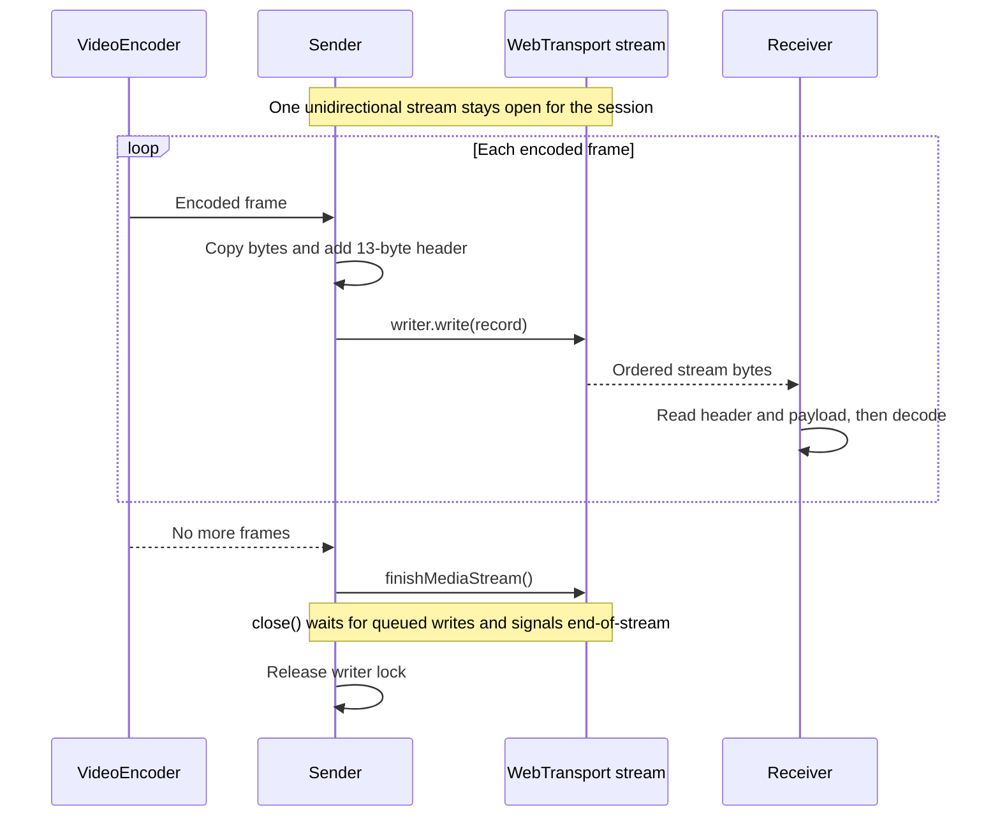

WebTransport is a modern web API that provides low-latency, bidirectional, client-server messaging. Built primarily on top of HTTP/3 and utilizing the QUIC protocol, it offers a significant leap forward in how web applications handle real-time communication.

This guide covers what WebTransport is, how it works, how it compares to older protocols, specific use cases, browser compatibility, and how to set up the server-side infrastructure.

## Core concepts: What is WebTransport?

At its core, WebTransport allows web applications to establish a single, secure connection to a server and multiplex multiple streams of data over it. It explicitly supports both reliable, ordered data delivery and unreliable, unordered data delivery within the same connection interface.

### How data moves: Streams and datagrams

WebTransport relies on the robust feature set of the QUIC protocol to manage data flow. Once connected, the API exposes two primary modes of data transfer:

* **Streams (Reliable Transport):** Applications can open individual data streams. These streams are reliable and guarantee the ordered delivery of bytes. Streams can be unidirectional (client-to-server or server-to-client) or bidirectional. Because QUIC multiplexes these streams, packet loss on one stream does not block data delivery on other active streams.

* **Datagrams (Unreliable Transport):** For latency-sensitive applications where recent data is more critical than perfect delivery, WebTransport provides datagrams. The browser sends datagrams as discrete packets of data without delivery guarantees or strict ordering requirements.

## Comparing protocols: WebTransport vs. TCP and UDP

WebTransport combines the structural strengths of traditional protocols while eliminating several historical limitations associated with standard web environments.

### The problem with TCP

TCP (Transmission Control Protocol) guarantees reliable, ordered delivery. However, it suffers from "head-of-line blocking." If a network drops a single packet, TCP forces all subsequent data to wait until it successfully retransmits the lost packet.

**The WebTransport Advantage:** Each WebTransport stream is a separate, ordered byte sequence within the same QUIC connection. If data is missing from one stream, later data on that stream waits for retransmission, but data on a separate stream, such as chat alongside video, can be delivered without waiting. A lost packet can carry data for multiple streams, and all streams share connection capacity and congestion control, so they are not completely isolated.

### The problem with UDP in the browser

UDP (User Datagram Protocol) provides fast, unreliable, and unordered data transfer, entirely avoiding head-of-line blocking. Historically, web browsers do not expose raw UDP access to developers due to security and network abuse concerns.

**The WebTransport Advantage:** WebTransport datagrams expose UDP-like performance directly to the browser while maintaining the mandatory security, congestion control, and TLS 1.3 encryption guarantees of QUIC.

## WebTransport vs. WebSockets: A deep dive

Developers often wonder if WebTransport is just a replacement for WebSockets. While they both provide persistent, bidirectional, client-server communication, they are built on fundamentally different network foundations.

### The foundation: TCP vs. QUIC

The most significant difference is the underlying transport protocol.

* **WebSockets run on TCP.** This means WebSockets inherit TCP's reliability, but also its primary flaw: **Head-of-Line (HOL) Blocking**. If a single packet is dropped on an unstable network (like a user switching from Wi-Fi to 5G), the entire WebSocket stream halts until that packet is successfully retransmitted.
* **WebTransport runs on QUIC (over UDP).** Unlike a WebSocket's single ordered byte stream, QUIC carries separate ordered streams within the same connection. For example, if a packet carrying video-stream data is lost, chat-stream data received in other packets can be delivered without waiting for the video data's retransmission. If the lost packet also carried chat data, that data must be retransmitted too. Shared congestion and connection-level flow control can still limit progress across the connection.

### Multiplexing and datagrams

* **WebSockets lack native multiplexing.** A WebSocket provides a single, continuous stream of ordered data. If you want to send chat messages and game state updates simultaneously, you either have to open multiple WebSocket connections (which is resource-intensive) or build complex application-level logic to interleave and manage the different data types over the single stream.

* **WebTransport has built-in multiplexing.** You can open multiple independent streams over a single connection. Furthermore, WebTransport offers unreliable, fire-and-forget datagrams for high-frequency data where you can tolerate lost updates, such as mouse movements or sensor data. WebSockets cannot do this; they force every single message to be reliably delivered.

### When to choose which?

WebTransport is a protocol upgrade, not a direct replacement.

* **Stick with WebSockets if:** You are building a standard real-time app (like a chat application, notification dashboard, or collaborative document editor) where absolute reliability is required, universal browser support for legacy devices is critical, and the complexity of managing QUIC infrastructure isn't worth the latency gains.

* **Upgrade to WebTransport if:** You are building ultra-low-latency applications (like cloud gaming, interactive live video, or high-frequency telemetry) where dropping a packet is preferable to waiting for it, and you need to multiplex reliable and unreliable data over a single connection.

## The relationship between WebTransport, QUIC, and HTTP/3

Because WebTransport and HTTP/3 both use UDP, you might assume their interaction is seamless simply due to that shared foundation. While UDP is the transport layer, the seamless nature of WebTransport is actually due to a deliberate architectural stacking: WebTransport is an extension of HTTP/3, which is built entirely on QUIC.

Here is how the network stack builds up to WebTransport:

* **UDP (The Foundation):** The base transport layer. It is fast and avoids head-of-line blocking, but it provides no encryption, no congestion control, and no delivery guarantees.
* **QUIC (The Engine):** Built on top of UDP, QUIC adds TLS 1.3 encryption, congestion control, and the concept of multiplexed streams. It provides the heavy lifting that makes UDP viable for the modern web.
* **HTTP/3 (The Application Layer):** Built on top of QUIC, HTTP/3 maps traditional HTTP semantics (methods, headers, status codes) to QUIC streams.
* **WebTransport (The API):** Sits on top of HTTP/3. To establish a WebTransport session, the client sends a special HTTP/3 `CONNECT` request.

### Why the interaction is truly seamless

Once the HTTP/3 `CONNECT` request establishes the WebTransport session, WebTransport essentially "reaches through" HTTP/3 to directly expose the underlying QUIC streams and datagrams to the JavaScript API.

WebTransport can share a QUIC connection with other HTTP/3 traffic, but reuse is not guaranteed. Connections are dedicated by default; opt in to pooling when constructing the transport with `new WebTransport(url, { allowPooling: true })`. The browser can then reuse an eligible HTTP/3 connection from its pool, for example one used for HTTP requests to the same authority. If it does, WebTransport avoids opening another QUIC connection and performing another TLS handshake. The server must support the WebTransport-over-HTTP/3 handshake, including extended CONNECT and the settings required by the protocol version it implements. Use a WebTransport server library and follow its documentation rather than mixing settings from different draft versions.

All example endpoints must support WebTransport over HTTP/3 on the specified port. The examples use port 443; replace it if your server listens on a different port.

## Browser support and 2026 features

**The core WebTransport API became Baseline Newly Available in March 2026.** Some newer capabilities are reaching that status later. For example, `WebTransport.getStats()` became Baseline Newly Available when Chrome 159 reached the Stable channel on November 18, 2026.

### Broad compatibility

<baseline-status featureid="webtransport"></baseline-status>

* **Chromium (Chrome, Edge, Opera, Samsung Internet):** Supported natively since version 97/98 on desktop and Android.
* **Firefox:** Fully supported since version 114 across desktop and Firefox for Android.
* **Safari:** Apple closed the final compatibility gap with full support starting in **Safari 26.4** across macOS, iOS, and iPadOS.

<custom-admonition type="info">
  <p>Legacy environments like Internet Explorer or very old iOS versions require WebSocket fallbacks.</p>
</custom-admonition>
<custom-admonition type="info">
  <p>For a full support matrix, see <a href="https://caniuse.com/webtransport">Caniuse</a> and the MDN <a href="https://developer.mozilla.org/en-US/docs/Web/API/WebTransport#browser_compatibility">WebTransport compatibility matrix</a>.</p>
</custom-admonition>

### Advanced API capabilities (2026 additions)

While the core functionality of Streams and Datagrams has been stable for years, the API has evolved recently to provide deeper control over the network layer. Features rolling out in late 2026 (like those seen in Chrome 155) include:

The browser support listed above applies to the core WebTransport API. Newer options and methods may have different support across browsers and versions; check the current [WebTransport compatibility data](https://developer.mozilla.org/en-US/docs/Web/API/WebTransport#browser_compatibility) before using them.

#### Custom headers (`WebTransportOptions`)

Historically, passing authentication tokens required opening a custom stream immediately after connection. Now, the constructor accepts custom HTTP request headers, and instances expose `responseHeaders`.

```typescript
// Pass auth tokens directly in the HTTP/3 CONNECT handshake
const transport = new WebTransport('https://api.example.com:443/stream', {
  headers: {
    'Authorization': 'Bearer <ACCESS_TOKEN>',
    'X-Client-Version': 'v2.4.1'
  }
});
await transport.ready;
```

#### Datagram BYOB streams

You can configure `datagramsReadableType: "bytes"` in the options to expose incoming datagram data as a byte stream and enable Bring-Your-Own-Buffer (BYOB) reading, which can reduce per-read allocations. This trades away datagram boundaries: byte-stream reads can combine data from multiple datagrams, and empty datagrams aren't represented. If your application needs to process each datagram as a separate message, use the default readable stream instead by omitting this option.

```typescript
const transport = new WebTransport('https://api.example.com:443', {
  datagramsReadableType: "bytes"
});
await transport.ready;

// Reuse the returned view as the destination for the next read
const reader = transport.datagrams.readable.getReader({ mode: "byob" });
const buffer = new ArrayBuffer(64 * 1024);
let view = new Uint8Array(buffer);

while (true) {
  const { done, value } = await reader.read(view);
  if (done) break;
  console.log("Received bytes:", value.byteLength);
  view = value;
}
```

#### Send groups and prioritization

Send groups let you set relative sending priorities for streams and datagram writers in the same group. Within a group, the browser must send queued data from higher-`sendOrder` streams or datagram writers before data from lower-`sendOrder` ones, unless the higher-priority source is blocked by flow control or has errored. The API does not rank different groups or guarantee network arrival or server processing order. For simple send prioritization, leave both streams in the transport's default send group and assign them different `sendOrder` values.

```typescript
const transport = new WebTransport('https://game.example.com:443');
await transport.ready;

// Both streams use the default send group, so their sendOrder values are compared.
const stateStream = await transport.createUnidirectionalStream({
  sendOrder: 10 // Higher send priority
});

const telemetryStream = await transport.createUnidirectionalStream({
  sendOrder: 1 // Lower send priority
});
```

#### Granular statistics

`WebTransport.getStats()` reports connection-level measurements such as round-trip time, estimated send rate, and counts of expired, lost, or dropped datagrams, where supported by the browser. The available fields can vary across implementations. This is separate from [`WebTransportSendStream.getStats()`](https://developer.mozilla.org/en-US/docs/Web/API/WebTransportSendStream/getStats), which reports per-stream byte counts such as `bytesWritten`, `bytesSent`, and `bytesAcknowledged`.

## When to use (and avoid) WebTransport

WebTransport is a specialized tool. It is not a blanket replacement for standard HTTP requests.

### Specific scenarios to avoid WebTransport

Do not use WebTransport for standard request-response patterns or scenarios that benefit from browser caching.

* **Retrieving Static Web Content:** If you need HTML, CSS, images, or JSON API responses, use the standard `fetch()` API. Fetch uses standard HTTP behavior for CORS, redirects, content types, and browser caching; the server's response headers determine whether and how eligible responses are cached. WebTransport bypasses this request-response infrastructure.
* **Video on Demand (VOD):** HLS or DASH over HTTP delivers media segments as HTTP objects that browsers and CDNs can cache. WebTransport carries data in a session rather than serving those segments as cacheable HTTP responses, so it does not automatically provide this object caching. CDN support for proxying WebTransport sessions varies by provider and configuration; verify support and caching behavior before choosing it. For conventional VOD, use HTTP-based HLS or DASH when you rely on CDN object caching.
* **Simple Server-to-Client Event Streams:** If you only need the server to push low-frequency updates to the client (e.g., a stock ticker, sports scores, or live blog updates), use [Server-Sent Events (SSE)](https://html.spec.whatwg.org/multipage/server-sent-events.html#server-sent-events). SSE is much simpler to implement, runs over standard HTTP, and natively handles automatic reconnections.
* **Standard CRUD Operations:** Use ordinary HTTP requests for create, read, update, and delete operations: POST creates resources, GET reads them, PUT replaces them (or PATCH updates part of a resource), and DELETE removes them. These are discrete request-response exchanges, so WebTransport's persistent bidirectional connection adds complexity without a meaningful benefit. HTTP also integrates with browser features and infrastructure, including Fetch, CORS, redirects, and caching for eligible GET responses.

```typescript
// Do this for standard API calls, NOT WebTransport
fetch('https://api.example.com/data.json')
  .then(response => response.json())
  .then(data => console.log(data));
```

For example, use `POST` to create an item and `PUT` to replace an existing item. Replace `/items/123` and the payload with values from your API:

```typescript
const item = { name: 'Example item' };

async function createAndReplaceItem(): Promise<void> {
  const created = await fetch('https://api.example.com/items', {
    method: 'POST',
    headers: { 'Content-Type': 'application/json' },
    body: JSON.stringify(item),
  });
  if (!created.ok) {
    throw new Error(`POST failed: ${created.status}`);
  }

  const replaced = await fetch('https://api.example.com/items/123', {
    method: 'PUT',
    headers: { 'Content-Type': 'application/json' },
    body: JSON.stringify(item),
  });
  if (!replaced.ok) {
    throw new Error(`PUT failed: ${replaced.status}`);
  }
}

createAndReplaceItem().catch(console.error);
```

### Specific scenarios to use WebTransport

WebTransport can suit stateful, bidirectional workloads when its streams, datagrams, or server-mediated architecture meet a specific application need.

* **Action Multiplayer Games:** In games with an authoritative server, **Datagrams** can carry replaceable state updates, while **Streams** can carry events that require reliable, ordered delivery, such as chat messages or inventory changes. Choose the transport for each message based on whether the application can tolerate loss or stale data.
* **Remote Desktop and Cloud Gaming:** WebTransport may suit server-mediated remote desktop or cloud gaming when low latency is important. QUIC avoids TCP head-of-line blocking between independent streams, but congestion, packet loss, encoding, decoding, and buffering can still interrupt video; low latency is not guaranteed.
* **Highly Collaborative Tools:** A collaborative application could send replaceable cursor positions as datagrams and document operations over reliable streams. This may reduce delay for some workloads, but whether it improves on WebSockets depends on the application, network, and implementation.
* **Interactive Live Broadcasting:** HLS latency varies with segment duration, player behavior, and CDN configuration. A custom WebTransport media pipeline may achieve sub-second glass-to-glass latency when capture, encoding, relay, network, decoding, and buffering are carefully optimized, but WebTransport does not guarantee it.

## WebTransport and WebCodecs (The custom media stack)

One of the most powerful paradigms in modern web development is pairing WebTransport with **WebCodecs**.

WebCodecs is an API that provides low-level access to the browser's hardware video and audio encoders and decoders. Historically, if you wanted to send video, you had to use WebRTC (which manages the entire pipeline for you) or MediaSource Extensions (which adds latency).

By combining these two APIs, you can build a custom, ultra-low-latency media pipeline:

1. **Capture:** Capture a video frame using standard APIs (`getUserMedia` or `getDisplayMedia`).

2. **Encode (WebCodecs):** Pass the raw frame to `VideoEncoder` to compress it into a chunk (e.g., H.264, VP9, AV1).

3. **Transmit (WebTransport):** Use **Datagrams** for small, time-sensitive updates when loss is acceptable or a newer update makes an older one irrelevant. Datagrams are not retransmitted and are limited by `maxDatagramSize`. Use reliable **Streams** when every byte must arrive in order, such as codec configuration or frame data that depends on earlier data. Encoded video chunks can exceed the datagram size limit or depend on earlier frames, so sending them as datagrams requires application-level packetization, metadata, and loss recovery.

4. **Receive & Decode (WebCodecs):** The receiver reconstructs each complete encoded chunk, creates an `EncodedVideoChunk` with its type and timestamp, passes it to a configured `VideoDecoder`, and paints the resulting frame to an HTML `<canvas>`.

This combination gives application developers control over parts of the media pipeline, including buffering, bitrate adaptation, and loss handling. It can suit cloud gaming or remote desktop when the application needs that control and can implement and tune the media pipeline; it is not the preferred architecture for every use case.

### Media transport and receiver examples

<custom-admonition type="warning" title="Important">
  <p>The endpoint <code>https://media-server.example.com</code> used in this code is a placeholder. It represents a custom server that <strong>YOU must build</strong> using the tools listed in the “Existing tools, libraries, and frameworks” section below (like Go, Rust, or Python) or a commercial offering. WebTransport requires an authoritative backend server to route the media chunks; it does not connect peer-to-peer.</p>
</custom-admonition>

When the `VideoEncoder` output callback provides `metadata.decoderConfig`, send it to the receiver over a reliable control stream before sending frames that use it, then configure the receiver's `VideoDecoder` with that data. The media server relays the control data and media payloads to the receiver. The code fragments below assume the sender's `transport` is connected and the receiver's decoder is configured.

This shared code copies an encoded chunk and provides a decoder setup helper. The examples below use an 8 MiB encoded-frame limit; choose a limit appropriate for your application. Call `copyEncodedChunk(chunk)` from the encoder's output callback.

```typescript
const MAX_ENCODED_FRAME_BYTES = 8 * 1024 * 1024;

type VideoFrameData = {
  type: EncodedVideoChunkType;
  timestamp: number;
  data: Uint8Array;
};

function copyEncodedChunk(chunk: EncodedVideoChunk): VideoFrameData {
  if (chunk.byteLength === 0 || chunk.byteLength > MAX_ENCODED_FRAME_BYTES) {
    throw new RangeError('Encoded frame exceeds the configured size limit.');
  }

  const data = new Uint8Array(chunk.byteLength);
  chunk.copyTo(data);
  return { type: chunk.type, timestamp: chunk.timestamp, data };
}

function createVideoDecoder(
  canvas: HTMLCanvasElement,
  config: VideoDecoderConfig
): VideoDecoder {
  const context = canvas.getContext('2d');
  if (!context) {
    throw new Error('Could not get a 2D canvas context.');
  }

  const decoder = new VideoDecoder({
    output(frame) {
      context.drawImage(frame, 0, 0, canvas.width, canvas.height);
      frame.close();
    },
    error(error) {
      console.error('Video decoding failed:', error);
    }
  });
  decoder.configure(config);
  return decoder;
}

function decodeVideoFrame(decoder: VideoDecoder, frame: VideoFrameData): void {
  decoder.decode(new EncodedVideoChunk({
    type: frame.type,
    timestamp: frame.timestamp,
    data: frame.data
  }));
}
```

#### Buffered stream reader

A stream read may return fewer bytes than a record needs or combine bytes from multiple records. This helper buffers the data so callers can read exact lengths and distinguish clean end-of-stream between records from a truncated record.

```typescript
class BufferedStreamReader {
  private reader: ReadableStreamDefaultReader<Uint8Array>;
  private buffer: Uint8Array = new Uint8Array(0);

  constructor(reader: ReadableStreamDefaultReader<Uint8Array>) {
    this.reader = reader;
  }

  async readExactlyOrEof(length: number): Promise<Uint8Array | null> {
    while (this.buffer.length === 0) {
      const { done, value } = await this.reader.read();
      if (done) {
        return null;
      }
      if (value?.length) {
        this.buffer = value;
      }
    }

    return this.readExactly(length);
  }

  async readExactly(length: number): Promise<Uint8Array> {
    while (this.buffer.length < length) {
      const { done, value } = await this.reader.read();

      if (done) {
        throw new Error('Stream ended before the frame was complete.');
      }

      if (value) {
        const newBuffer = new Uint8Array(this.buffer.length + value.length);
        newBuffer.set(this.buffer);
        newBuffer.set(value, this.buffer.length);
        this.buffer = newBuffer;
      }
    }

    const result = this.buffer.slice(0, length);
    this.buffer = this.buffer.slice(length);

    return result;
  }

  releaseLock() {
    this.reader.releaseLock();
  }
}
```

#### Reliable stream

Use one unidirectional stream for the encoded frames. Each record has a 13-byte header containing the frame type, timestamp, and payload length, followed by the encoded bytes. The receiver uses the `BufferedStreamReader` defined above to reconstruct each record. WebTransport preserves byte order within this stream.

The sequence below shows one stream carrying multiple frames. The sender closes it once, after encoding ends.



```typescript
const STREAM_HEADER_BYTES = 13;

const streamWriter = (await transport.createUnidirectionalStream()).getWriter();

async function sendFrameOverStream(
  writer: WritableStreamDefaultWriter<Uint8Array>,
  frame: VideoFrameData
): Promise<void> {
  const record = new Uint8Array(STREAM_HEADER_BYTES + frame.data.byteLength);
  record[0] = frame.type === 'key' ? 0 : 1;

  const header = new DataView(record.buffer);
  header.setFloat64(1, frame.timestamp);
  header.setUint32(9, frame.data.byteLength);
  record.set(frame.data, STREAM_HEADER_BYTES);
  await writer.write(record);
}

async function finishMediaStream(): Promise<void> {
  try {
    await streamWriter.close();
  } finally {
    streamWriter.releaseLock();
  }
}

async function receiveFramesFromStream(
  stream: ReadableStream<Uint8Array>,
  decoder: VideoDecoder
): Promise<void> {
  const buffered = new BufferedStreamReader(stream.getReader());

  try {
    while (true) {
      const header = await buffered.readExactlyOrEof(STREAM_HEADER_BYTES);
      if (header === null) {
        return;
      }

      const type = header[0] === 0 ? 'key' : header[0] === 1 ? 'delta' : null;
      if (type === null) {
        throw new Error('Invalid video frame type.');
      }

      const view = new DataView(header.buffer, header.byteOffset, header.byteLength);
      const timestamp = view.getFloat64(1);
      const length = view.getUint32(9);
      if (length > MAX_ENCODED_FRAME_BYTES) {
        throw new RangeError('Encoded frame exceeds the configured size limit.');
      }

      const data = await buffered.readExactly(length);
      decodeVideoFrame(decoder, { type, timestamp, data });
    }
  } finally {
    buffered.releaseLock();
  }
}
```

Treat this as a live media stream: open one unidirectional stream and call `sendFrameOverStream(streamWriter, copyEncodedChunk(chunk))` for each encoder output. The record header marks each frame boundary; closing the stream ends the whole stream, not an individual frame. After the encoder stops producing frames, call `await finishMediaStream()` once. It closes the writer after queued writes and releases its lock. For a finite transfer, close once after the final frame. On the receiver, pass the relayed readable stream and configured decoder to `receiveFramesFromStream`.

#### When datagrams are appropriate

Datagrams can suit small, time-sensitive updates that can be dropped or superseded, such as transient game state. For encoded video, use them only when the application can handle fragmentation and loss; a missing fragment can make a frame undecodable until the next key frame. Use a reliable stream when complete, ordered frame delivery matters.

## WebTransport vs. WebRTC

Developers often confuse WebTransport and WebRTC because both support low-latency communication over UDP. However, they solve fundamentally different architectural problems.

### Topology: Client-server vs. peer-to-peer

* **WebRTC:** Designed primarily for **Peer-to-Peer (P2P)** communication. It allows two browsers to connect directly to each other to share audio, video, and arbitrary data (`RTCDataChannel`).

* **WebTransport:** Designed exclusively for **Client-Server** communication. It connects a browser to an authoritative backend server.

### Connection complexity

* **WebRTC:** Establishing a connection is highly complex. It requires an external signaling server to exchange Session Description Protocol (SDP) payloads and relies on STUN/TURN servers (ICE negotiation) to punch through firewalls and NATs to find a direct route between peers.

* **WebTransport:** Establishing a connection is as simple as fetching a URL. It uses the standard HTTP/3 handshake (`new WebTransport('https://server.example.com:443')`), bypassing the need for ICE negotiation, STUN, or TURN.

### When to choose which?

* Use **WebRTC** when building a video conferencing app (like Google Meet or Zoom) where users communicate directly in small groups, or when you explicitly want to avoid the server bandwidth costs of routing media.

* Use **WebTransport** when you are building a central server architecture. Examples include massive multiplayer games with an authoritative server, interactive live streams with thousands of viewers (fan-out architecture), or any scenario where the server needs to inspect, record, or modify the data in transit.

## Client implementation example

The following TypeScript example demonstrates establishing a session, sending an unreliable datagram, and opening a reliable bidirectional stream.

```typescript
async function initializeWebTransport(url: string): Promise<void> {
  try {
    const transport = new WebTransport(url);

    // Wait for the connection to fully establish
    await transport.ready;
    console.log('WebTransport connection established.');

    // 1. Send an unreliable datagram
    const datagramWriter = transport.datagrams.writable.getWriter();
    const datagramData = new TextEncoder().encode('Hello via Datagram!');

    try {
      await datagramWriter.write(datagramData);
    } finally {
      datagramWriter.releaseLock();
    }
    console.log('Datagram sent.');

    // 2. Open a reliable bidirectional stream
    const stream = await transport.createBidirectionalStream();
    const streamWriter = stream.writable.getWriter();
    const streamData = new TextEncoder().encode('Hello via Stream!');

    try {
      await streamWriter.write(streamData);
      await streamWriter.close();
    } finally {
      streamWriter.releaseLock();
    }
    console.log('Stream data sent.');

  } catch (error) {
    console.error('WebTransport connection failed:', error);
  }
}

```

`releaseLock()` releases the writer without closing the underlying writable stream. Keep the datagram writable open if you plan to send more datagrams; close the stream writer after its final bytes to signal end-of-stream. Closing the stream does not guarantee that its payload is well-formed: receivers must validate stream framing and content. `receiveFramesFromStream` releases its reader lock but does not cancel the underlying stream, so its caller must cancel or reset that stream if parsing fails. Discard malformed datagrams.

WebTransport stream-creation methods do not take an `AbortSignal`; cancellation uses the [Streams API](https://developer.mozilla.org/en-US/docs/Web/API/Streams_API). On malformed input, cancel the receiving side with the active reader's `cancel(reason)` method. If abandoning a bidirectional stream, abort its sending side with the writer's `abort(reason)` method as well. These actions cancel or reset the stream, not the entire WebTransport session. An [`AbortController`](https://developer.mozilla.org/en-US/docs/Web/API/AbortController) can abort a [`pipeTo()`](https://developer.mozilla.org/en-US/docs/Web/API/ReadableStream/pipeTo) operation through its `signal` option; a manually managed read loop must connect the signal to reader cancellation itself.

## Managing bidirectional streams

Bidirectional streams require concurrent management of reading and writing. WebTransport exposes this through the standard Web Streams API (`ReadableStream` and `WritableStream`). You manage this complexity by running independent read and write loops asynchronously.

Because streams transfer raw `Uint8Array` bytes without message boundaries, you must implement application-level framing (like prefixing messages with their byte length) if you intend to send multiple distinct messages over a single stream.

### Application-level framing (length-prefixed)

To prevent streams from arbitrarily cutting your messages in half or clumping them together, a common strategy is to prefix every message with a fixed-size header (usually a 4-byte integer) that declares the exact length of the upcoming payload.

In a production environment, network streams fragment data unpredictably. A single `reader.read()` call might return fewer bytes than requested, or it might span across multiple frames. To handle this safely, we must build a buffer that accumulates incoming bytes until a complete frame is ready.

Here is a robust TypeScript demonstration of writing and reading length-prefixed messages over a WebTransport stream.
This example limits each payload to 1 MiB; choose a limit appropriate for your protocol. End-of-stream before a new frame begins is treated as clean EOF, while end-of-stream inside a frame is an error.

```typescript
const MAX_FRAME_SIZE = 1_048_576;

// --- 1. Writing Length-Prefixed Data ---
async function writeFramedMessage(writer: WritableStreamDefaultWriter<Uint8Array>, message: string) {
  const encoder = new TextEncoder();
  const payload = encoder.encode(message);

  if (payload.byteLength > MAX_FRAME_SIZE) {
    throw new RangeError(`Message exceeds the ${MAX_FRAME_SIZE}-byte frame limit.`);
  }

  // Create a 4-byte buffer for the length prefix (Uint32)
  const lengthBuffer = new ArrayBuffer(4);
  const dataView = new DataView(lengthBuffer);
  dataView.setUint32(0, payload.byteLength); // Write length at byte offset 0

  // Write the length prefix, then the actual payload
  await writer.write(new Uint8Array(lengthBuffer));
  await writer.write(payload);
}

// Safely reconstruct the message using the buffered reader
async function readFramedMessage(bufferedReader: BufferedStreamReader): Promise<string | null> {
  // 1. Read the prefix, allowing clean EOF only before a new frame begins
  const prefixChunk = await bufferedReader.readExactlyOrEof(4);
  if (prefixChunk === null) {
    return null;
  }

  // 2. Extract the expected payload length
  const dataView = new DataView(prefixChunk.buffer, prefixChunk.byteOffset, prefixChunk.byteLength);
  const messageLength = dataView.getUint32(0);
  if (messageLength > MAX_FRAME_SIZE) {
    throw new RangeError(`Frame exceeds the ${MAX_FRAME_SIZE}-byte limit.`);
  }

  // 3. Read exactly the payload length
  const payloadChunk = await bufferedReader.readExactly(messageLength);

  // 4. Decode the complete payload
  const decoder = new TextDecoder();
  return decoder.decode(payloadChunk);
}

```

### Orchestrating the stream

With the framing functions defined, you can now implement the main stream handler. The `handleBidirectionalStream` function acts as the orchestrator. It establishes a new bidirectional stream and launches the `readLoop` and `writeLoop` concurrently. `Promise.all` waits for both loops during normal completion. If either loop rejects, it rejects immediately but does not stop the other loop. `Promise.any` would not cancel the other loop either; it fulfills as soon as one loop fulfills. On failure, cancel the reader and abort the writer, then wait for both loops to settle before releasing their locks.

```typescript
async function handleBidirectionalStream(transport: WebTransport) {
  try {
    const stream = await transport.createBidirectionalStream();
    const reader = stream.readable.getReader();
    const bufferedReader = new BufferedStreamReader(reader);
    const writer = stream.writable.getWriter();

    const readTask = readLoop(bufferedReader);
    const writeTask = writeLoop(writer);

    try {
      await Promise.all([readTask, writeTask]);
    } catch (error) {
      const cleanupResults = await Promise.allSettled([
        reader.cancel(error),
        writer.abort(error),
        readTask,
        writeTask,
      ]);

      for (const result of cleanupResults.slice(0, 2)) {
        if (result.status === 'rejected') {
          console.error('Stream cleanup error:', result.reason);
        }
      }

      throw error;
    } finally {
      bufferedReader.releaseLock();
      writer.releaseLock();
    }
  } catch (error) {
    console.error('Stream error:', error);
  }
}

async function readLoop(bufferedReader: BufferedStreamReader): Promise<void> {
  while (true) {
    // Reconstruct messages cleanly using the buffered reader
    const message = await readFramedMessage(bufferedReader);
    if (message === null) break;
    console.log('Received framed message:', message);
  }
}

async function writeLoop(writer: WritableStreamDefaultWriter<Uint8Array>): Promise<void> {
  await writeFramedMessage(writer, 'First update');
  await writeFramedMessage(writer, 'Second update with a much longer payload');
  await writer.close();
}

```

## Server-side: Creating an endpoint and existing tools

Creating a WebTransport endpoint is fundamentally different from creating a standard HTTP/1.1 or HTTP/2 route. Because WebTransport relies on HTTP/3 and QUIC, your server must listen for UDP packets and handle an extended `CONNECT` request whose `:protocol` pseudo-header is set to `webtransport`. For browser clients, verify the request's `Origin` against an allowlist before accepting the session, as [MDN's server guidance](https://developer.mozilla.org/en-US/docs/Web/API/WebTransport_API#server_implementation) recommends.

### Transport-only Go server with webtransport-go

This example demonstrates WebTransport session setup, Origin checking, and bidirectional stream handling. It is not a media server: it echoes bytes and does not process or relay media. The server accepts sessions at `/webtransport` only from the configured browser origin. The client should connect to `https://api.example.com:443/webtransport` from a page served at `https://app.example.com` and close its writable stream when it finishes sending, so the server can finish echoing the data. The `Origin` check is not authentication; authenticate users separately. In a new Go module, install the [webtransport-go](https://quic-go.net/docs/webtransport/server/) dependency:

```sh
go mod init example.com/webtransport-server
go get github.com/quic-go/webtransport-go
```

Use the Go version required by the selected `webtransport-go` release. Provide a browser-trusted certificate for `api.example.com` and its matching private key as `server.crt` and `server.key`, and allow UDP traffic on port 443.

```go
package main

import (
	"crypto/tls"
	"io"
	"log"
	"net/http"

	"github.com/quic-go/quic-go/http3"
	"github.com/quic-go/webtransport-go"
)

func main() {
	const allowedOrigin = "https://app.example.com"

	mux := http.NewServeMux()
	server := webtransport.Server{
		H3: &http3.Server{
			Addr:      ":443",
			Handler:   mux,
			TLSConfig: http3.ConfigureTLSConfig(&tls.Config{}),
		},
		CheckOrigin: func(r *http.Request) bool {
			return r.Header.Get("Origin") == allowedOrigin
		},
	}

	mux.HandleFunc("/webtransport", func(w http.ResponseWriter, r *http.Request) {
		session, err := server.Upgrade(w, r)
		if err != nil {
			log.Printf("accept WebTransport session: %v", err)
			http.Error(w, "WebTransport session rejected", http.StatusBadRequest)
			return
		}
		go echoSession(session)
	})

	if err := server.ListenAndServeTLS("server.crt", "server.key"); err != nil {
		log.Fatalf("run WebTransport server: %v", err)
	}
}

func echoSession(session *webtransport.Session) {
	for {
		stream, err := session.AcceptStream(session.Context())
		if err != nil {
			if session.Context().Err() == nil {
				log.Printf("accept stream: %v", err)
			}
			return
		}
		go echoStream(stream)
	}
}

func echoStream(stream *webtransport.Stream) {
	if _, err := io.Copy(stream, stream); err != nil {
		log.Printf("echo stream: %v", err)
	}
	if err := stream.Close(); err != nil {
		log.Printf("close echo stream: %v", err)
	}
}
```

### Existing tools, libraries, and frameworks

Many traditional web frameworks do not natively support WebTransport yet. However, several powerful tools and libraries have emerged:

#### Programming language libraries (for custom servers)

* **Go:** The [quic-go](https://github.com/quic-go/quic-go) library provides excellent QUIC support, and [webtransport-go](https://github.com/quic-go/webtransport-go) provides a ready-to-use HTTP/3 WebTransport implementation.
* **Rust:** Libraries like [wtransport](https://github.com/BiagioFesta/wtransport) and [quinn](https://github.com/quinn-rs/quinn) offer robust, memory-safe implementations for building highly concurrent servers.
* **Python:** The [aioquic](https://github.com/aiortc/aioquic) library is an asynchronous implementation of QUIC and HTTP/3 with built-in WebTransport support.
* **JavaScript/TypeScript:** Node.js packages such as [@fails-components/webtransport](https://www.npmjs.com/package/@fails-components/webtransport) provide server-side WebTransport implementations.

#### Proxies and ingress gateways

If you run a microservices architecture, you can offload HTTP/3 termination to a load balancer.

* **Envoy Proxy:** [Envoy](https://www.envoyproxy.io/) has strong HTTP/3 support and specifically supports routing WebTransport traffic.

#### Additional server options

* **Centrifugo:** [Centrifugo](https://centrifugal.dev/docs/transports/webtransport) is an open-source real-time messaging server with experimental WebTransport support over HTTP/3. Its documentation says this transport is not recommended for production, so treat it as an evaluation option and check the project's current status before adopting it.

## Conclusion

WebTransport represents a significant evolution in web communication, bridging the gap between the reliability of TCP and the speed of UDP. By leveraging the power of QUIC and HTTP/3, it provides developers with a robust API for handling low-latency, bidirectional data transfer directly in the browser.

While it does not replace the standard Fetch API for everyday content retrieval, WebTransport may be one possible fit for workloads that need granular control over network streams and datagrams. Examples include multiplayer games, collaborative tools, and custom low-latency media pipelines using WebCodecs. Under suitable conditions, that control can help deliver responsive user experiences.
